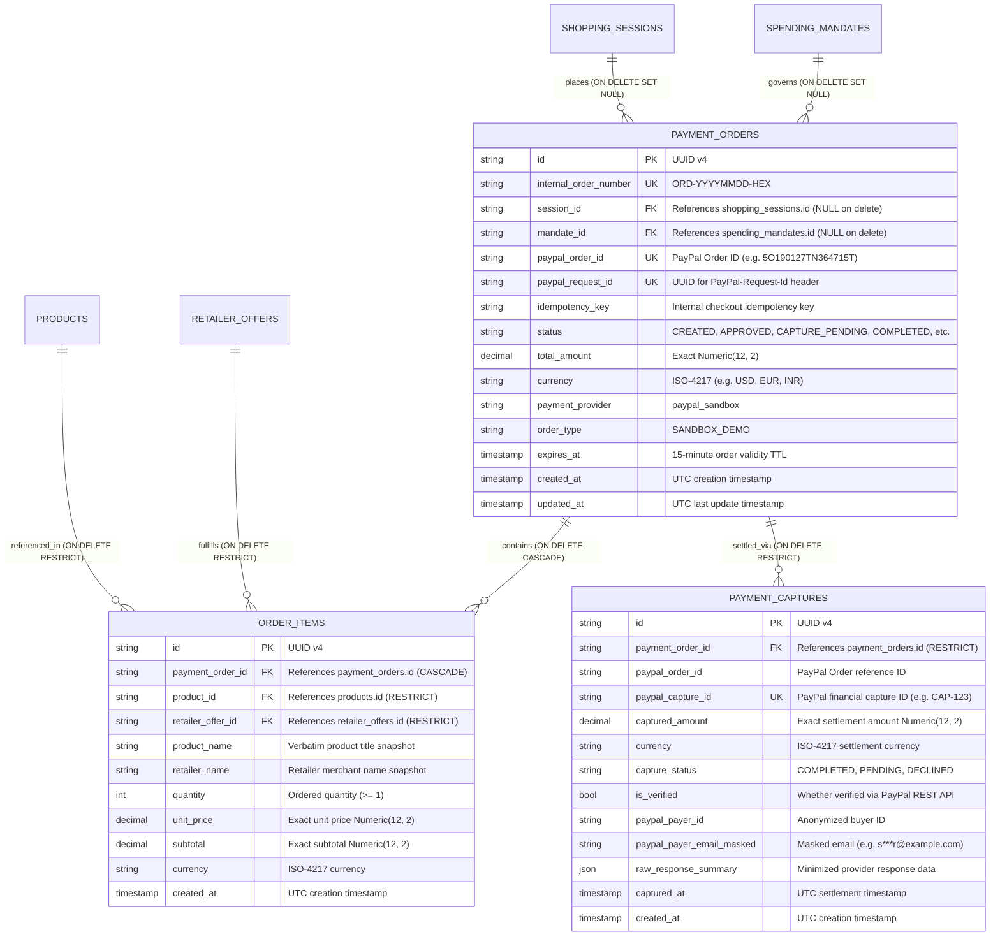

# Payment Database Design & Schema Specification (Phase 4.1 & 4.1.1)

**Platform:** AI-Powered Multilingual Shopping Intelligence Platform  
**Tagline:** Discover smarter. Compare deeper. Spend responsibly.  
**Document Version:** 1.1.0  
**Milestone:** Phase 4.1.1 — Payment Database Safety Hardening  
**Status:** **HARDENED & VERIFIED** (28 payment tests, 144 total tests passing, 100% pass rate)

---

## 1. Overview & Architectural Role

Phase 4.1 and Phase 4.1.1 establish the hardened database and domain model foundation for **PayPal Sandbox checkout, itemized order snapshots, and verified financial capture settlement**.

Rather than introducing brittle mocks or premature external API calls, these milestones enforce:
1. **Financial Record Preservation:** Guest shopping session deletions never cascade to financial ledgers (`ON DELETE SET NULL`).
2. **Session-Scoped Idempotency:** Checkout deduplication is scoped strictly to `(session_id, idempotency_key)`.
3. **Exact Decimal Precision:** Floating-point numbers are prohibited; all amounts use `Numeric(12, 2)` and Python `Decimal`.
4. **Trusted Backend Verification Boundary:** Orders cannot be marked `COMPLETED` without independently verified capture records validating amounts, currencies, and gateway settlement.

### Core Architectural Invariant
```text
┌────────────────────────────────────────────────────────────────────────┐
│  "Never use floating-point numbers for money.                          │
│   Never cascade delete payment orders when sessions are purged.        │
│   Scope checkout idempotency to the session and operation.            │
│   Never transition to COMPLETED without trusted capture verification." │
└────────────────────────────────────────────────────────────────────────┘
```

---

## 2. Database Entities & Schemas

The payment domain is modeled across three interconnected tables:
1. `payment_orders`: Tracks checkout attempts, approval lifecycle, and settlement state.
2. `order_items`: Preserves immutable historical product, retailer, price, and quantity snapshots.
3. `payment_captures`: Stores verified settlement proof from PayPal's capture endpoint.



---

## 3. Financial Record Deletion Policy

### 3.1. The Hazard of `ON DELETE CASCADE`
In Phase 4.1, `session_id` used `ON DELETE CASCADE`. If a transient guest browsing session expired or was purged during periodic maintenance, the database or ORM would have silently erased all associated `PaymentOrder`, `OrderItem`, and `PaymentCapture` records. This violated audit durability and financial non-repudiation.

### 3.2. Hardened Deletion Policy (Phase 4.1.1)
1. **Foreign Key `ON DELETE SET NULL`:**
   - In `PaymentOrder`, `session_id` is defined as:
     ```python
     session_id = Column(
         String(64),
         ForeignKey("shopping_sessions.id", ondelete="SET NULL"),
         nullable=True,
         index=True,
     )
     ```
   - When a guest `ShoppingSession` is deleted, `PaymentOrder.session_id` safely becomes `NULL`.
2. **ORM Cascade Decoupling:**
   - In `ShoppingSession`, the `orders` relationship no longer uses `cascade="all, delete-orphan"`:
     ```python
     orders = relationship("PaymentOrder", back_populates="session")
     ```
   - SQLAlchemy will never delete historical orders during session cleanups.
3. **Child Preservation:**
   - `OrderItem` and `PaymentCapture` remain bound to their parent `PaymentOrder`.
   - Historical item titles, unit prices, subtotals, settlement IDs, and timestamps remain completely intact.
4. **Catalog Protection (`ON DELETE RESTRICT`):**
   - Products and retailer offers referenced in `order_items` cannot be deleted (`ON DELETE RESTRICT`), preventing accidental catalog deletions from destroying order history.

---

## 4. Session-Scoped Idempotency Semantics

In distributed payment architectures, client-supplied idempotency keys must be scoped to the caller's session rather than applied as a global table-wide unique constraint:

1. **Composite Uniqueness on `(session_id, idempotency_key)`:**
   - `payment_orders` enforces:
     ```python
     __table_args__ = (
         UniqueConstraint("session_id", "idempotency_key", name="uq_payment_orders_session_idempotency"),
     )
     ```
2. **Intra-Session Deduplication:**
   - Repeating the same checkout request with identical `idempotency_key` within the same session is rejected by the database with an `IntegrityError`. The checkout service can intercept this and safely return the existing order.
3. **Cross-Session Key Isolation:**
   - Two different guest sessions utilizing standard client-generated keys (e.g. `checkout_1`, `btn_submit_abc`) do not collide with each other.
4. **Global Gateway Identifiers:**
   - `paypal_request_id`: Globally `UNIQUE`. Backends generate a unique UUID v4 header per external PayPal operation.
   - `paypal_order_id`: Globally `UNIQUE`. Prevents two local orders from referencing the same PayPal transaction.
   - `paypal_capture_id`: Globally `UNIQUE`. Prevents double-settlement recordings.
   - `internal_order_number`: Globally `UNIQUE`. Human-friendly order identifier.

---

## 5. Trusted Payment Completion & State Machine

### 5.1. Lifecycle State Machine
```text
               ┌──────────┐
               │ CREATED  │
               └────┬─────┘
                    │
         ┌──────────┼──────────────┬──────────────┐
         ▼          ▼              ▼              ▼
   ┌──────────┐ ┌────────┐   ┌───────────┐   ┌─────────┐
   │ APPROVED │ │ FAILED │   │ CANCELLED │   │ EXPIRED │
   └────┬─────┘ └────────┘   └───────────┘   └─────────┘
        │
   ┌────┴──────────────────────────┐
   ▼                               ▼
┌─────────────────┐         ┌───────────┐
│ CAPTURE_PENDING │         │ CANCELLED │
└───────┬─────────┘         └───────────┘
        │
   ┌────┴────────┐
   ▼             ▼
┌───────────┐ ┌────────┐
│ COMPLETED │ │ FAILED │
└───────────┘ └────────┘
```

### 5.2. Non-Bypassable Completion Invariants
To prevent front-end spoofing, state shortcuts, and unverified settlements:

1. **Direct Completion Prohibited:**
   Calling `order.transition_to(PaymentOrderStatus.COMPLETED)` without passing a verified capture raises `InvalidStateTransitionError`:
   > *"Direct transition to 'COMPLETED' is prohibited. Payment completion requires verified backend capture proof via complete_with_verified_capture(capture)."*
2. **Mandatory Locking State (`CAPTURE_PENDING`):**
   `APPROVED` cannot transition directly to `COMPLETED`. An order must transition to `CAPTURE_PENDING` first, providing mutual exclusion against concurrent capture attempts.
3. **The Six Verification Invariants in `complete_with_verified_capture`:**
   When `order.complete_with_verified_capture(capture)` is called by the backend, it strictly validates:
   - **Status Check:** Order must currently be in `CAPTURE_PENDING`.
   - **Verification Flag:** `capture.is_verified` must be `True`. If `False`, raises `UnverifiedCaptureError`.
   - **Amount Exactness:** `capture.captured_amount == order.total_amount`. If mismatched, raises `CaptureAmountMismatchError`.
   - **Currency Match:** `capture.currency.upper() == order.currency.upper()`. If mismatched, raises `CaptureCurrencyMismatchError`.
   - **Settlement Status:** `capture.capture_status == "COMPLETED"`. If not, raises `PaymentVerificationError`.
   - **Order Reference:** `capture.payment_order_id` must match `order.id`.
4. **Terminal State Immutability:**
   Once an order reaches `COMPLETED`, `CANCELLED`, `EXPIRED`, or `FAILED`, no further transitions are permissible under any circumstance.

---

## 6. Strict Decimal Precision Architecture

- **Database Column:** `Numeric(12, 2, asdecimal=True)`.
- **Python Type:** `decimal.Decimal` (never `float`).
- **Pydantic Validation:** `Decimal = Field(..., gt=Decimal("0.00"), decimal_places=2)`.
- Eliminates floating-point accumulation drift and IEEE 754 rounding artifacts across all currencies (`USD`, `EUR`, `INR`).

---

## 7. Pydantic v2 Schema Contracts (`backend/app/schemas/checkout.py`)

- **`CheckoutOrderCreate`:** Payload for checkout initiation (session ID, items list, currency, idempotency key).
- **`OrderItemCreate`:** Item input snapshot (product name, unit price, quantity, currency).
- **`OrderItemResponse`:** Detailed item response with computed `subtotal`.
- **`PaymentCaptureResponse`:** Verified capture receipt with masked payer metadata.
- **`PaymentOrderResponse`:** Complete order view including approval link and item snapshots (`session_id: str | None` supports purged sessions).
- **`PaymentHistoryItemResponse`:** Compact summary for order history tables.
- **`PaymentOrderListResponse`:** Paginated history list for session views.

---

## 8. Verification & Test Suite Matrix

The payment subsystem is validated across **28 dedicated automated tests** in [`backend/tests/test_payment_models.py`](file:///C:/Users/SANJAI-R/Desktop/AI-Shopping-Intelligence-Platform/backend/tests/test_payment_models.py):

| Test ID | Test Category | Description | Result |
| :--- | :--- | :--- | :--- |
| `test_payment_order_creation_defaults` | Creation | Default attributes, UUIDs, human-friendly order code | PASSED |
| `test_payment_order_with_mandate_relationship` | Relationships | Links order to SpendingMandate and session backrefs | PASSED |
| `test_order_items_creation_and_cascade_delete` | Cascades & Snapshots | Verifies order items cascade delete with order, catalog intact | PASSED |
| `test_payment_capture_persistence_and_relationships` | Capture Model | Verifies capture persistence, audit data, and order linkage | PASSED |
| `test_unique_paypal_order_id_constraint` | Integrity | Enforces uniqueness constraint on `paypal_order_id` | PASSED |
| `test_unique_paypal_capture_id_constraint` | Integrity | Enforces uniqueness constraint on `paypal_capture_id` | PASSED |
| `test_unique_paypal_request_id_constraint` | Integrity | Enforces uniqueness constraint on `paypal_request_id` | PASSED |
| `test_unique_internal_order_number_constraint` | Integrity | Enforces uniqueness constraint on `internal_order_number` | PASSED |
| `test_currency_preservation_and_exact_decimal_precision` | Money Precision | Verifies exact Decimal precision without floating drift (USD, EUR, INR) | PASSED |
| `test_valid_payment_order_lifecycle_happy_path` | Lifecycle | Happy path: CREATED -> APPROVED -> CAPTURE_PENDING -> COMPLETED | PASSED |
| `test_valid_cancellation_and_expiry_lifecycle` | Lifecycle | Verifies CANCELLED, EXPIRED, and FAILED branch transitions | PASSED |
| `test_invalid_payment_state_transitions_rejected` | Security | Rejects shortcuts (CREATED->COMPLETED) and terminal regressions | PASSED |
| `test_foreign_key_session_integrity` | Constraints | Enforces foreign key constraint between order and session | PASSED |
| `test_foreign_key_order_item_integrity` | Constraints | Enforces foreign key constraint between item and order | PASSED |
| `test_foreign_key_capture_integrity` | Constraints | Enforces foreign key constraint between capture and order | PASSED |
| `test_foreign_key_restrict_on_product_deletion` | Constraints | Verifies `ON DELETE RESTRICT` protects catalog products in history | PASSED |
| `test_pydantic_checkout_schemas` | Schemas | Validates `CheckoutOrderCreate` Pydantic payload | PASSED |
| `test_pydantic_schema_rejects_negative_or_zero_price` | Validation | Rejects non-positive prices at schema validation boundary | PASSED |
| `test_pydantic_schema_from_orm_models` | Serialization | Serializes ORM instances into `PaymentOrderResponse` | PASSED |
| `test_payment_history_summary_schema` | Serialization | Validates `PaymentHistoryItemResponse` schema structure | PASSED |
| `test_session_deletion_preserves_payment_order_history` | Hardening 1 | Deleting ShoppingSession sets `session_id=NULL`; order, items, captures preserved | PASSED |
| `test_idempotency_keys_across_different_sessions` | Hardening 2 | Reusing same key in different sessions succeeds cleanly | PASSED |
| `test_duplicate_idempotency_within_same_session_rejected`| Hardening 3 | Reusing same key in same session fails with `IntegrityError` | PASSED |
| `test_capture_amount_mismatch_rejected` | Hardening 4 | Rejects capture with amount != order total with `CaptureAmountMismatchError` | PASSED |
| `test_capture_currency_mismatch_rejected` | Hardening 5 | Rejects capture with currency != order currency with `CaptureCurrencyMismatchError` | PASSED |
| `test_unverified_capture_completion_rejected` | Hardening 6 | Rejects unverified capture (`is_verified=False`) with `UnverifiedCaptureError` | PASSED |
| `test_direct_completion_without_verified_capture_rejected` | Hardening 7 | Direct `transition_to(COMPLETED)` without capture proof raises error | PASSED |
| `test_terminal_state_immutability_all_terminal_states` | Hardening 8 | Enforces strict immutability on COMPLETED, CANCELLED, EXPIRED, FAILED | PASSED |

**Total Regression Suite:** **144 passed in 34.91s** (116 original tests + 28 payment tests, 100% pass rate).
