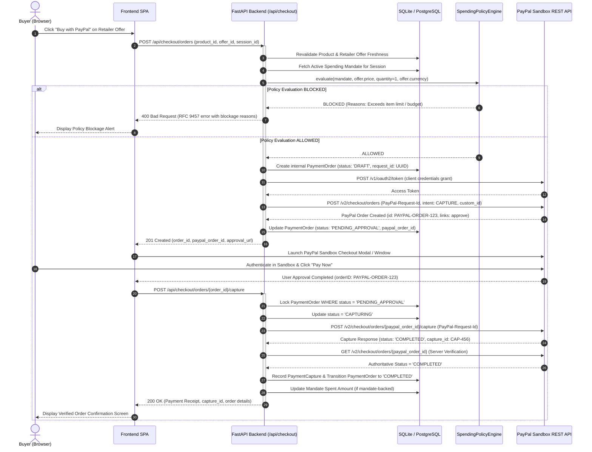

# Phase 4.0 — PayPal & Frontend Readiness Audit

**Platform:** AI-Powered Multilingual Shopping Intelligence Platform  
**Tagline:** Discover smarter. Compare deeper. Spend responsibly.  
**Document Version:** 1.0.0  
**Audit Date:** November 2, 2026  
**Target Milestone:** Phase 4 (PayPal Sandbox Checkout, Shopping Frontend & Full API Integration)  

---

## 1. Executive Summary

This audit assesses the readiness of the existing codebase for **Phase 4**, which will introduce:
1. End-to-end PayPal Sandbox checkout and payment capture.
2. A responsive, premium shopping frontend built with HTML5, CSS, Vanilla JavaScript, and Tailwind CSS CDN.
3. Seamless integration between the frontend interface and existing FastAPI backend services.

### Core Audit Findings
- **Backend Architecture & APIs:** The core shopping, search, aggregation, mandate, and AI assistant foundations are exceptionally solid, fully tested (116 passing tests, 100% pass rate), and highly reusable.
- **PayPal Integration Status:** Configuration fields exist in `Settings` and `.env.example`, but **zero PayPal application code or database models exist**. No PayPal client, OAuth token manager, order creation, capture logic, or payment database tables have been implemented.
- **Frontend Status:** The `frontend/` directory is **completely empty**. No static file serving is currently mounted in FastAPI, and no HTML, CSS, or JavaScript assets exist.
- **Security & Financial Integrity:** The deterministic `SpendingPolicyEngine` and guest session tracking provide an ideal foundation for financial gating, but order models, idempotency records, and dual-track checkout safeguards (Mandate-backed vs No-mandate baseline) must be introduced in Phase 4.

---

## 2. Feature & Component Readiness Matrix

Every platform component and planned Phase 4 feature is classified below under one of four authoritative statuses:
- `IMPLEMENTED`: Built, active in codebase, and covered by automated tests.
- `PARTIALLY IMPLEMENTED`: Configuration or skeleton exists, but critical functional logic is missing.
- `NOT IMPLEMENTED`: Does not exist in the application code.
- `NOT VERIFIED`: Code exists but has not been verified against a live environment or test suite.

| Component / Feature | Classification | Details & Code Location |
| :--- | :--- | :--- |
| **FastAPI Core & Lifespan** | `IMPLEMENTED` | [`backend/app/main.py`](file:///C:/Users/SANJAI-R/Desktop/AI-Shopping-Intelligence-Platform/backend/app/main.py): Lifespan table creation, seed execution, connection disposal. |
| **Centralized Settings** | `IMPLEMENTED` | [`backend/app/core/config.py`](file:///C:/Users/SANJAI-R/Desktop/AI-Shopping-Intelligence-Platform/backend/app/core/config.py): Pydantic Settings, `SecretStr`, SQLite path normalization. |
| **RFC 9457 Error Handlers** | `IMPLEMENTED` | [`backend/app/core/errors.py`](file:///C:/Users/SANJAI-R/Desktop/AI-Shopping-Intelligence-Platform/backend/app/core/errors.py): Standardized JSON problem details for 400, 404, 422, 500. |
| **Database Engine & PRAGMAs** | `IMPLEMENTED` | [`backend/app/core/database.py`](file:///C:/Users/SANJAI-R/Desktop/AI-Shopping-Intelligence-Platform/backend/app/core/database.py): SQLite WAL mode, foreign keys ON, busy timeout 5000ms. |
| **Product & Offer Models** | `IMPLEMENTED` | [`backend/app/models/shopping.py`](file:///C:/Users/SANJAI-R/Desktop/AI-Shopping-Intelligence-Platform/backend/app/models/shopping.py): `Product`, `RetailerOffer` with 1-to-many relationship. |
| **Guest Session Model** | `IMPLEMENTED` | [`backend/app/models/shopping.py`](file:///C:/Users/SANJAI-R/Desktop/AI-Shopping-Intelligence-Platform/backend/app/models/shopping.py): `ShoppingSession` with UUID session identifiers. |
| **Spending Mandate Model** | `IMPLEMENTED` | [`backend/app/models/shopping.py`](file:///C:/Users/SANJAI-R/Desktop/AI-Shopping-Intelligence-Platform/backend/app/models/shopping.py): `SpendingMandate` with budget, max price, quantity, currency. |
| **Product Catalog Search API** | `IMPLEMENTED` | `GET /api/products`: Stored product catalog search with text, category, brand, price filters. |
| **Live Channel3 Search API** | `IMPLEMENTED` | `GET /api/products/search`: Live aggregator search with persistence, deduplication, and warnings. |
| **Product Detail API** | `IMPLEMENTED` | `GET /api/products/{id}`: Detailed specifications, competing retailer offers, and lowest price. |
| **Product Comparison API** | `IMPLEMENTED` | `GET /api/products/compare`: Multi-product matrix with currency consistency safeguards. |
| **Spending Mandate API** | `IMPLEMENTED` | `POST`, `GET`, `PUT /api/mandates`: Session-bound mandate creation, retrieval, and update. |
| **Deterministic Policy Engine** | `IMPLEMENTED` | [`backend/app/services/policy_engine.py`](file:///C:/Users/SANJAI-R/Desktop/AI-Shopping-Intelligence-Platform/backend/app/services/policy_engine.py): Mathematical budget, item price, quantity validation. |
| **Conversational AI Assistant API** | `IMPLEMENTED` | `POST /api/assistant/query`: Gemini intent extraction, Channel3 search, mandate check, synthesis. |
| **Channel3 Client & Normalizer** | `IMPLEMENTED` | [`backend/app/services/channel3_client.py`](file:///C:/Users/SANJAI-R/Desktop/AI-Shopping-Intelligence-Platform/backend/app/services/channel3_client.py): Live HTTP client, exponential backoff, data cleaning. |
| **Gemini Client & Fallback** | `IMPLEMENTED` | [`backend/app/services/gemini_client.py`](file:///C:/Users/SANJAI-R/Desktop/AI-Shopping-Intelligence-Platform/backend/app/services/gemini_client.py): `gemini-3.8-flash` client with deterministic rule-based fallback. |
| **Regression Test Coverage** | `IMPLEMENTED` | 116 unit and integration tests passing in `backend/tests/` across 8 test suites. |
| **PayPal Configuration Settings** | `PARTIALLY IMPLEMENTED` | [`backend/app/core/config.py`](file:///C:/Users/SANJAI-R/Desktop/AI-Shopping-Intelligence-Platform/backend/app/core/config.py): Settings defined (`PAYPAL_CLIENT_ID`, `PAYPAL_CLIENT_SECRET`), but no runtime credentials validator. |
| **PayPal OAuth2 Token Client** | `NOT IMPLEMENTED` | No service to call `/v1/oauth2/token` or manage token lifecycle. |
| **PayPal Order Creation Service** | `NOT IMPLEMENTED` | No logic to invoke `/v2/checkout/orders` with `intent: "CAPTURE"`. |
| **PayPal Approval URL Handling** | `NOT IMPLEMENTED` | No parser for PayPal HATEOAS approval links. |
| **PayPal Order Capture Service** | `NOT IMPLEMENTED` | No logic to invoke `/v2/checkout/orders/{id}/capture`. |
| **PayPal Server-Side Verification**| `NOT IMPLEMENTED` | No independent `GET /v2/checkout/orders/{id}` capture status probe. |
| **Payment & Order DB Models** | `NOT IMPLEMENTED` | No `PaymentOrder`, `OrderItem`, `PaymentCapture`, or `PayPalWebhookEvent` models. |
| **PayPal Idempotency Management** | `NOT IMPLEMENTED` | No `PayPal-Request-Id` generation, tracking, or deduplication in database. |
| **Mock Payment Service** | `NOT IMPLEMENTED` | No offline sandbox simulator for credential-free development testing. |
| **PayPal Webhook Receiver** | `NOT IMPLEMENTED` | No `/api/checkout/webhooks` endpoint or signature verification. |
| **Frontend HTML Pages** | `NOT IMPLEMENTED` | Directory `frontend/` is completely empty. |
| **Frontend CSS & Tailwind CDN** | `NOT IMPLEMENTED` | No stylesheets or CDN integration scripts. |
| **Frontend JavaScript & API Client**| `NOT IMPLEMENTED` | No browser JavaScript, state management, or Fetch API client. |
| **FastAPI Static File Mount** | `NOT IMPLEMENTED` | `backend/app/main.py` does not mount `frontend/` or serve `index.html`. |
| **Order History Endpoint** | `NOT IMPLEMENTED` | No endpoint exists to query historical purchases for a session. |
| **Live PayPal Sandbox Credentials** | `NOT VERIFIED` | Real sandbox transaction execution has not been verified against PayPal's servers. |

---

## 3. Existing Implementation Inventory

### 3.1. Application Entrypoint & Middleware (`backend/app/main.py`)
- **Lifespan Management:** Initializes database tables on startup via `Base.metadata.create_all`, ensures schema compatibility via `ensure_schema_compatibility`, seeds default catalog data via `seed_database`, and safely disposes of the connection pool on shutdown.
- **CORS Configuration:** Uses `CORSMiddleware` with `allow_origins=["*"]` in development.
- **Error Handlers:** Configures RFC 9457 compliant problem details for common HTTP status codes.
- **Routers Registered:** Health (`/health`, `/`), Products (`/api/products`), Mandates (`/api/mandates`), Assistant (`/api/assistant`).

### 3.2. Centralized Configuration (`backend/app/core/config.py`)
- Powered by `pydantic-settings.BaseSettings`.
- Loads from environment variables and `.env` file at repository root.
- All secrets (`GEMINI_API_KEY`, `CHANNEL3_API_KEY`, `PAYPAL_CLIENT_SECRET`, `SECRET_KEY`) are protected using `pydantic.SecretStr` to prevent leakage in log statements, stack traces, and serialization.
- Normalizes SQLite connection strings to absolute paths anchored at the repository root.

### 3.3. Database Infrastructure (`backend/app/core/database.py`)
- Synchronous SQLAlchemy 2.0 with connection pooling.
- SQLite connection listener enforcing:
  - `PRAGMA journal_mode = WAL;` (high concurrency).
  - `PRAGMA foreign_keys = ON;` (relational integrity).
  - `PRAGMA busy_timeout = 5000;` (lock contention mitigation).
  - `PRAGMA synchronous = NORMAL;` (optimal durability balance).

### 3.4. Domain Models (`backend/app/models/shopping.py`)
- **`Product`:** Authoritative product metadata (`id`, `name`, `brand`, `category`, `description`, `specifications` JSON, `image_url`, `provider`, `provider_product_id`, `is_synthetic`, timestamps). Includes `lowest_price()` and `lowest_price_offer()` helpers.
- **`RetailerOffer`:** Competing seller offerings (`id`, `product_id`, `retailer_name`, `price`, `currency`, `product_url`, `availability`, `compare_at_price`, `provider_offer_id`, `is_synthetic`, `retrieved_at`, `created_at`).
- **`ShoppingSession`:** Lightweight guest browsing session identified by unique `session_identifier`.
- **`SpendingMandate`:** Session-bound budget policy (`id`, `session_id`, `total_budget`, `maximum_item_price`, `maximum_quantity`, `currency`).

### 3.5. Existing Services & Business Logic
- **`ProductService` (`backend/app/services/product_service.py`):** Handles stored catalog filtering, pagination, live Channel3 queries, product detail views, and multi-product comparison matrices.
- **`Channel3Client` & `Channel3Normalizer` (`backend/app/services/channel3_*.py`):** Interacts with Channel3 REST API, maps external products to internal models, normalizes ratings/review counts, and flags discrepancies.
- **`SpendingPolicyEngine` (`backend/app/services/policy_engine.py`):** Evaluates candidate purchases against active spending mandates deterministically.
- **`GeminiClient` & `AssistantService` (`backend/app/services/gemini_*.py`):** Coordinates conversational shopping assistance, parses hardware constraints, verifies candidate eligibility, and falls back gracefully when AI is unavailable.

### 3.6. Test Infrastructure (`backend/tests/`)
- 116 passing tests across 8 test suites.
- Fixtures provide temporary isolated SQLite databases with full PRAGMAs, seeded products, transactional rollbacks, and an asynchronous HTTP test client (`httpx.AsyncClient`).

---

## 4. Reusable Backend Components

The following components can be reused directly in Phase 4 without breaking changes:

1. **`SpendingPolicyEngine` (`backend/app/services/policy_engine.py`):**
   - Direct reuse as the non-bypassable pre-checkout validation gate.
   - When a user initiates checkout, `SpendingPolicyEngine.evaluate(...)` must be called to verify budget ceiling, item price ceiling, and quantity before generating a PayPal order.
2. **`MandateRepository` & `ShoppingSession` (`backend/app/repositories/mandate_repository.py`):**
   - Direct reuse for resolving or creating guest sessions via `get_or_create_session`.
   - Direct reuse for retrieving active spending limits during checkout.
3. **`ProductRepository` & `ProductService` (`backend/app/repositories/product_repository.py`):**
   - Direct reuse for revalidating product existence, current pricing, currency, and availability immediately prior to order creation.
4. **`AssistantService` & `GeminiClient`:**
   - Direct reuse to power the frontend conversational shopping assistant.
5. **FastAPI Error Handlers (`backend/app/core/errors.py`):**
   - Direct reuse for consistent RFC 9457 error formatting when handling PayPal API errors, expired orders, or policy rejections.

---

## 5. PayPal Readiness Assessment

### 5.1. Existing Configuration vs Missing Implementation
- **What Exists:**
  - `PAYPAL_MODE: Literal["sandbox", "live"] = "sandbox"` in `Settings`.
  - `PAYPAL_CLIENT_ID: str = ""` in `Settings`.
  - `PAYPAL_CLIENT_SECRET: SecretStr | None = None` in `Settings`.
  - `PAYPAL_WEBHOOK_ID: str = ""` in `Settings`.
  - `PAYPAL_IDEMPOTENCY_RETENTION_HOURS: int = 6` in `Settings`.
  - `.env.example` contains template keys.
- **What is Completely Missing:**
  - **No PayPal Client Module:** There is no `paypal_client.py` to communicate with `https://api-m.sandbox.paypal.com`.
  - **No OAuth2 Bearer Token Flow:** No client credentials exchange (`POST /v1/oauth2/token`) or cached token manager.
  - **No Order Creation Logic:** No implementation calling PayPal Orders v2 (`POST /v2/checkout/orders`).
  - **No Approval Link Extraction:** No logic parsing `links` with `rel: "approve"`.
  - **No Order Capture Logic:** No implementation calling `POST /v2/checkout/orders/{id}/capture`.
  - **No Server-Side Verification:** No independent verification call (`GET /v2/checkout/orders/{id}`) to confirm `COMPLETED` status.
  - **No Order/Payment Database Tables:** The database has no tables to store created orders, ordered items, capture transaction IDs, or payment status.
  - **No Idempotency Handling:** No tracking of `PayPal-Request-Id` to prevent duplicate charges upon retries.
  - **No Mock Payment Mode:** No local simulator for developers testing checkout without live PayPal credentials.
  - **No Webhook Handling:** No webhook listener or signature verification.
  - **No Unit/Integration Tests:** Zero tests exist for checkout or PayPal flows.

### 5.2. PayPal Readiness Verdict: **NOT IMPLEMENTED**
The platform has defined environment settings, but zero payment functionality exists in the application code.

---

## 6. Frontend Readiness Assessment

### 6.1. Current Frontend State
- Directory `frontend/` is completely empty.
- No HTML files, no CSS stylesheets, no JavaScript scripts, and no assets.
- `backend/app/main.py` currently serves a JSON response at `GET /` (`RootResponse`) and does not mount the `frontend/` directory.

### 6.2. Backend API Suitability for Frontend
The existing backend APIs are exceptionally well-suited to support the frontend:
- **Product Search & Catalog:** Fully supported via `GET /api/products` (stored) and `GET /api/products/search` (live Channel3).
- **Product Details:** Fully supported via `GET /api/products/{id}`.
- **Comparison Matrix:** Fully supported via `GET /api/products/compare?ids=...`.
- **Spending Mandates:** Fully supported via `POST`, `GET`, `PUT /api/mandates/{session_id}` and `POST /api/mandates/{session_id}/validate`.
- **AI Shopping Assistant:** Fully supported via `POST /api/assistant/query`.
- **Missing APIs for Frontend:**
  - `POST /api/checkout/orders` (create order, validate mandate, return PayPal order ID and approval URL).
  - `POST /api/checkout/orders/{order_id}/capture` (execute capture after user approves in PayPal popup).
  - `GET /api/checkout/orders/{order_id}` (check order status and receipt details).
  - `GET /api/checkout/orders/history/{session_id}` (retrieve order history for the session).

### 6.3. Development & Serving Strategy
- **CORS & Same-Origin Strategy:** Rather than running a separate Node/Vite dev server that encounters browser cross-origin policy issues with credentials, the frontend should be mounted directly in FastAPI using `fastapi.staticfiles.StaticFiles`.
- **Application Routing:**
  - `GET /` serves `frontend/index.html`.
  - Static assets served under `/static/` (`frontend/css/`, `frontend/js/`, `frontend/assets/`).
  - API documentation remains at `/docs` and `/redoc`.
  - API endpoints remain at `/api/*`.
- **No Build Step Required:** Using Tailwind CSS CDN and ES Modules allows instantaneous iteration without `npm`, `webpack`, or Node.js.

### 6.4. Frontend Readiness Verdict: **NOT IMPLEMENTED**

---

## 7. Proposed Frontend Architecture

### 7.1. Directory Structure
```text
frontend/
├── index.html                   # Unified Single-Page Application (SPA) shell
├── css/
│   └── styles.css               # Custom styles, transitions, animations, scrollbars
├── js/
│   ├── app.js                   # Application coordinator, view router, DOM initialization
│   ├── api.js                   # Centralized Fetch API client with session injection
│   ├── state.js                 # Reactive state store (session, mandate, comparison tray, cart)
│   ├── components/
│   │   ├── header.js            # Header, brand, search bar, active mandate pill, compare counter
│   │   ├── search_view.js       # Product search grid, live/synthetic filters, pagination
│   │   ├── product_card.js      # Individual product card with pricing, offers, and compare toggle
│   │   ├── product_detail.js    # Modal displaying full specs, data quality warnings, retailer offers
│   │   ├── comparison_view.js   # Side-by-side spec comparison table with winner highlights
│   │   ├── assistant_view.js    # AI conversational drawer with grounded product cards and chat history
│   │   ├── mandate_modal.js     # Spending mandate setup and budget update modal
│   │   ├── checkout_modal.js    # Purchase confirmation, policy verification, PayPal SDK button
│   │   └── history_view.js      # Order history table with verified receipts and order status
│   └── utils/
│       ├── formatters.js        # Currency, date, and specification formatters
│       └── toast.js             # User feedback notifications (success, warning, error)
```

### 7.2. Core User Interface Layout
1. **Top Navigation Bar:**
   - Platform brand: *"AI Shopping Intelligence"*.
   - Natural language search input with clear trigger.
   - Live Spending Mandate Indicator: Displays active budget pill (e.g. `Budget: $500.00 | $120.00 Used` or `No Mandate Set`). Clicking opens Mandate Manager.
   - Comparison Tray Pill: Shows number of pinned items (e.g. `Compare (2)`).
   - AI Assistant Pill: Floating or header shortcut to open the AI conversation panel.
2. **Main Content Views (Single-Page Switching):**
   - **View 1: Product Discovery (Default):** Search filters (source: all/live/synthetic, category, price range), responsive product card grid, pagination controls.
   - **View 2: Product Comparison Workspace:** Spec-by-spec comparison matrix highlighting lowest price, differences, and AI-assisted trade-offs.
   - **View 3: Order History:** List of completed and pending orders for the session with receipt details.
3. **Interactive Overlays & Drawers:**
   - **Product Detail Modal:** Detailed technical specifications, data quality warnings, and list of all competing retailer offers.
   - **AI Shopping Assistant Drawer:** Slide-over conversational interface supporting multilingual queries, specification extraction breakdown, and grounded product recommendations.
   - **Spending Mandate Modal:** Set total budget, maximum per-item price, and maximum quantity.
   - **Checkout Modal:** Reviews selected offer, executes pre-purchase policy validation, displays clear disclaimers, and renders the PayPal Sandbox Button.

### 7.3. Session & State Management
- Guest session identifier (`session_identifier`) stored in browser `localStorage`.
- Auto-generated UUID v4 if not already present.
- Every API request sends `X-Session-ID` header or session query parameter.
- Centralized event bus for notifying components of mandate changes or comparison tray updates.

---

## 8. Proposed PayPal Payment Architecture

### 8.1. End-to-End Sequence Diagram



### 8.2. Dual Journey Separation: Demo Purchases vs External Retailer Redirects

To prevent misleading users or violating merchant guidelines, the application must maintain a strict architectural separation:

```text
┌────────────────────────────────────────────────────────────────────────┐
│                        PURCHASE PATH SEPARATION                        │
├──────────────────────────────────┬─────────────────────────────────────┤
│ 1. Demo / Native Platform Catalog │ 2. Live Channel3 / Retailer Offers   │
├──────────────────────────────────┼─────────────────────────────────────┤
│ • Handled via PayPal Sandbox.    │ • User redirected directly to merchant│
│ • Clear disclosure badge:        │ • Clear disclosure badge:           │
│   "Demo Purchase (Sandbox Only).  │   "Sold by [Retailer]. You will be  │
│   No real order will be shipped."│    redirected to complete purchase." │
│ • Tests mandate limits & payments│ • Outbound link opens retailer URL  │
│ • Creates internal receipt record│ • No fake internal capture created  │
└──────────────────────────────────┴─────────────────────────────────────┘
```

### 8.3. Core Financial & Architectural Invariants
1. **AI Isolation:** Gemini never creates orders, captures payments, or interacts with PayPal.
2. **Zero Card Storage:** No payment card numbers, CVVs, or sensitive credentials touch the application.
3. **Server-Side Verification:** Client approval is never trusted alone; backend independently verifies capture status with PayPal's API.
4. **No Premature Completion:** An order is never marked paid upon creation; only a verified capture transitions the state to `COMPLETED`.
5. **Single Active Capture:** Atomic state transition (`WHERE status = 'PENDING_APPROVAL'`) ensures duplicate capture requests fail immediately.
6. **Strict Idempotency:** Every PayPal API write passes a unique, persisted `PayPal-Request-Id`.
7. **Sandbox Mode Enforcement:** Hard guardrails ensure live PayPal endpoints cannot be contacted without explicit production configuration.

---

## 9. Security and Reliability Audit

| Area | Observed Risk | Architectural Safeguard for Phase 4 |
| :--- | :--- | :--- |
| **Session Isolation** | Guessable or overlapping session IDs | Session IDs must be cryptographically secure UUID v4 strings. API endpoints must validate session ownership before returning order data. |
| **Payment Verification** | Client-spoofed capture status | Backend ignores client assertions of payment success. Only server-to-server PayPal verification (`GET /v2/checkout/orders/{id}`) confirms capture. |
| **Duplicate Captures** | Network retry triggering multiple charges | Implement atomic conditional updates (`UPDATE payment_orders SET status = 'CAPTURING' WHERE id = :id AND status = 'PENDING_APPROVAL'`). Pass identical `PayPal-Request-Id` on retries. |
| **Stale Offer Arbitrage** | Product price changes between search and checkout | Backend must reload the `RetailerOffer` record inside the checkout transaction and re-evaluate price and availability. |
| **Mandate Bypass** | User initiates order, modifies mandate concurrently | Spending mandate validation must occur within the same database transaction that initializes the `PaymentOrder`. |
| **Credential Protection** | PayPal secret leakage in logs or exceptions | Wrap `PAYPAL_CLIENT_SECRET` in `SecretStr`. Mask credentials in logging and sanitizers. |
| **Database Consistency** | Partial failure during capture recording | Wrap capture status update, payment capture record insertion, and mandate budget deduction in a single atomic database transaction. |
| **Mock vs Live Separation** | Accidental live charges in test environments | Restrict `PAYPAL_MODE` to `"sandbox"` by default. Provide a local `MockPayPalService` when credentials are not configured. |

---

## 10. Recommended Implementation Sequence for Phase 4

To ensure stable, test-driven delivery, Phase 4 should be executed in five sequential sub-milestones:

### Milestone 4.1: Database Models & Schemas
1. Define SQLAlchemy models in `backend/app/models/payment.py`:
   - `PaymentOrder`: Internal order tracking (`id`, `session_id`, `mandate_id`, `status`, `total_amount`, `currency`, `paypal_order_id`, `paypal_request_id`, `expires_at`, timestamps).
   - `OrderItem`: Ordered product snapshot (`id`, `order_id`, `product_id`, `retailer_offer_id`, `unit_price`, `quantity`, `currency`).
   - `PaymentCapture`: Completed capture records (`id`, `order_id`, `paypal_capture_id`, `amount`, `currency`, `status`, `captured_at`).
2. Add Pydantic schemas in `backend/app/schemas/checkout.py`:
   - `CheckoutOrderCreate`, `CheckoutOrderResponse`, `CaptureOrderResponse`, `OrderReceiptResponse`.
3. Update `Base.metadata.create_all` to initialize new tables.

### Milestone 4.2: PayPal Client & Checkout Service
1. Implement `backend/app/services/paypal_client.py`:
   - OAuth2 Bearer token retrieval with expiration caching.
   - `create_order` with `PayPal-Request-Id` idempotency.
   - `get_order` status probe.
   - `capture_order` execution.
   - Mock mode fallback when credentials are not configured.
2. Implement `backend/app/services/checkout_service.py`:
   - Pre-checkout offer revalidation.
   - Deterministic `SpendingPolicyEngine` verification.
   - Order creation and atomic capture orchestration.
3. Implement `backend/app/api/checkout.py`:
   - `POST /api/checkout/orders`
   - `POST /api/checkout/orders/{id}/capture`
   - `GET /api/checkout/orders/{id}`
   - `GET /api/checkout/orders/history/{session_id}`
4. Add automated unit and integration tests (`backend/tests/test_checkout.py`).

### Milestone 4.3: Frontend Shell & Static File Serving
1. Update `backend/app/main.py`:
   - Mount `frontend/` static directory via `fastapi.staticfiles.StaticFiles`.
   - Update `GET /` to serve `frontend/index.html`.
2. Create `frontend/index.html` with Tailwind CSS CDN, responsive shell, header, and view containers.
3. Create `frontend/js/api.js` and `frontend/js/state.js` with guest session management.

### Milestone 4.4: Core Frontend Views & Shopping Features
1. Implement Product Search View & Product Cards (`search_view.js`, `product_card.js`).
2. Implement Product Detail Modal with competing retailer offers (`product_detail.js`).
3. Implement Comparison Matrix Workspace (`comparison_view.js`).
4. Implement AI Shopping Assistant drawer (`assistant_view.js`).
5. Implement Spending Mandate configuration modal and active header pill (`mandate_modal.js`).

### Milestone 4.5: Checkout UI, PayPal SDK Integration & History
1. Implement Checkout Modal with dual purchase paths:
   - External retailer outbound redirect for live aggregated products.
   - PayPal Sandbox button integration for demo catalog products.
2. Implement Order Receipt Confirmation Screen.
3. Implement Order History View (`history_view.js`).
4. End-to-end regression testing and cross-browser verification.

---

## 11. Risks and Dependencies

1. **PayPal Sandbox Latency & Upstream Availability:**
   - PayPal Sandbox can exhibit elevated response times (1–3 seconds).
   - *Mitigation:* Configure 15-second HTTP timeouts in HTTPX client and display smooth loading spinners in the UI.
2. **Missing PayPal Sandbox Credentials in Local Environments:**
   - Developers without Sandbox credentials cannot run checkout tests if a real API call is required.
   - *Mitigation:* Build a high-fidelity `MockPayPalClient` enabled when credentials are empty or during automated pytest runs.
3. **Currency Inconsistencies:**
   - Channel3 offers may be in USD, while a user may configure an INR or EUR spending mandate.
   - *Mitigation:* The `SpendingPolicyEngine` already strictly blocks cross-currency checkout when currencies do not match, preventing unverified conversion errors.
4. **Browser Pop-up Blockers:**
   - PayPal approval flows using pop-up windows can occasionally be blocked by aggressive browser settings.
   - *Mitigation:* Support both the PayPal JavaScript SDK modal flow and a full-page redirect fallback.

---

## 12. Verification and Sign-Off

- **Existing Tests:** All 116 tests passing across Phase 0, 1, 2, 2.2, 3, and 3.1.
- **Dependency Status:** `pip check` confirmed clean (`No broken requirements found.`).
- **Codebase Integrity:** Zero application code modified during this audit phase.
- **Audit Deliverable:** Stored at `backend/docs/PHASE_4_READINESS_AUDIT.md`.
