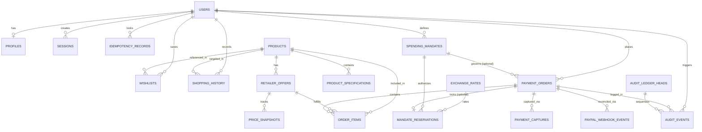
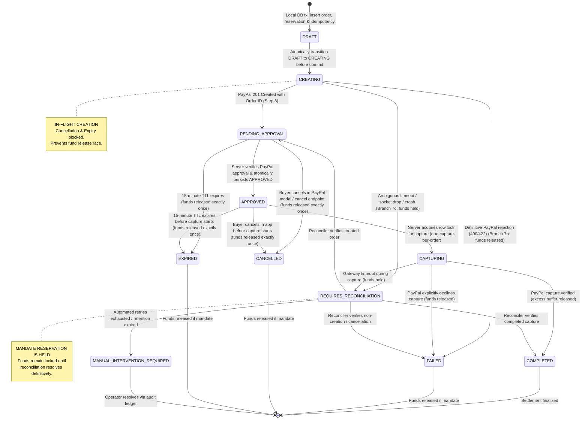

# Database Architecture & Schema Specification
## AI-Powered Multilingual Shopping Intelligence Platform

> **Document Status:** Authoritative Architectural Specification (Task 6: Final Architecture Approval & PayPal Reliability Pass)  
> **Target Database Systems:** SQLite 3.38+ (Local Dev with WAL mode) & PostgreSQL 15+ (Production on Render)  
> **ORM Layer:** SQLAlchemy 2.0 (Async) with Pydantic v2 domain schemas  
> **Authority Level:** Sole authoritative source for table names, relationships, constraints, and DDL creation sequence.

---

## 1. Database Architecture Overview & Design Principles

The database schema is engineered with strict Third Normal Form (3NF) principles while incorporating pragmatic JSON attribute storage for high-variance product specifications and audit payloads.

### Core Architectural Principles
1. **Cross-Engine Portability:** The schema is 100% portable between SQLite and PostgreSQL. It avoids dialect-specific quirks by utilizing ISO-8601 strings (`TEXT`) or native UTC timestamps (`TIMESTAMPTZ` in Postgres), standard UUID strings (`VARCHAR(36)`) for primary keys, and standard JSON abstraction via SQLAlchemy `JSON`.
2. **Strict Topological DDL Dependency Order (Authoritative DAG):**
   - Tables are created in strict dependency order across all migrations and DDL scripts.
   - `payment_orders` (#11) is created **before** `mandate_reservations` (#13).
   - `mandate_reservations.payment_order_id` references `payment_orders(id)` with a unique constraint. `payment_orders` contains a nullable foreign key to `spending_mandates(id)` and **no foreign key** to `mandate_reservations`, eliminating circular dependencies and allowing clean no-mandate checkouts.
   - Dedicated table `paypal_webhook_events` (#15) provides isolated, high-performance event deduplication and audit storage for PayPal webhook deliveries without coupling unauthenticated gateway callbacks to user-scoped idempotency records.
3. **Dual Checkout Architecture (Mandate-Backed vs No-Mandate):**
   - In `payment_orders`, `mandate_id` is nullable (`ON DELETE SET NULL`).
   - For mandate-backed purchases, a corresponding `mandate_reservations` row is created to lock budget funds.
   - For no-mandate checkouts governed by platform baseline safeguards, `mandate_id` is `NULL`, and **no fake mandate or reservation row is created**. Both checkout tracks enforce identical PayPal request-ID idempotency, server-side approval verification, atomic state transitions, and capture safeguards.
4. **Exact Scaled Integer FX Construction & FK Integrity:**
   - Exchange rates are ingested via Python `Decimal` and stored as 64-bit integers scaled by a constant factor of $10^8$ (`scale_factor = 100_000_000`, 8 decimal places):
     $$\text{rate\_scaled} = \text{int}\left((\text{Decimal}(rate\_str) \times 10^8).\text{quantize}(\text{Decimal}(1),\; \text{rounding}=\text{ROUND\_HALF\_UP})\right)$$
   - **Same-Currency Invariant:** When `base_currency == quote_currency`, identity rate is exactly $100\,000\,000$, `exchange_rate_id` is `NULL`, and no external lookup is required.
   - **Cross-Currency Invariant:** When `base_currency <> quote_currency`, an authentic, correctly oriented, timestamped `exchange_rates` record is **mandatory**. The rate is copied directly into `applied_rate_scaled`, and `exchange_rate_id` references that record with **`ON DELETE RESTRICT`** to preserve immutable financial audit history. Identity-rate fallback is strictly prohibited.
   - `applied_rate_scaled` has **no default value**; cross-currency consistency is enforced via database `CHECK` constraints and application-level validation.
   - **Stale-Rate Policy:** Maximum rate age is 24 hours in development and 1 hour in production. Missing or stale rates safely reject the transaction.
5. **No-Mandate Baseline Ceiling Conversion:**
   - Platform baseline ceiling for no-mandate checkouts is canonically **USD 1,000** (100,000 cents).
   - For USD orders, evaluated directly against `total_amount_minor <= 100000`.
   - For non-USD orders (EUR, GBP, INR), dynamically converted to USD using a valid, timestamped exchange rate with integer arithmetic and `ROUND_HALF_UP`. Evaluated against the gross payment amount of the order (`total_amount_minor`). Missing or stale rates reject checkout.
6. **FX Buffer Non-Expenditure Policy:**
   - `mandate_reservations` records `estimated_converted_price_minor`, `fx_buffer_minor` (e.g. 200 bps = 2.0%), and `reserved_amount_minor`.
   - The buffer is held strictly as a volatility safeguard and is **never counted as expenditure**. Upon capture, the exact converted purchase amount is committed to `actual_consumed_minor`, and the excess buffer is **released immediately** back to the available budget.
7. **PayPal Reliability & Unsupported Search Assumption Removal:**
   - The architecture does **not** assume PayPal provides an order search API by `custom_id` or `invoice_id`.
   - Instead, every order creation generates and persists a unique `paypal_request_id` (UUID v4). Ambiguous order creation attempts are retried using the **identical `PayPal-Request-Id` and payload**, allowing PayPal's server-side idempotency cache to safely return the existing order.
   - Authoritative order state is retrieved solely via the documented endpoint `GET /v2/checkout/orders/{paypal_order_id}`.
   - `custom_id` and `invoice_id` serve exclusively as merchant accounting and reconciliation metadata.
8. **Explicit Persisted State Machine & One-Capture-Per-Order Invariant:**
   - The successful payment state flow strictly executes:
     `DRAFT → CREATING → PENDING_APPROVAL → APPROVED → CAPTURING → COMPLETED`
   - The intermediate `APPROVED` state is **explicitly persisted** following server-side approval verification (`GET /v2/checkout/orders/{id}`) before moving to `CAPTURING`.
   - Exactly **one capture operation** may ever be active per internal payment order, guaranteed by atomic conditional SQL updates (`WHERE status = 'APPROVED'`).
9. **Synchronized Payment Order Expiry:**
   - `payment_orders` includes `expires_at TIMESTAMP WITH TIME ZONE NOT NULL` (indexed), authoritative for the 15-minute order validity window.
   - If mandate-backed, `mandate_reservations.expires_at` is set to the identical timestamp (`mandate_reservations.expires_at = payment_orders.expires_at`).
   - The expiry worker never expires orders or releases reservations while capture is active (`CAPTURING`) or payment outcome is uncertain (`REQUIRES_RECONCILIATION`).
10. **Tamper-Evident Chained Audit Logging with Dedicated Ledger-Head:**
    - Singleton table `audit_ledger_heads (id=1)` maintains exclusive row-level mutex locking, guaranteeing atomic sequence allocation (`sequence_number`) and race-free `previous_hash` propagation.
    - Audit event envelopes contain **eight mandatory fields** canonicalized via RFC 8785 JSON Canonicalization Scheme (JCS) and hashed with SHA-256. Classified as **tamper-evident, not tamper-proof**.

---

## 2. Entity-Relationship (ER) Diagram

The ER diagram illustrates the authoritative relationships and entity names:



---

## 3. Authoritative 19-Step Topological DDL Creation Order

To guarantee seamless schema creation on both SQLite (with PRAGMA foreign keys enabled) and PostgreSQL, DDL scripts, SQLAlchemy metadata (`Base.metadata.create_all()`), and Alembic migrations must execute in this exact sequence:

1. `users`
2. `profiles`
3. `sessions`
4. `spending_mandates`
5. `exchange_rates`
6. `idempotency_records`
7. `products`
8. `product_specifications`
9. `retailer_offers`
10. `price_snapshots`
11. `payment_orders`
12. `order_items`
13. `mandate_reservations`
14. `payment_captures`
15. `paypal_webhook_events`
16. `wishlists`
17. `shopping_history`
18. `audit_ledger_heads`
19. `audit_events`

### Technical Explanation for Table 15 Addition
A dedicated table `paypal_webhook_events` (#15) is introduced following `payment_captures` to provide dedicated, high-performance deduplication and audit storage for PayPal webhook deliveries. This eliminates foreign-key constraints on user identity (since webhooks originate unauthenticated from PayPal's infrastructure) and avoids NULL quirks in compound unique constraints.

Every foreign-key dependency strictly references a table preceding it in this sequence.

---

## 4. Authoritative Entity Schema Specifications

### 4.0 Authoritative Timestamp Storage & Server Default Policy
To guarantee 100% deterministic portability between SQLite (local development) and PostgreSQL (production), the schema establishes the following strict timestamp policy:
1. **Application-Supplied UTC Timestamps:** All timestamp columns are declared `TIMESTAMP WITH TIME ZONE NOT NULL` without naive database server defaults.
2. **Elimination of Naive `DEFAULT CURRENT_TIMESTAMP`:** In SQLite, the built-in `CURRENT_TIMESTAMP` generates naive strings in `'YYYY-MM-DD HH:MM:SS'` format (space separator, zero sub-second precision, omitted timezone offset). Because ASCII space (`' '`, 32) sorts before `'T'` (84), mixing SQLite server defaults with application ISO-8601 strings corrupts lexicographical string comparisons (`expires_at < :now` and `lease_expires_at <= :now`). All naive server defaults are strictly eliminated from SQLite DDL.
3. **ORM Model Application Defaults:** In SQLAlchemy models, timestamps are assigned exclusively via python timezone-aware UTC factories: `default=lambda: datetime.now(timezone.utc)` and `onupdate=lambda: datetime.now(timezone.utc)`.
4. **Canonical SQLite Storage (32 Characters):** All timestamps in SQLite are serialized by `AwareDateTime` as fixed 32-character strings: `YYYY-MM-DDTHH:MM:SS.ffffff+00:00`, guaranteeing that ASCII string comparisons correspond exactly to chronological time.
5. **PostgreSQL Native Timestamps:** On PostgreSQL, columns utilize native `TIMESTAMPTZ` (`TIMESTAMP WITH TIME ZONE`).

### 4.1 Authentication, Identity & Profiles

#### 1. Table: `users`
```sql
CREATE TABLE users (
    id VARCHAR(36) PRIMARY KEY,                         -- UUID v4
    email VARCHAR(255) UNIQUE,                          -- Nullable for guest accounts
    password_hash VARCHAR(255),                         -- Argon2id hash (Nullable for guests)
    is_guest BOOLEAN NOT NULL DEFAULT FALSE,
    is_active BOOLEAN NOT NULL DEFAULT TRUE,
    is_verified BOOLEAN NOT NULL DEFAULT FALSE,
    created_at TIMESTAMP WITH TIME ZONE NOT NULL,
    updated_at TIMESTAMP WITH TIME ZONE NOT NULL
);
CREATE INDEX idx_users_email ON users(email);
CREATE INDEX idx_users_is_guest ON users(is_guest);
```

#### 2. Table: `profiles`
```sql
CREATE TABLE profiles (
    id VARCHAR(36) PRIMARY KEY,                         -- UUID v4
    user_id VARCHAR(36) NOT NULL UNIQUE,
    display_name VARCHAR(100),
    preferred_language VARCHAR(5) NOT NULL DEFAULT 'en', -- 'en', 'de', 'it', 'es'
    preferred_currency VARCHAR(3) NOT NULL DEFAULT 'USD',-- 'USD', 'EUR', 'GBP', 'INR'
    monthly_budget_target_minor BIGINT DEFAULT NULL,    -- Minor units (paise, cents, pence)
    avatar_url VARCHAR(500),
    created_at TIMESTAMP WITH TIME ZONE NOT NULL,
    updated_at TIMESTAMP WITH TIME ZONE NOT NULL,
    CONSTRAINT fk_profiles_user FOREIGN KEY (user_id) REFERENCES users(id) ON DELETE CASCADE
);
```

#### 3. Table: `sessions`
```sql
CREATE TABLE sessions (
    id VARCHAR(36) PRIMARY KEY,                         -- UUID v4
    user_id VARCHAR(36) NOT NULL,
    session_token_hash VARCHAR(64) NOT NULL UNIQUE,     -- SHA-256 hash of CSPRNG token
    ip_address VARCHAR(45),                             -- IPv4 / IPv6
    user_agent VARCHAR(500),
    is_active BOOLEAN NOT NULL DEFAULT TRUE,
    expires_at TIMESTAMP WITH TIME ZONE NOT NULL,
    created_at TIMESTAMP WITH TIME ZONE NOT NULL,
    last_accessed_at TIMESTAMP WITH TIME ZONE NOT NULL,
    CONSTRAINT fk_sessions_user FOREIGN KEY (user_id) REFERENCES users(id) ON DELETE CASCADE
);
CREATE INDEX idx_sessions_token_hash ON sessions(session_token_hash);
CREATE INDEX idx_sessions_user_active ON sessions(user_id, is_active);
```

---

### 4.2 Governance, Currencies & Idempotency

#### 4. Table: `spending_mandates`
User-defined spending rules and policy constraints.
```sql
CREATE TABLE spending_mandates (
    id VARCHAR(36) PRIMARY KEY,                         -- UUID v4
    user_id VARCHAR(36) NOT NULL,
    mandate_name VARCHAR(150) NOT NULL,
    max_budget_minor BIGINT NOT NULL,                   -- Absolute total spending ceiling in minor units
    reserved_amount_minor BIGINT NOT NULL DEFAULT 0,    -- Funds temporarily locked in pending orders
    consumed_amount_minor BIGINT NOT NULL DEFAULT 0,    -- Funds finalized in captured purchases
    currency VARCHAR(3) NOT NULL DEFAULT 'USD',         -- Mandate base currency (USD, EUR, GBP, INR)
    max_price_per_item_minor BIGINT,                    -- Per-item unit price ceiling in minor units
    max_quantity_per_order INT DEFAULT 10,
    allowed_categories_json TEXT,                       -- JSON array of allowed category strings
    retailer_restrictions_json TEXT,                    -- JSON array of allowed merchant names
    is_active BOOLEAN NOT NULL DEFAULT TRUE,
    start_date TIMESTAMP WITH TIME ZONE NOT NULL,
    expiry_date TIMESTAMP WITH TIME ZONE,
    created_at TIMESTAMP WITH TIME ZONE NOT NULL,
    updated_at TIMESTAMP WITH TIME ZONE NOT NULL,
    CONSTRAINT fk_mandates_user FOREIGN KEY (user_id) REFERENCES users(id) ON DELETE CASCADE
);
CREATE INDEX idx_mandates_user_active ON spending_mandates(user_id, is_active);
```

#### 5. Table: `exchange_rates`
Exact 64-bit scaled integer exchange rates constructed via Python `Decimal`.
```sql
CREATE TABLE exchange_rates (
    id VARCHAR(36) PRIMARY KEY,                         -- UUID v4
    base_currency VARCHAR(3) NOT NULL,                  -- Unit currency (e.g. 'USD')
    quote_currency VARCHAR(3) NOT NULL,                 -- Quoted currency (e.g. 'INR')
    rate_scaled BIGINT NOT NULL,                        -- Multiplied by 10^8 (e.g. 8350000000 = 83.50000000)
    scale_factor INT NOT NULL DEFAULT 100000000,        -- Constant 10^8
    source VARCHAR(100) NOT NULL,                       -- e.g. 'ECB_REFERENCE', 'OPEN_EXCHANGE_RATES'
    fetched_at TIMESTAMP WITH TIME ZONE NOT NULL,
    effective_until TIMESTAMP WITH TIME ZONE NOT NULL,  -- Maximum validity TTL
    CONSTRAINT uq_rates_composite UNIQUE (id, base_currency, quote_currency, rate_scaled, fetched_at),
    CONSTRAINT uq_rate_pair_time UNIQUE (base_currency, quote_currency, fetched_at),
    CONSTRAINT chk_positive_rate CHECK (rate_scaled > 0)
);
CREATE INDEX idx_exchange_rates_lookup ON exchange_rates(base_currency, quote_currency, fetched_at DESC);
```

#### 6. Table: `idempotency_records`
Operation-specific idempotency tracking with active recovery protocol.
```sql
CREATE TABLE idempotency_records (
    id VARCHAR(36) PRIMARY KEY,                         -- UUID v4
    user_id VARCHAR(36) NOT NULL,
    operation VARCHAR(50) NOT NULL,                     -- 'ORDER_CREATE', 'ORDER_CAPTURE', 'ORDER_CANCEL', 'ORDER_RECONCILE'
    idempotency_key VARCHAR(100) NOT NULL,              -- Client-supplied UUID
    request_payload_hash VARCHAR(64) NOT NULL,          -- SHA-256 hash of incoming JSON request body
    status VARCHAR(30) NOT NULL DEFAULT 'IN_PROGRESS',  -- 'IN_PROGRESS', 'RECOVERY_IN_PROGRESS', 'COMPLETED', 'FAILED', 'REQUIRES_RECONCILIATION', 'MANUAL_INTERVENTION_REQUIRED'
    response_status_code INT,
    response_json TEXT,                                 -- Cached JSON response payload
    resource_id VARCHAR(100),                           -- Associated internal order ID
    recovery_attempts INT NOT NULL DEFAULT 0,           -- Number of recovery retries executed
    last_recovery_at TIMESTAMP WITH TIME ZONE,          -- Timestamp of last recovery inspection
    created_at TIMESTAMP WITH TIME ZONE NOT NULL,
    updated_at TIMESTAMP WITH TIME ZONE NOT NULL,
    expires_at TIMESTAMP WITH TIME ZONE NOT NULL,       -- 24h validity for terminal states; NEVER purged if unresolved
    CONSTRAINT uq_user_op_idempotency UNIQUE (user_id, operation, idempotency_key),
    CONSTRAINT fk_idemp_user FOREIGN KEY (user_id) REFERENCES users(id) ON DELETE CASCADE
);
CREATE INDEX idx_idemp_lookup ON idempotency_records(user_id, operation, idempotency_key);
CREATE INDEX idx_idemp_recovery ON idempotency_records(status, updated_at);
```

---

### 4.3 Catalog, Specifications & Provenance

#### 7. Table: `products`
```sql
CREATE TABLE products (
    id VARCHAR(36) PRIMARY KEY,                         -- UUID v4
    canonical_slug VARCHAR(255) NOT NULL UNIQUE,
    title VARCHAR(500) NOT NULL,
    brand VARCHAR(150),
    category VARCHAR(100) NOT NULL,                     -- e.g. 'audio/headphones'
    model_number VARCHAR(100),
    upc_ean VARCHAR(50),
    description TEXT,
    primary_image_url VARCHAR(1000),
    image_gallery_json TEXT,
    attributes_json TEXT,
    data_provenance VARCHAR(30) NOT NULL DEFAULT 'SYNTHETIC_DEMO_DATA', -- 'LIVE_PROVIDER_DATA' or 'SYNTHETIC_DEMO_DATA'
    provider_source VARCHAR(100) NOT NULL DEFAULT 'MOCK_CATALOG',
    is_active BOOLEAN NOT NULL DEFAULT TRUE,
    created_at TIMESTAMP WITH TIME ZONE NOT NULL,
    updated_at TIMESTAMP WITH TIME ZONE NOT NULL
);
CREATE INDEX idx_products_category ON products(category);
CREATE INDEX idx_products_brand ON products(brand);
CREATE INDEX idx_products_provenance ON products(data_provenance);
```

#### 8. Table: `product_specifications`
```sql
CREATE TABLE product_specifications (
    id VARCHAR(36) PRIMARY KEY,                         -- UUID v4
    product_id VARCHAR(36) NOT NULL,
    spec_group VARCHAR(100) NOT NULL,                   -- e.g. 'Battery', 'Audio'
    spec_key VARCHAR(100) NOT NULL,                     -- e.g. 'battery_life_hours'
    spec_name VARCHAR(150) NOT NULL,
    spec_value VARCHAR(500) NOT NULL,
    data_type VARCHAR(20) NOT NULL DEFAULT 'string',
    unit VARCHAR(30),
    is_primary BOOLEAN NOT NULL DEFAULT FALSE,
    CONSTRAINT fk_specs_product FOREIGN KEY (product_id) REFERENCES products(id) ON DELETE CASCADE
);
CREATE INDEX idx_specs_product ON product_specifications(product_id);
```

#### 9. Table: `retailer_offers`
```sql
CREATE TABLE retailer_offers (
    id VARCHAR(36) PRIMARY KEY,                         -- UUID v4
    product_id VARCHAR(36) NOT NULL,
    retailer_name VARCHAR(100) NOT NULL,
    retailer_sku VARCHAR(150),
    offer_type VARCHAR(30) NOT NULL DEFAULT 'EXTERNAL_REDIRECT', -- 'ELIGIBLE_SANDBOX' or 'EXTERNAL_REDIRECT'
    product_url VARCHAR(1500) NOT NULL,                 -- Validated HTTPS + host whitelist
    original_price_minor BIGINT NOT NULL,               -- Exact integer minor units
    original_currency VARCHAR(3) NOT NULL DEFAULT 'USD',
    shipping_cost_minor BIGINT NOT NULL DEFAULT 0,
    in_stock BOOLEAN NOT NULL DEFAULT TRUE,
    condition VARCHAR(30) NOT NULL DEFAULT 'NEW',
    data_provenance VARCHAR(30) NOT NULL DEFAULT 'SYNTHETIC_DEMO_DATA',
    provider_source VARCHAR(100) NOT NULL DEFAULT 'MOCK_CATALOG',
    data_freshness_score NUMERIC(3, 2) DEFAULT 1.00,
    last_fetched_at TIMESTAMP WITH TIME ZONE NOT NULL,
    CONSTRAINT fk_offers_product FOREIGN KEY (product_id) REFERENCES products(id) ON DELETE CASCADE
);
CREATE INDEX idx_offers_product ON retailer_offers(product_id);
CREATE INDEX idx_offers_type ON retailer_offers(offer_type);
```

#### 10. Table: `price_snapshots`
```sql
CREATE TABLE price_snapshots (
    id VARCHAR(36) PRIMARY KEY,                         -- UUID v4
    retailer_offer_id VARCHAR(36) NOT NULL,
    price_minor BIGINT NOT NULL,
    currency VARCHAR(3) NOT NULL,
    data_provenance VARCHAR(30) NOT NULL,
    source_provider VARCHAR(100) NOT NULL,
    raw_payload_hash VARCHAR(64),
    in_stock BOOLEAN NOT NULL DEFAULT TRUE,
    recorded_at TIMESTAMP WITH TIME ZONE NOT NULL,
    CONSTRAINT fk_snapshots_offer FOREIGN KEY (retailer_offer_id) REFERENCES retailer_offers(id) ON DELETE CASCADE
);
CREATE INDEX idx_snapshots_offer_date ON price_snapshots(retailer_offer_id, recorded_at DESC);
```

---

### 4.4 Orders, Reservations & Payments

#### 11. Table: `payment_orders`
Internal order ledger governing checkout requests. `mandate_id` is nullable to support no-mandate checkout under baseline safeguards. Includes `paypal_request_id` for idempotent PayPal order creation and `expires_at` for synchronized 15-minute order lifecycle.
```sql
CREATE TABLE payment_orders (
    id VARCHAR(36) PRIMARY KEY,                         -- UUID v4
    user_id VARCHAR(36) NOT NULL,
    mandate_id VARCHAR(36),                             -- Nullable: NULL if checkout without mandate
    order_type VARCHAR(30) NOT NULL DEFAULT 'SANDBOX_DEMO', -- 'SANDBOX_DEMO' or 'EXTERNAL_TRACKED'
    internal_order_number VARCHAR(50) NOT NULL UNIQUE,  -- Human-friendly ID e.g. 'ORD-20261101-8932'
    paypal_request_id VARCHAR(36) NOT NULL UNIQUE,      -- Client-generated UUID for PayPal-Request-Id header
    total_amount_minor BIGINT NOT NULL,                 -- Exact minor units in payment currency
    currency VARCHAR(3) NOT NULL DEFAULT 'USD',
    paypal_order_id VARCHAR(100) UNIQUE,                -- Stored upon PayPal creation (e.g. '5O190127TN364715T')
    status VARCHAR(32) NOT NULL DEFAULT 'DRAFT',        -- 'DRAFT', 'CREATING', 'PENDING_APPROVAL', 'APPROVED', 'CAPTURING', 'COMPLETED', 'FAILED', 'CANCELLED', 'EXPIRED', 'REQUIRES_RECONCILIATION', 'MANUAL_INTERVENTION_REQUIRED'
    idempotency_key VARCHAR(100) NOT NULL,
    request_payload_hash VARCHAR(64) NOT NULL,
    expires_at TIMESTAMP WITH TIME ZONE NOT NULL,       -- Authoritative 15-minute order validity TTL
    created_at TIMESTAMP WITH TIME ZONE NOT NULL,
    updated_at TIMESTAMP WITH TIME ZONE NOT NULL,
    CONSTRAINT fk_orders_user FOREIGN KEY (user_id) REFERENCES users(id) ON DELETE CASCADE,
    CONSTRAINT fk_orders_mandate FOREIGN KEY (mandate_id) REFERENCES spending_mandates(id) ON DELETE SET NULL,
    CONSTRAINT chk_payment_order_status CHECK (status IN ('DRAFT', 'CREATING', 'PENDING_APPROVAL', 'APPROVED', 'CAPTURING', 'COMPLETED', 'FAILED', 'CANCELLED', 'EXPIRED', 'REQUIRES_RECONCILIATION', 'MANUAL_INTERVENTION_REQUIRED'))
);
CREATE INDEX idx_orders_user ON payment_orders(user_id);
CREATE INDEX idx_orders_status ON payment_orders(status);
CREATE INDEX idx_orders_paypal_id ON payment_orders(paypal_order_id);
CREATE INDEX idx_orders_paypal_req_id ON payment_orders(paypal_request_id);
CREATE INDEX idx_orders_status_expiry ON payment_orders(status, expires_at);
```

#### 12. Table: `order_items`
```sql
CREATE TABLE order_items (
    id VARCHAR(36) PRIMARY KEY,                         -- UUID v4
    payment_order_id VARCHAR(36) NOT NULL,
    product_id VARCHAR(36) NOT NULL,
    retailer_offer_id VARCHAR(36) NOT NULL,
    quantity INT NOT NULL DEFAULT 1,
    unit_price_minor BIGINT NOT NULL,
    total_price_minor BIGINT NOT NULL,
    currency VARCHAR(3) NOT NULL,
    CONSTRAINT fk_items_order FOREIGN KEY (payment_order_id) REFERENCES payment_orders(id) ON DELETE CASCADE,
    CONSTRAINT fk_items_product FOREIGN KEY (product_id) REFERENCES products(id) ON DELETE RESTRICT,
    CONSTRAINT fk_items_offer FOREIGN KEY (retailer_offer_id) REFERENCES retailer_offers(id) ON DELETE RESTRICT
);
CREATE INDEX idx_order_items_order ON order_items(payment_order_id);
```

#### 13. Table: `mandate_reservations`
Temporary fund locks created strictly for mandate-backed checkouts. Removed unsafe defaults, enforced strict FX consistency constraints, synchronized expiry with `payment_orders.expires_at`, and set foreign-key deletion policy to `ON DELETE RESTRICT`.
```sql
CREATE TABLE mandate_reservations (
    id VARCHAR(36) PRIMARY KEY,                         -- UUID v4
    mandate_id VARCHAR(36) NOT NULL,
    user_id VARCHAR(36) NOT NULL,
    payment_order_id VARCHAR(36) NOT NULL UNIQUE,       -- 1:1 foreign key with payment_orders
    exchange_rate_id VARCHAR(36),                       -- Nullable: NULL if same currency (identity conversion)
    base_currency VARCHAR(3) NOT NULL,                  -- Offer currency (e.g. 'USD')
    quote_currency VARCHAR(3) NOT NULL,                 -- Mandate currency (e.g. 'INR')
    applied_rate_scaled BIGINT NOT NULL,                -- 10^8 scale factor (NO unsafe default value)
    rate_timestamp TIMESTAMP WITH TIME ZONE NOT NULL,
    estimated_converted_price_minor BIGINT NOT NULL,    -- Converted offer price
    fx_buffer_minor BIGINT NOT NULL DEFAULT 0,          -- e.g. 200 bps buffer (Not counted as expenditure)
    reserved_amount_minor BIGINT NOT NULL,              -- Total locked = converted + fx_buffer
    actual_consumed_minor BIGINT DEFAULT NULL,          -- Final captured amount in mandate currency
    currency VARCHAR(3) NOT NULL,                       -- Mandate base currency
    status VARCHAR(30) NOT NULL DEFAULT 'PENDING',      -- 'PENDING', 'COMMITTED', 'RELEASED', 'LOCKED_IN_RECONCILIATION'
    expires_at TIMESTAMP WITH TIME ZONE NOT NULL,       -- Synchronized with payment_orders.expires_at (15-min TTL)
    created_at TIMESTAMP WITH TIME ZONE NOT NULL,
    updated_at TIMESTAMP WITH TIME ZONE NOT NULL,
    CONSTRAINT fk_reservations_mandate FOREIGN KEY (mandate_id) REFERENCES spending_mandates(id) ON DELETE RESTRICT,
    CONSTRAINT fk_reservations_user FOREIGN KEY (user_id) REFERENCES users(id) ON DELETE CASCADE,
    CONSTRAINT fk_reservations_order FOREIGN KEY (payment_order_id) REFERENCES payment_orders(id) ON DELETE RESTRICT,
    -- Financial audit integrity: historical exchange-rate records must never be deleted while referenced:
    CONSTRAINT fk_reservations_rate FOREIGN KEY (exchange_rate_id) REFERENCES exchange_rates(id) ON DELETE RESTRICT,
    -- Composite foreign key guarantees exact currency-pair, rate, and timestamp integrity with exchange_rates:
    CONSTRAINT fk_reservations_exchange_rate_composite FOREIGN KEY (exchange_rate_id, base_currency, quote_currency, applied_rate_scaled, rate_timestamp) REFERENCES exchange_rates(id, base_currency, quote_currency, rate_scaled, fetched_at) ON DELETE RESTRICT,
    -- Enforce exact match between mandate base currency and FX rate quote currency:
    CONSTRAINT chk_mandate_currency_match CHECK (currency = quote_currency),
    -- Enforce exact same-currency vs cross-currency invariants:
    CONSTRAINT chk_fx_currency_consistency CHECK (
        (base_currency = quote_currency AND exchange_rate_id IS NULL AND applied_rate_scaled = 100000000) OR
        (base_currency <> quote_currency AND exchange_rate_id IS NOT NULL AND applied_rate_scaled > 0)
    )
);
CREATE INDEX idx_reservations_status_expiry ON mandate_reservations(status, expires_at);
```

#### 14. Table: `payment_captures`
Cryptographic and transactional proof of PayPal Sandbox settlement with privacy data minimization.
```sql
CREATE TABLE payment_captures (
    id VARCHAR(36) PRIMARY KEY,                         -- UUID v4
    payment_order_id VARCHAR(36) NOT NULL,
    paypal_order_id VARCHAR(100) NOT NULL UNIQUE,       -- Must match payment_orders.paypal_order_id
    paypal_capture_id VARCHAR(100),                     -- PayPal financial capture settlement ID
    capture_status VARCHAR(50) NOT NULL,                -- 'COMPLETED', 'PENDING', 'DECLINED'
    amount_captured_minor BIGINT NOT NULL,
    currency VARCHAR(3) NOT NULL,
    is_discrepancy BOOLEAN NOT NULL DEFAULT FALSE,      -- Set TRUE if captured on terminal order (e.g. CANCELLED/EXPIRED)
    discrepancy_reason VARCHAR(100),                    -- 'CAPTURE_ON_TERMINAL_ORDER', 'AMOUNT_MISMATCH', etc.
    paypal_payer_id VARCHAR(100),                       -- Anonymized PayPal account ID
    paypal_payer_email_masked VARCHAR(255),             -- Redacted email (e.g. s***r@example.com)
    sanitized_paypal_summary_json TEXT NOT NULL,        -- Minimized summary (no raw card or device PII)
    captured_at TIMESTAMP WITH TIME ZONE NOT NULL,
    CONSTRAINT fk_captures_order FOREIGN KEY (payment_order_id) REFERENCES payment_orders(id) ON DELETE RESTRICT,
    CONSTRAINT uq_payment_captures_paypal_capture_id UNIQUE (paypal_capture_id)
);
CREATE INDEX idx_captures_paypal_order ON payment_captures(paypal_order_id);
CREATE INDEX idx_captures_capture_id ON payment_captures(paypal_capture_id);
CREATE INDEX idx_captures_discrepancy ON payment_captures(is_discrepancy);
```

#### 15. Table: `paypal_webhook_events`
Dedicated deduplication and audit tracking for verified incoming PayPal webhook deliveries with recoverable lease lifecycle and lease fencing.
```sql
CREATE TABLE paypal_webhook_events (
    id VARCHAR(36) PRIMARY KEY,                         -- UUID v4
    paypal_event_id VARCHAR(100) NOT NULL UNIQUE,       -- PayPal event ID (e.g. 'WH-9876543210ABCDEFG')
    event_type VARCHAR(100) NOT NULL,                   -- e.g. 'CHECKOUT.ORDER.APPROVED', 'PAYMENT.CAPTURE.COMPLETED'
    resource_type VARCHAR(50) NOT NULL,                 -- 'checkout-order', 'capture'
    resource_id VARCHAR(100) NOT NULL,                  -- PayPal Order ID or Capture ID
    parent_order_id VARCHAR(100),                       -- Parent PayPal Order ID (from supplementary_data.related_ids.order_id for captures)
    payment_order_id VARCHAR(36),                       -- Internal order ID if resolved
    status VARCHAR(30) NOT NULL DEFAULT 'RECEIVED',     -- 'RECEIVED', 'PROCESSING', 'PROCESSED', 'RETRYABLE_FAILED', 'MANUAL_REVIEW_REQUIRED', 'IGNORED_DUPLICATE'
    worker_id VARCHAR(64),                              -- ID of the background worker claiming the processing lease
    lease_token VARCHAR(64),                            -- Unique UUID v4 token for current lease ownership fencing
    lease_generation INT NOT NULL DEFAULT 0,            -- Monotonically increasing lease acquisition counter
    processing_started_at TIMESTAMP WITH TIME ZONE,     -- Timestamp when current worker lease started
    lease_expires_at TIMESTAMP WITH TIME ZONE,          -- Lease TTL for stale processing recovery
    retry_count INT NOT NULL DEFAULT 0,                 -- Number of worker processing attempts
    last_error TEXT,                                    -- Error message on failure
    next_retry_at TIMESTAMP WITH TIME ZONE,             -- Timestamp for scheduled retry (exponential backoff)
    payload_hash VARCHAR(64) NOT NULL,                  -- SHA-256 of raw webhook payload
    received_at TIMESTAMP WITH TIME ZONE NOT NULL,      -- UTC timestamp when webhook arrived (application-supplied)
    updated_at TIMESTAMP WITH TIME ZONE NOT NULL,       -- UTC timestamp when record was last updated (application-supplied)
    processed_at TIMESTAMP WITH TIME ZONE,              -- Timestamp when successfully processed
    CONSTRAINT fk_webhook_order FOREIGN KEY (payment_order_id) REFERENCES payment_orders(id) ON DELETE SET NULL,
    CONSTRAINT chk_webhook_status CHECK (status IN ('RECEIVED', 'PROCESSING', 'PROCESSED', 'RETRYABLE_FAILED', 'MANUAL_REVIEW_REQUIRED', 'IGNORED_DUPLICATE'))
);
CREATE INDEX idx_webhook_event_id ON paypal_webhook_events(paypal_event_id);
CREATE INDEX idx_webhook_resource ON paypal_webhook_events(resource_id);
CREATE INDEX idx_webhook_parent_order ON paypal_webhook_events(parent_order_id);
CREATE INDEX idx_webhook_worker_eligibility ON paypal_webhook_events(status, next_retry_at, lease_expires_at);
CREATE INDEX idx_webhook_lease_fencing ON paypal_webhook_events(id, lease_token);
```

---

### 4.5 Personal Intelligence, History & Tamper-Evident Chained Auditing

#### 16. Table: `wishlists`
```sql
CREATE TABLE wishlists (
    id VARCHAR(36) PRIMARY KEY,                         -- UUID v4
    user_id VARCHAR(36) NOT NULL,
    product_id VARCHAR(36) NOT NULL,
    target_price_minor BIGINT,
    currency VARCHAR(3) NOT NULL DEFAULT 'USD',
    notify_on_drop BOOLEAN NOT NULL DEFAULT TRUE,
    created_at TIMESTAMP WITH TIME ZONE NOT NULL,
    CONSTRAINT fk_wishlist_user FOREIGN KEY (user_id) REFERENCES users(id) ON DELETE CASCADE,
    CONSTRAINT fk_wishlist_product FOREIGN KEY (product_id) REFERENCES products(id) ON DELETE CASCADE,
    CONSTRAINT uq_user_product_wishlist UNIQUE (user_id, product_id)
);
CREATE INDEX idx_wishlists_user ON wishlists(user_id);
```

#### 17. Table: `shopping_history`
```sql
CREATE TABLE shopping_history (
    id VARCHAR(36) PRIMARY KEY,                         -- UUID v4
    user_id VARCHAR(36) NOT NULL,
    product_id VARCHAR(36) NOT NULL,
    interaction_type VARCHAR(50) NOT NULL,              -- 'VIEWED', 'COMPARED', 'INITIATED_CHECKOUT', 'REDIRECTED_TO_RETAILER', 'PURCHASED_SANDBOX'
    metadata_json TEXT,
    created_at TIMESTAMP WITH TIME ZONE NOT NULL,
    CONSTRAINT fk_history_user FOREIGN KEY (user_id) REFERENCES users(id) ON DELETE CASCADE,
    CONSTRAINT fk_history_product FOREIGN KEY (product_id) REFERENCES products(id) ON DELETE CASCADE
);
CREATE INDEX idx_history_user_date ON shopping_history(user_id, created_at DESC);
```

#### 18. Table: `audit_ledger_heads`
Singleton table maintaining the mutex lock and state for the tamper-evident hash chain.
```sql
CREATE TABLE audit_ledger_heads (
    id INT PRIMARY KEY DEFAULT 1,
    head_sequence_number BIGINT NOT NULL,               -- Latest sequence number
    head_record_hash VARCHAR(64) NOT NULL,              -- Latest block SHA-256 hash
    updated_at TIMESTAMP WITH TIME ZONE NOT NULL,
    CONSTRAINT chk_singleton CHECK (id = 1)
);
-- Seeded with Genesis block:
INSERT INTO audit_ledger_heads (id, head_sequence_number, head_record_hash, updated_at) 
VALUES (1, 0, '0000000000000000000000000000000000000000000000000000000000000000', :genesis_time);
```

#### 19. Table: `audit_events`
Tamper-evident system log utilizing RFC 8785 Canonical JSON (JCS), strictly monotonic sequence numbers, and SHA-256 hash chaining.
```sql
CREATE TABLE audit_events (
    id VARCHAR(36) PRIMARY KEY,                         -- UUID v4
    sequence_number BIGINT NOT NULL UNIQUE,             -- Monotonically allocated from audit_ledger_heads
    user_id VARCHAR(36),                                -- Nullable for system actions
    event_type VARCHAR(100) NOT NULL,                   -- 'MANDATE_CREATED', 'POLICY_REJECTION', 'PAYMENT_CAPTURED', 'GUEST_MIGRATED', 'RECONCILIATION_RESOLVED'
    actor_type VARCHAR(30) NOT NULL DEFAULT 'USER',     -- 'USER', 'SYSTEM', 'POLICY_ENGINE', 'PAYPAL_GATEWAY'
    resource_type VARCHAR(50) NOT NULL,                 -- 'MANDATE', 'PAYMENT_ORDER', 'USER'
    resource_id VARCHAR(100) NOT NULL,
    canonical_details_json TEXT NOT NULL,               -- RFC 8785 Canonical JSON representation of payload details
    previous_hash VARCHAR(64) NOT NULL,                 -- SHA-256 of the prior audit record
    record_hash VARCHAR(64) NOT NULL,                   -- SHA-256 of the RFC 8785 canonical envelope
    is_checkpoint BOOLEAN NOT NULL DEFAULT FALSE,       -- True for periodic anchor checkpoints
    checkpoint_signature VARCHAR(256),                  -- External HMAC signature if checkpoint
    ip_address VARCHAR(45),
    timestamp TIMESTAMP WITH TIME ZONE NOT NULL
);
CREATE INDEX idx_audit_seq ON audit_events(sequence_number);
CREATE INDEX idx_audit_resource ON audit_events(resource_type, resource_id);
CREATE INDEX idx_audit_event_type ON audit_events(event_type);
CREATE INDEX idx_audit_timestamp ON audit_events(timestamp DESC);
```

---

## 5. Audit Ledger Concurrency & Canonical Eight-Field Hash Envelope Specification

### 5.1 Canonical Eight-Field Event Envelope Structure
To eliminate ambiguous delimiter-free string concatenation, the hash input is strictly defined as an **eight-field JSON envelope**:

```json
{
  "actor": {
    "actor_type": "USER",
    "user_id": "usr_88192a"
  },
  "canonical_details": {
    "currency": "USD",
    "internal_order_number": "ORD-20261101-9921",
    "total_amount_minor": 32800
  },
  "event_id": "evt_7721ab",
  "event_type": "PAYMENT_CAPTURED",
  "previous_hash": "4a7d1829...391b",
  "resource": {
    "resource_id": "ord_88201a",
    "resource_type": "PAYMENT_ORDER"
  },
  "sequence_number": 42,
  "timestamp": "2026-11-01T23:45:00Z"
}
```

The eight mandatory envelope fields are:
1. `actor` (object with `actor_type`, `user_id`)
2. `canonical_details` (object containing event-specific attributes)
3. `event_id` (string UUID v4)
4. `event_type` (string enum)
5. `previous_hash` (64-character hex string)
6. `resource` (object with `resource_type`, `resource_id`)
7. `sequence_number` (strictly monotonic integer)
8. `timestamp` (ISO-8601 UTC string)

### 5.2 Cryptographic Calculation Pipeline
1. Begin local database transaction.
2. Acquire exclusive row lock on the singleton head:
   ```sql
   SELECT head_sequence_number, head_record_hash 
   FROM audit_ledger_heads 
   WHERE id = 1 FOR UPDATE;
   ```
   *(SQLite WAL executes with `BEGIN IMMEDIATE` exclusive write lock).*
3. Set `new_sequence = head_sequence_number + 1` and `previous_hash = head_record_hash`.
4. Construct the envelope dictionary with all **eight mandatory fields**.
5. Canonicalize the envelope into UTF-8 bytes using **RFC 8785 JSON Canonicalization Scheme (JCS)**:
   $$\text{canonical\_bytes} = \text{rfc8785\_canonicalize}(\text{envelope})$$
6. Compute SHA-256 hash over the canonical UTF-8 bytes:
   $$\text{record\_hash} = \text{SHA-256}(\text{canonical\_bytes}).\text{hexdigest}()$$
7. Insert `audit_events` row with `new_sequence`, `previous_hash`, `record_hash`, and RFC 8785 details JSON.
8. Update `audit_ledger_heads`:
   ```sql
   UPDATE audit_ledger_heads 
   SET head_sequence_number = :new_sequence, head_record_hash = :record_hash, updated_at = :now 
   WHERE id = 1;
   ```
9. Commit Transaction.

### 5.3 Verification Algorithm & Security Classification
- **Verification:** Reconstructs the exact eight-field envelope object from stored columns, canonicalizes using RFC 8785, re-hashes with SHA-256, and verifies `recomputed_hash == record_hash`. Also asserts `previous_hash == prior_row.record_hash` and monotonic sequence continuity without gaps.
- **Classification:** The ledger is **tamper-evident, not tamper-proof** against root database administrators. Periodic signed checkpoints anchored to external immutable storage provide independent non-repudiation.

---

## 6. PayPal Reliability & Active Idempotency Recovery Protocol

### 6.1 Disambiguation of Transaction Identifiers
To prevent architectural confusion, the six transaction identifiers are strictly segregated:

| Identifier Name | Origin | Database Column | Purpose & Searchability |
| :--- | :--- | :--- | :--- |
| **Internal Payment Order ID** | Platform Backend | `payment_orders.id` & `internal_order_number` | Authoritative internal order identifier (e.g. `ord_88201a` / `ORD-20261101-9921`). Primary key and client reference. |
| **PayPal Request ID** | Platform Backend | `payment_orders.paypal_request_id` | Unique UUID v4 transmitted in the `PayPal-Request-Id` HTTP header. Governs PayPal server-side idempotency during order creation. |
| **PayPal Order ID** | PayPal Orders v2 API | `payment_orders.paypal_order_id` | Gateway order identifier assigned by PayPal (e.g. `5O190127TN364715T`). Authoritative handle for direct API retrieval (`GET /v2/checkout/orders/{id}`) and capture. |
| **PayPal Capture ID** | PayPal Orders v2 API | `payment_captures.paypal_capture_id` | Financial settlement identifier assigned upon capture (e.g. `789012345678`). |
| **`custom_id`** | Platform Backend | Sent in PayPal purchase unit | Contains `internal_order_number`. Appears on PayPal merchant dashboard and webhook events as **reconciliation metadata only**. **Not a searchable API query parameter.** |
| **`invoice_id`** | Platform Backend | Sent in PayPal purchase unit | Contains `internal_order_number`. Appears on merchant accounting statements as **reconciliation metadata only**. **Not a searchable API query parameter.** |

### 6.2 PayPal Order Creation Retry Protocol (Removal of Unsupported Search Assumptions)
The platform **never assumes** PayPal provides an order-search endpoint by `custom_id` or `invoice_id`. When order creation results in an ambiguous outcome (HTTP 504 timeout, socket drop, or local DB persistence failure):

```mermaid
flowchart TD
    Ambiguous["Ambiguous Creation Outcome (Timeout / Socket Drop)"] --> Lock["Order set to REQUIRES_RECONCILIATION<br/>Mandate Funds LOCKED<br/>Idempotency: RECOVERY_IN_PROGRESS"]
    Lock --> CheckTTL{"Within PayPal Idempotency Window?<br/>(Default 6h retention)"}
    
    CheckTTL -->|Yes| RetryReqID["Re-submit POST /v2/checkout/orders<br/>with IDENTICAL PayPal-Request-Id & Payload"]
    RetryReqID --> PPRes{"PayPal Response?"}
    PPRes -->|201 / 200 with Order ID| AttachOrd["Attach returned paypal_order_id<br/>Order: PENDING_APPROVAL<br/>Idempotency: COMPLETED"]
    PPRes -->|400 / 422 Definitive Rejection| DefFail["Order confirmed NOT created<br/>Order: FAILED<br/>Release Mandate Reservation<br/>Idempotency: FAILED"]
    PPRes -->|Still Ambiguous / 5xx| SchedRetry["Keep Reservation LOCKED<br/>Schedule Exponential Backoff Retry"]
    
    CheckTTL -->|Expired (>6h)| WebhookCheck{"Verified PayPal Webhook<br/>Received in paypal_webhook_events?"}
    WebhookCheck -->|Yes: CHECKOUT.ORDER.APPROVED| UseWH["Extract paypal_order_id from webhook<br/>Query GET /v2/checkout/orders/{id}<br/>Transition to PENDING_APPROVAL / APPROVED"]
    WebhookCheck -->|No| ManualEsc["Transition to MANUAL_INTERVENTION_REQUIRED<br/>Mandate Funds remain strictly LOCKED<br/>Alerts Merchant Ops for Dashboard Review"]
```

### Protocol Rules:
1. **Never Assume Searchability:** No calls are made to imaginary search endpoints querying `custom_id` or `invoice_id`.
2. **Idempotency-Keyed Retry Window (Default 6 Hours):** Within PayPal's documented default idempotency-retention period (**6 hours**, configurable via `PAYPAL_IDEMPOTENCY_RETENTION_HOURS`), retrying with the identical `PayPal-Request-Id` and canonical payload returns the previously created order safely without duplication.
   - An extension up to 72 hours requires explicit contractual agreement with a PayPal Account Manager and must be treated as `UNVERIFIED` until formally confirmed.
   - The platform strictly defaults to `PAYPAL_IDEMPOTENCY_RETENTION_HOURS = 6`.
   - Never generate a new `PayPal-Request-Id` because an earlier attempt timed out or lost connection.
   - Once the confirmed retention window expires, order creation is **never blindly retried**. Ambiguous orders escalate to verified webhook checks or `MANUAL_INTERVENTION_REQUIRED`.
3. **Three Distinct Time Windows (Never Conflate):**
   - **PayPal Request-ID Retention Window:** Default 6 hours (configurable). Dictates how long PayPal honors duplicate `PayPal-Request-Id` headers during `POST /v2/checkout/orders`.
   - **PayPal Order Approval Validity:** Up to 3 hours from creation. Gateway-side buyer approval window before PayPal voids the order.
   - **Platform Internal Order Expiry (`expires_at`):** Authoritative 15-minute TTL. Synchronized between `payment_orders` and `mandate_reservations` to prevent stale pricing and fund locks.
4. **Never Release Funds on Uncertainty:** Mandate reservations remain locked until PayPal authoritatively confirms non-existence, explicit cancellation, or terminal failure.
5. **Recoverable Webhook Processing, Lease Fencing & Lifecycle:**
   - **Ingestion:** Webhooks received in `paypal_webhook_events` are cryptographically verified, persisted with status `RECEIVED`, and acknowledged with HTTP 200 OK.
   - **Worker Eligibility Query:** Correctly handles `NULL` retry timestamps and expired worker leases:
     ```sql
     SELECT id FROM paypal_webhook_events
     WHERE
         status = 'RECEIVED'
         OR (
             status = 'RETRYABLE_FAILED'
             AND next_retry_at IS NOT NULL
             AND next_retry_at <= :now
         )
         OR (
             status = 'PROCESSING'
             AND lease_expires_at IS NOT NULL
             AND lease_expires_at <= :now
         )
     ORDER BY received_at ASC
     LIMIT :batch_size;
     ```
   - **Authoritative Webhook Lease Fencing Strategy:**
     A background worker owns a webhook event exclusively if and only if all ownership predicates evaluate to `TRUE`:
     1. `id = :event_id`
     2. `status = 'PROCESSING'`
     3. `lease_token = :current_lease_token` (the cryptographically unique UUID v4 issued exclusively to this worker on claim)
     4. `lease_expires_at > :now` (the application-supplied UTC timestamp confirming the lease has not expired).
     
     *Role of `lease_generation`:* `lease_generation` is a strictly monotonic integer counter incremented upon each lease acquisition (`lease_generation = lease_generation + 1`). It serves as an audit sequence counter and telemetry identifier for distributed tracing and worker churn analysis. Because `lease_token` is a cryptographically unique 128-bit UUID v4 generated on each acquisition, checking `lease_token` uniquely guarantees exclusive database ownership; `lease_generation` is returned to the worker on lease acquisition and logged in audit trails, but is not independently checked in conditional updates.
     
     *Strict Atomicity, Transactional Boundary & 9-Step Processing Sequence:*
     To strictly prevent open database transactions during external gateway latency while guaranteeing absolute fencing:
     1. **Claim webhook lease:** Atomically claim the event using eligibility predicates (`status = 'RECEIVED'` or retry/expired processing). Persist `status = 'PROCESSING'`, `lease_token`, `lease_generation`, `lease_expires_at = :lease_expiry`.
     2. **Commit lease claim:** Commit the lease claim immediately and release the database connection back to the connection pool before invoking external APIs.
     3. **External PayPal REST verification:** Independently query the appropriate PayPal REST endpoint (`GET /v2/payments/captures/{paypal_capture_id}` for captures; `GET /v2/checkout/orders/{paypal_order_id}` for orders) with zero open database transactions. Extract and validate `supplementary_data.related_ids.order_id`.
     4. **Begin processing transaction:** Only after the external PayPal REST response is authoritatively received and parsed, open a new short-lived database transaction.
     5. **Lock and validate internal records:** Load the internal payment order and webhook event under row-level lock. Authoritatively verify that the internal payment order's stored `paypal_order_id` strictly matches the verified PayPal parent order ID (`supplementary_data.related_ids.order_id`). If mismatched, escalate as a `PARENT_ORDER_MISMATCH` correlation discrepancy.
     6. **Savepoint-protected insertion:** Attempt capture insertion inside a nested savepoint (`session.begin_nested()`). If `uq_payment_captures_paypal_capture_id` is violated, roll back to the savepoint, leaving the outer transaction healthy.
     7. **Resolve outcome:** Handle first-time capture settlement, identical duplicate replay, or conflicting duplicate escalation.
     8. **Fenced finalization with row-count check:** Execute the conditional webhook status update matching `id = :event_id AND status = 'PROCESSING' AND lease_token = :current_lease_token AND lease_expires_at > :now`. Enforce that `result.rowcount == 1`. If `result.rowcount != 1` (0 rows or unexpected multi-row), immediately roll back the entire transaction!
     9. **Atomic commit:** Commit all related financial mutations, capture records, audit ledger events, and webhook outcome together.

     *Universal Row-Count Check Invariant (All Outcomes):*
     Every webhook outcome that mutates state (successful completion, identical duplicate, conflicting duplicate, terminal-order discrepancy, parent-order correlation failure, retryable failure, permanent failure, and heartbeat renewal) must verify that the conditional update affected **exactly one row** (`result.rowcount == 1`):
     - If `result.rowcount == 0` (lease expired or acquired by another worker): immediately roll back the entire database transaction. Zero order changes, zero mandate adjustments, zero capture records, and zero audit events are committed.
     - If `result.rowcount > 1`: treat as a severe database invariant violation and roll back immediately.
     - Stale workers are mathematically prohibited from committing mutations or clearing a newer worker's lease.

   - **Atomic Lease-Claiming Query with Fencing (SQLite & PostgreSQL Compatible):**
     Each successful claim generates a fresh UUID v4 `lease_token` and increments `lease_generation`. `:lease_expiry` is calculated in the application as `datetime.now(timezone.utc) + timedelta(seconds=30)` (strictly application-parameterized UTC timestamp; zero dialect `INTERVAL` syntax):
     ```sql
     UPDATE paypal_webhook_events
     SET status = 'PROCESSING',
         worker_id = :worker_id,
         lease_token = :new_lease_token,
         lease_generation = lease_generation + 1,
         processing_started_at = :now,
         lease_expires_at = :lease_expiry,
         updated_at = :now,
         retry_count = CASE 
             WHEN status IN ('RETRYABLE_FAILED', 'PROCESSING') THEN retry_count + 1 
             ELSE retry_count 
         END
     WHERE id = :candidate_id
       AND (
           status = 'RECEIVED'
           OR (status = 'RETRYABLE_FAILED' AND next_retry_at IS NOT NULL AND next_retry_at <= :now)
           OR (status = 'PROCESSING' AND lease_expires_at IS NOT NULL AND lease_expires_at <= :now)
       )
     RETURNING id, lease_token, lease_generation;
     ```
   - **Safe Lease Renewal Query (Heartbeat for Long-Running Operations):**
     For verified operations (e.g. slow PayPal REST verification) that legitimately need more than 30 seconds, the worker extends its lease prior to expiration:
     ```sql
     UPDATE paypal_webhook_events
     SET lease_expires_at = :new_lease_expiry,
         updated_at = :now
     WHERE id = :event_id
       AND status = 'PROCESSING'
       AND lease_token = :current_lease_token
       AND lease_expires_at > :now;
     ```
     *Fencing Invariant:* If 0 rows return, the lease has already expired or been superseded by another worker. The calling worker immediately aborts processing and rolls back local work.
   - **Fenced Atomic Completion Guarantee (Successful Outcome & Identical Duplicates):**
     The worker executes its financial state mutations (updating payment orders, captures, reservations, and appending audit events) and completes the webhook event in the **same database transaction**, strictly conditioned on owning the valid unexpired lease:
     ```sql
     UPDATE paypal_webhook_events
     SET status = 'PROCESSED',
         processed_at = :now,
         lease_token = NULL,
         lease_expires_at = NULL,
         updated_at = :now
     WHERE id = :event_id
       AND status = 'PROCESSING'
       AND lease_token = :current_lease_token
       AND lease_expires_at > :now;
     ```
     *Rollback on Lease Loss:* If 0 rows return (lease expired or reclaimed by another worker), the worker detects lease loss, rolls back the entire database transaction, logs `LEASE_SUPERSEDED_OR_EXPIRED`, and touches zero financial records.
   - **Fenced Retry & Failure Queries:**
     On transient network failure or timeout during REST verification, the worker transitions status to `RETRYABLE_FAILED` with exponential backoff (`:next_retry_at = now + timedelta(...)`):
     ```sql
     UPDATE paypal_webhook_events
     SET status = 'RETRYABLE_FAILED',
         retry_count = retry_count + 1,
         next_retry_at = :next_retry_at,
         last_error = :error_message,
         lease_token = NULL,
         lease_expires_at = NULL,
         updated_at = :now
     WHERE id = :event_id
       AND status = 'PROCESSING'
       AND lease_token = :current_lease_token
       AND lease_expires_at > :now;
     ```
     If 0 rows return, the lease was already superseded; the transaction rolls back without modifying the event.
     
     On unrecoverable error, conflicting duplicate capture, or max retries (5) exceeded:
     ```sql
     UPDATE paypal_webhook_events
     SET status = 'MANUAL_REVIEW_REQUIRED',
         last_error = :error_message,
         lease_token = NULL,
         lease_expires_at = NULL,
         updated_at = :now
     WHERE id = :event_id
       AND status = 'PROCESSING'
       AND lease_token = :current_lease_token
       AND lease_expires_at > :now;
     ```
     If 0 rows return, the transaction rolls back immediately.
   - **Worker Crash & Stale-Worker Recovery Sequence:**
     1. Worker 1 (`worker_id = 'w1'`) claims event $E_1$ with `lease_token = 'tok_1'`, `lease_generation = 1`, and `lease_expires_at = T_0 + 30\text{s}`.
     2. Worker 1 hangs or experiences GC/network pause while querying PayPal REST API.
     3. Time advances past $T_0 + 30\text{s}$. Worker 1's lease expires.
     4. Worker 2 (`worker_id = 'w2'`) polls the inbox; event $E_1$ matches the eligibility query because `status = 'PROCESSING' AND lease_expires_at <= :now`.
     5. Worker 2 executes the Atomic Lease-Claiming Query, setting `lease_token = 'tok_2'`, `lease_generation = 2`, and `lease_expires_at = T_{\text{now}} + 30\text{s}`.
     6. Worker 1 wakes up and attempts to commit financial mutations and finalize $E_1$ using `lease_token = 'tok_1'`.
     7. Worker 1's conditional completion query matches **0 rows** because the database currently holds `lease_token = 'tok_2'` (and `lease_expires_at > :now` for `tok_1` is false).
     8. Worker 1 detects `rows_updated == 0`, immediately rolls back its transaction, logs `LEASE_SUPERSEDED_OR_EXPIRED`, and aborts.
     9. Worker 2 completes its verified processing and atomically marks $E_1$ `PROCESSED`.
     10. Dual financial mutations are mathematically impossible.
6. **Resource-Type-Specific REST Verification:**
   - `checkout-order` events (`CHECKOUT.ORDER.*`) are queried via `GET /v2/checkout/orders/{paypal_order_id}`.
   - `capture` events (`PAYMENT.CAPTURE.*`) are queried via `GET /v2/payments/captures/{paypal_capture_id}`, extracting parent order ID via `supplementary_data.related_ids.order_id` to correlate to the internal payment order. Capture IDs are NEVER passed to order retrieval endpoints.

---

## 7. Explicit Persisted State Machine & Race-Safe Concurrency Protocol

### 7.1 Authoritative Payment State Flow
The successful payment state machine strictly requires the persisted `CREATING` and `APPROVED` states:

$$\text{DRAFT} \longrightarrow \text{CREATING} \longrightarrow \text{PENDING\_APPROVAL} \longrightarrow \text{APPROVED} \longrightarrow \text{CAPTURING} \longrightarrow \text{COMPLETED}$$



### 7.2 Atomic Conditional SQL & Race-Safe Concurrency Guarantees

#### 1. Authoritative 8-Step Initial Order Creation Sequence & Race Elimination:
To completely eliminate race conditions between order creation, client cancellation, and background expiry, the platform executes this strict sequence:
1. **Begin short-lived local database transaction:** Generate internal order identifiers, UUID v4 `paypal_request_id`, and synchronized 15-minute `expires_at`.
2. **Insert `payment_orders` with initial status `DRAFT`:** Stores internal order details, `paypal_request_id`, and `expires_at`.
3. **Insert `mandate_reservations` with status `PENDING` (if mandate-backed):** Locks required budget and FX buffer with identical synchronized `expires_at`, enforcing `chk_mandate_currency_match` and `chk_fx_currency_consistency`.
4. **Insert `idempotency_records` with status `IN_PROGRESS`:** Scoped by `(user_id, 'ORDER_CREATE', idempotency_key)` to intercept concurrent duplicate submissions.
5. **Atomically transition `payment_orders` from `DRAFT` to `CREATING`:**
   ```sql
   UPDATE payment_orders
   SET status = 'CREATING', updated_at = :now
   WHERE id = :order_id AND status = 'DRAFT'
   RETURNING id;
   ```
6. **Commit local database transaction and release connection:** Both the order insertion, reservation, idempotency record, and transition to `CREATING` belong to this single committed transaction. The database connection is released back to the connection pool immediately before any external network request.
7. **Dispatch external PayPal Sandbox API request:** Execute `POST /v2/checkout/orders` using the persisted `PayPal-Request-Id` and canonical payload.
8. **In a new short-lived database transaction, persist returned order:** Transition `payment_orders` from `CREATING` to `PENDING_APPROVAL`, update order with returned `paypal_order_id`, mark `idempotency_records` status `COMPLETED`, and commit.

##### Alternative Outcome Branches from Step 7 (Failure Classification & Reconciliation):
- **Branch 7a (Happy Path -> Step 8):** PayPal returns HTTP 201 Created with `paypal_order_id`. Proceed directly to Step 8.
- **Branch 7b (Definitive Failure Compensation):** On PayPal validation rejection (HTTP 400 `INVALID_REQUEST`, 422 `UNPROCESSABLE_ENTITY`, 401, 403), PayPal confirms the order was NOT created. Execute safe compensating transaction in local DB: transition order from `CREATING` to `FAILED`, release mandate reservation (`status = 'RELEASED'`), mark idempotency `FAILED`, and return RFC 9457 error.
- **Branch 7c (Ambiguous Outcome / Network Timeout):** On gateway timeout (HTTP 504), network drop, server error (HTTP 500, 502, 503), or local DB failure after PayPal returns an ID: **the mandate reservation remains strictly locked.** Transition order from `CREATING` to `REQUIRES_RECONCILIATION`. Return HTTP 202 Accepted as a standard JSON operation-status response (NOT RFC 9457 error).
- **Branch 7d (Active Reconciliation Retry):** Background reconciler retries creation using the stored `PayPal-Request-Id` within the default 6-hour window. If PayPal authoritatively confirms the order exists, link `paypal_order_id` and resume; if confirmed non-existent, transition to `FAILED` and release reservation.

*Race-Safe Lockout Invariant:* Cancellation and expiry queries explicitly check `WHERE status IN ('PENDING_APPROVAL', 'APPROVED')`. Because the transaction was committed with `status = 'CREATING'` (`DRAFT` is never committed visible outside the local creation transaction), concurrent cancellation and expiry requests match **0 rows** and return HTTP 409 Conflict while the external network call is in flight. A mandate reservation cannot be prematurely released during gateway communication!

*Crash Recovery Invariant:* If the backend process crashes after committing `CREATING` but before receiving or persisting PayPal's response, the background active reconciliation worker detects orders in `CREATING` where `updated_at < :stale_cutoff` (e.g. >5 minutes). The worker re-submits creation to PayPal using the stored `paypal_request_id`. PayPal request idempotency returns the existing order safely without duplicate billing.

#### 2. Backend-Owned Capture Exclusivity:
- **Strict Invariant:** Client-side PayPal JavaScript SDK `actions.order.capture()` is **strictly prohibited**. The backend exclusively owns payment capture.
- **Precondition:** Order must be in `APPROVED` status (server verified via `GET /v2/checkout/orders/{paypal_order_id}`).
- **Atomic Transition:**
  ```sql
  UPDATE payment_orders 
  SET status = 'CAPTURING', updated_at = :now 
  WHERE id = :order_id AND status = 'APPROVED'
  RETURNING id;
  ```
- **Consequence:** If 0 rows return, another capture worker, cancellation, or expiry already took ownership; capture aborts immediately. Once in `CAPTURING`, cancellation and expiry workers cannot touch the order.
- **Post-Capture Settlement:**
  - Upon PayPal capture success: Order transitions to `COMPLETED`, `mandate_reservations` transitions to `COMMITTED`, actual converted amount is moved to `actual_consumed_minor`, and **the excess FX buffer is released immediately**.
  - Upon ambiguous capture response: Order transitions to `REQUIRES_RECONCILIATION`. Reservation remains `LOCKED_IN_RECONCILIATION`. If unresolvable, escalates to `MANUAL_INTERVENTION_REQUIRED`.

#### 3. Cancellation Wins (Permitted from `PENDING_APPROVAL` or `APPROVED` prior to capture):
- **Precondition:** Order must be in `PENDING_APPROVAL` or `APPROVED` (buyer approved in PayPal modal but abandoned or cancelled before backend capture began). `DRAFT` is never committed visible.
- **Prohibited States:** Cancellation matches 0 rows and fails if status is `CREATING`, `CAPTURING`, `COMPLETED`, `FAILED`, `EXPIRED`, `REQUIRES_RECONCILIATION`, or `MANUAL_INTERVENTION_REQUIRED`.
- **Atomic Transition:**
  ```sql
  UPDATE payment_orders 
  SET status = 'CANCELLED', updated_at = :now 
  WHERE id = :order_id AND status IN ('PENDING_APPROVAL', 'APPROVED')
  RETURNING id;
  ```
- **Release Exactly Once:**
  ```sql
  UPDATE mandate_reservations 
  SET status = 'RELEASED', updated_at = :now 
  WHERE payment_order_id = :order_id AND status = 'PENDING'
  RETURNING reserved_amount_minor, mandate_id;
  ```
  Atomically decrements `spending_mandates.reserved_amount_minor`.
- **Consequence:** If the cancellation query succeeds (1 row updated), any subsequent capture request fails `WHERE status = 'APPROVED'` and is rejected with HTTP 409 Conflict (`ORDER_ALREADY_CANCELLED`). Delayed PayPal webhooks cannot revive a cancelled order.

#### 4. Expiry Wins (Permitted from `PENDING_APPROVAL` or `APPROVED` prior to capture):
- **Precondition:** Order must be in `PENDING_APPROVAL` or `APPROVED` with `expires_at < :now` (parameterized timezone-aware UTC datetime `datetime.now(timezone.utc)`). `DRAFT` is never committed visible.
- **Prohibited States:** Expiry matches 0 rows and cannot touch orders in `CREATING`, `CAPTURING`, `REQUIRES_RECONCILIATION`, or `MANUAL_INTERVENTION_REQUIRED`.
- **Atomic Transition:**
  ```sql
  UPDATE payment_orders 
  SET status = 'EXPIRED', updated_at = :now 
  WHERE id = :order_id AND status IN ('PENDING_APPROVAL', 'APPROVED') AND expires_at < :now
  RETURNING id;
  ```
  RETURNING id;
  ```
- **Release Exactly Once:** Atomically transitions reservation to `RELEASED` and restores mandate balance.
- **Consequence:** Orders that were approved by the buyer in PayPal but where the browser was closed or network disconnected before `/capture` was invoked will cleanly expire after 15 minutes, preventing indefinite fund locks. Orders in `CREATING`, `CAPTURING`, `REQUIRES_RECONCILIATION`, or `MANUAL_INTERVENTION_REQUIRED` are **never expired automatically**; active or ambiguous capture outcomes must be authoritatively reconciled before funds are released.

#### 5. No-Mandate Parity:
Orders created without a spending mandate (`mandate_id = NULL`) follow the exact same state machine (`DRAFT -> CREATING -> PENDING_APPROVAL -> APPROVED -> CAPTURING -> COMPLETED`), conditional SQL transitions, and race protections. No fake mandate reservations are created; baseline safeguards (quantity $\le 5$, USD 1,000 ceiling) are verified before entering `CREATING`.

---

### 7.3 Handling Verified Capture on Terminal Orders (Financial Discrepancy Protocol)
In exceptional circumstances, PayPal's authoritative REST API or verified webhook may confirm a completed capture (`COMPLETED`) for an internal order that has already transitioned to a terminal non-success state (`CANCELLED`, `EXPIRED`, or `FAILED`):
1. **Never Silently Discard:** The financial capture event is authoritatively recorded in `payment_captures` with `is_discrepancy = TRUE` and `discrepancy_reason = 'CAPTURE_ON_TERMINAL_ORDER'`.
2. **Preserve State Transition Audit:** The prior terminal transition is preserved in history; the order status is updated to `MANUAL_INTERVENTION_REQUIRED` to alert merchant operations.
3. **Prevent Duplicate Consumption or Auto-Release:** The mandate reservation was already released upon cancellation/expiry. The platform **does not** automatically re-reserve or silently consume funds. 
4. **Chained Audit Notification:** Appends a high-priority audit event to `audit_events` with `event_type = 'FINANCIAL_DISCREPANCY_DETECTED'` and the canonical eight-field envelope.
5. **Operator Resolution Workflow:** Merchant operations inspects the discrepancy via an administrative console. Operators can either:
   - *Option A (Merchant Refund):* Issue an immediate refund via the PayPal merchant dashboard / refund API.
   - *Option B (Order Reinstatement):* Re-validate mandate capacity manually and confirm order fulfillment.
6. **No-Mandate Parity:** Applied identically to no-mandate checkout discrepancies to prevent unrecorded settlement leaks.

---

### 7.4 Duplicate Capture Idempotency & Conflict Resolution Protocol
PayPal webhooks can deliver distinct webhook event IDs (`paypal_event_id`) that refer to the same financial capture ID (`paypal_capture_id`). Additionally, payment capture can be initiated via the client return endpoint while a webhook is in flight.

To guarantee that duplicate capture events never cause duplicate financial mutations, transaction aborts, or unhandled exceptions, processing strictly adheres to the following three-phase architectural boundary.

#### 1. PostgreSQL-Safe Capture Processing via SQLAlchemy 2.0 Savepoint
In PostgreSQL, an unhandled database uniqueness violation immediately aborts the current transaction block (`ERROR: current transaction is aborted, commands ignored until end of transaction block`). Simply catching `IntegrityError` in Python without a savepoint leaves the outer transaction in an unusable aborted state, preventing subsequent queries from executing.

To guarantee portable, crash-safe execution across both SQLite and PostgreSQL, the worker wraps the capture insertion inside a **nested transaction (SAVEPOINT)** (`session.begin_nested()`). External PayPal REST calls execute strictly outside all database transactions.

```python
# =========================================================================
# PHASE 1: ATOMIC LEASE CLAIM (Dedicated Short-Lived Database Transaction)
# =========================================================================
async with db_session_factory() as session:
    async with session.begin():
        claim_stmt = (
            update(PayPalWebhookEvent)
            .where(
                PayPalWebhookEvent.id == candidate_id,
                or_(
                    PayPalWebhookEvent.status == "RECEIVED",
                    and_(
                        PayPalWebhookEvent.status == "RETRYABLE_FAILED",
                        PayPalWebhookEvent.next_retry_at.is_not(None),
                        PayPalWebhookEvent.next_retry_at <= now
                    ),
                    and_(
                        PayPalWebhookEvent.status == "PROCESSING",
                        PayPalWebhookEvent.lease_expires_at.is_not(None),
                        PayPalWebhookEvent.lease_expires_at <= now
                    )
                )
            )
            .values(
                status="PROCESSING",
                worker_id=worker_id,
                lease_token=new_lease_token,
                lease_generation=PayPalWebhookEvent.lease_generation + 1,
                processing_started_at=now,
                lease_expires_at=lease_expiry,
                updated_at=now
            )
            .returning(PayPalWebhookEvent.id, PayPalWebhookEvent.lease_token, PayPalWebhookEvent.lease_generation)
        )
        claim_result = (await session.execute(claim_stmt)).one_or_none()
        if not claim_result:
            return  # Already claimed by another worker; exit safely
        event_id, current_lease_token, current_lease_generation = claim_result
    # COMMIT HAPPENS HERE: Connection is released immediately back to pool!

# =========================================================================
# PHASE 2: EXTERNAL PAYPAL REST VERIFICATION (ZERO DATABASE CONNECTIONS HELD)
# =========================================================================
# External network calls execute strictly outside any database connection/transaction.
try:
    verified_res = await paypal_client.get_capture(paypal_capture_id)
except (httpx.TimeoutException, httpx.NetworkError) as exc:
    # Transient network failure: execute fenced transition to RETRYABLE_FAILED
    await handle_transient_failure(event_id, current_lease_token, exc)
    return
except PayPalAPIError as exc:
    # Unrecoverable error: execute fenced transition to MANUAL_REVIEW_REQUIRED
    await handle_permanent_failure(event_id, current_lease_token, exc)
    return

verified_parent_order_id = verified_res.get("supplementary_data", {}).get("related_ids", {}).get("order_id")
verified_capture_id = verified_res["id"]
verified_amount_minor = parse_minor_units(verified_res["amount"]["value"])
verified_currency = verified_res["amount"]["currency_code"]
verified_status = verified_res["status"]

# =========================================================================
# PHASE 3: FINANCIAL PROCESSING TRANSACTION (New Short-Lived Database Tx)
# =========================================================================
async with db_session_factory() as session:
    async with session.begin():
        # Step 5: Lock and validate internal payment order using verified parent order ID
        order = (await session.execute(
            select(PaymentOrder).where(PaymentOrder.paypal_order_id == verified_parent_order_id).with_for_update()
        )).scalar_one_or_none()
        
        # Correction C: Authoritative PayPal Parent-Order Correlation Validation
        if not order or order.paypal_order_id != verified_parent_order_id:
            # Parent-Order Correlation Failure (Discrepancy: capture parent ID mismatches internal order)
            if order:
                order.status = "MANUAL_INTERVENTION_REQUIRED"
                order.updated_at = now
            audit_service.record_event(
                event_type="FINANCIAL_DISCREPANCY_DETECTED",
                details={"reason": "PARENT_ORDER_MISMATCH", "verified_parent": verified_parent_order_id, "capture_id": verified_capture_id}
            )
            fence_result = await session.execute(
                update(PayPalWebhookEvent)
                .where(
                    PayPalWebhookEvent.id == event_id,
                    PayPalWebhookEvent.status == "PROCESSING",
                    PayPalWebhookEvent.lease_token == current_lease_token,
                    PayPalWebhookEvent.lease_expires_at > now
                )
                .values(status="MANUAL_REVIEW_REQUIRED", last_error="PARENT_ORDER_MISMATCH", lease_token=None, lease_expires_at=None, updated_at=now)
            )
            # Correction B: Universal Row-Count Enforcement
            if fence_result.rowcount != 1:
                await session.rollback() # Stale worker lease lost; rollback all mutations!
                return
            return # Transaction commits successfully on context manager exit

        # Step 6: Savepoint-Protected Insertion Attempt
        capture_inserted = False
        try:
            async with session.begin_nested(): # Emits SAVEPOINT in PostgreSQL / SQLite
                session.add(PaymentCapture(
                    id=generate_uuid(),
                    payment_order_id=order.id,
                    paypal_order_id=verified_parent_order_id,
                    paypal_capture_id=verified_capture_id,
                    capture_status=verified_status,
                    amount_captured_minor=verified_amount_minor,
                    currency=verified_currency,
                    sanitized_paypal_summary_json=sanitized_json,
                    captured_at=now
                ))
                await session.flush()
                capture_inserted = True
        except IntegrityError:
            # PostgreSQL-Safe: Uniqueness collision on uq_payment_captures_paypal_capture_id
            # Automatically rolls back to savepoint, preserving the outer transaction!
            pass

        # Step 7: Resolve Outcome
        if capture_inserted:
            # Outcome 1: First-Time Successful Capture
            if order.status in ("CANCELLED", "EXPIRED", "FAILED"):
                # Terminal Order Discrepancy Protocol
                order.status = "MANUAL_INTERVENTION_REQUIRED"
                order.updated_at = now
                audit_service.record_event(
                    event_type="FINANCIAL_DISCREPANCY_DETECTED",
                    details={"reason": "CAPTURE_ON_TERMINAL_ORDER", "capture_id": verified_capture_id}
                )
            else:
                # Active Order Settlement
                order.status = "COMPLETED"
                order.updated_at = now
                # Commit mandate reservation and release excess FX buffer
                await settle_mandate_reservation(session, order, verified_amount_minor)

            # Step 8: Fenced Finalization
            fence_result = await session.execute(
                update(PayPalWebhookEvent)
                .where(
                    PayPalWebhookEvent.id == event_id,
                    PayPalWebhookEvent.status == "PROCESSING",
                    PayPalWebhookEvent.lease_token == current_lease_token,
                    PayPalWebhookEvent.lease_expires_at > now
                )
                .values(status="PROCESSED", processed_at=now, lease_token=None, lease_expires_at=None, updated_at=now)
            )
            # Correction B: Universal Row-Count Enforcement
            if fence_result.rowcount != 1:
                await session.rollback() # Rollback all mutations if lease lost!
                return

        else:
            # Duplicate Collision Detected: Query existing capture record
            existing_capture = (await session.execute(
                select(PaymentCapture).where(PaymentCapture.paypal_capture_id == verified_capture_id)
            )).scalar_one_or_none()

            # Correction D: Uniform 6-Field Duplicate Comparison Contract
            is_identical = (
                existing_capture is not None and
                existing_capture.paypal_capture_id == verified_capture_id and
                existing_capture.payment_order_id == order.id and
                existing_capture.paypal_order_id == verified_parent_order_id and
                existing_capture.amount_captured_minor == verified_amount_minor and
                existing_capture.currency == verified_currency and
                existing_capture.capture_status == verified_status
            )

            if is_identical:
                # Outcome 2: Identical Duplicate (Benign Replay)
                # - No second capture insertion
                # - No second mandate debit
                # - No repeated reservation settlement
                # - No order-state regression
                fence_result = await session.execute(
                    update(PayPalWebhookEvent)
                    .where(
                        PayPalWebhookEvent.id == event_id,
                        PayPalWebhookEvent.status == "PROCESSING",
                        PayPalWebhookEvent.lease_token == current_lease_token,
                        PayPalWebhookEvent.lease_expires_at > now
                    )
                    .values(status="PROCESSED", processed_at=now, lease_token=None, lease_expires_at=None, updated_at=now)
                )
                # Correction B: Universal Row-Count Enforcement
                if fence_result.rowcount != 1:
                    await session.rollback()
                    return
            else:
                # Outcome 3: Conflicting Duplicate (Data Tampering / Discrepancy)
                order.status = "MANUAL_INTERVENTION_REQUIRED"
                order.updated_at = now
                audit_service.record_event(
                    event_type="FINANCIAL_DISCREPANCY_DETECTED",
                    details={"reason": "DUPLICATE_CAPTURE_CONFLICT", "capture_id": verified_capture_id}
                )
                fence_result = await session.execute(
                    update(PayPalWebhookEvent)
                    .where(
                        PayPalWebhookEvent.id == event_id,
                        PayPalWebhookEvent.status == "PROCESSING",
                        PayPalWebhookEvent.lease_token == current_lease_token,
                        PayPalWebhookEvent.lease_expires_at > now
                    )
                    .values(status="MANUAL_REVIEW_REQUIRED", last_error="DUPLICATE_CAPTURE_CONFLICT", lease_token=None, lease_expires_at=None, updated_at=now)
                )
                # Correction B: Universal Row-Count Enforcement
                if fence_result.rowcount != 1:
                    await session.rollback()
                    return

    # Step 9: Atomic Commit: Automatically committed upon clean exit of session.begin()
```

#### 2. Authoritative Parent-Order Correlation Validation
Before accepting any first-time capture, updating internal payment orders, or settling mandate reservations:
1. **Authoritative REST Resource As Source of Truth:** The worker queries `GET /v2/payments/captures/{paypal_capture_id}`.
2. **Extract Parent Order Identifier:** The worker extracts `verified_parent_order_id = verified_res["supplementary_data"]["related_ids"]["order_id"]`.
3. **Internal Payment Order Resolution & Strict Match Assertion:** The internal payment order is resolved exclusively using this verified parent PayPal order ID (never an unverified webhook field or client-supplied parameter). The application asserts:
   $$\text{internal\_order.paypal\_order\_id} == \text{verified\_res["supplementary\_data"]["related\_ids"]["order\_id"]}$$
4. **Mismatch Handling (Correlation Failure):** If the verified parent order ID does not match the internal order:
   - Do NOT insert the capture as a normal capture.
   - Do NOT debit or settle the spending mandate.
   - Do NOT release the FX buffer.
   - Do NOT transition order to `COMPLETED`.
   - Escalate internal order to `MANUAL_INTERVENTION_REQUIRED`.
   - Record a tamper-evident `FINANCIAL_DISCREPANCY_DETECTED` audit event with reason `'PARENT_ORDER_MISMATCH'`.
   - Transition webhook event to `MANUAL_REVIEW_REQUIRED` under fenced lease.
   - Verify that `result.rowcount == 1`. If lease lost, roll back the entire transaction.
   - This is handled as a distinct correlation failure, clearly separated from duplicate-capture conflicts.

#### 3. Uniform 6-Field Duplicate Comparison Contract
When evaluating a duplicate capture collision against the authoritative verified PayPal REST resource (`GET /v2/payments/captures/{paypal_capture_id}`), the worker evaluates exactly six fields:
1. **`paypal_capture_id`:** Must match verified PayPal capture resource ID (`verified_res["id"]`).
2. **`payment_order_id`:** Must match the internal payment order ID (`order.id`).
3. **Parent `paypal_order_id`:** Must match `payment_orders.paypal_order_id` AND the PayPal capture resource's parent order reference (`verified_res["supplementary_data"]["related_ids"]["order_id"]`).
4. **`amount_captured_minor`:** Must match the verified gross captured minor units.
5. **`currency`:** Must match the verified ISO 4217 settlement currency.
6. **`capture_status`:** Must match the verified capture status (e.g. `'COMPLETED'`).

#### 4. Duplicate Capture Outcome Invariants:
- **Identical Duplicate:** All six fields match. The event is a benign replay. The worker does not create a second capture record, does not debit the mandate again, does not alter internal order state, and marks the webhook `PROCESSED` with `lease_token = NULL, lease_expires_at = NULL` under its fenced lease, verifying `result.rowcount == 1`.
- **Conflicting Duplicate:** Any of the six fields differ. The event represents a data corruption or tampering attempt. The internal order escalates to `MANUAL_INTERVENTION_REQUIRED`, mandate balance is quarantined, a `FINANCIAL_DISCREPANCY_DETECTED` audit event is logged, and the webhook transitions to `MANUAL_REVIEW_REQUIRED` under its fenced lease, verifying `result.rowcount == 1`.
- **Terminal-Order Financial Discrepancy Preservation:** If the parent order is already `CANCELLED`, `EXPIRED`, or `FAILED`:
  - If no capture record exists, execute the Section 7.3 Financial Discrepancy Protocol (`is_discrepancy = TRUE`, `MANUAL_INTERVENTION_REQUIRED`, quarantine funds, `FINANCIAL_DISCREPANCY_DETECTED`).
  - If an existing discrepancy capture record is already present, safely acknowledge the duplicate without repeating duplicate operator alerts.

---

## 8. SQLite vs PostgreSQL Portability Matrix & Timezone Architecture

### 8.1 Database Engine Portability Table

| Feature | SQLite Implementation (Local Dev) | PostgreSQL Implementation (Render Prod) | ORM Abstraction (SQLAlchemy 2.0) |
| :--- | :--- | :--- | :--- |
| **Primary Keys** | `VARCHAR(36)` containing UUID v4 string | `VARCHAR(36)` or native `UUID` | `Column(String(36), primary_key=True, default=generate_uuid)` |
| **Financial Money** | `INTEGER` 64-bit integer minor units (Paise/Cents) | `BIGINT` 64-bit integer minor units | `Column(BigInteger, nullable=False)` |
| **Scaled Exchange Rates** | `INTEGER` 64-bit integer scaled by $10^8$ | `BIGINT` 64-bit integer scaled by $10^8$ | `Column(BigInteger, nullable=False)` |
| **Dates & Timestamps** | `VARCHAR(32)` canonical ISO-8601 strings (`YYYY-MM-DDTHH:MM:SS.ffffff+00:00`) | `TIMESTAMPTZ` with timezone | `Column(AwareDateTime, nullable=False, default=lambda: datetime.now(timezone.utc))` |
| **Server Defaults** | Strictly omitted (`NOT NULL`); application provides UTC values | `NOT NULL`; application provides UTC values | Eliminates SQLite space-separated `CURRENT_TIMESTAMP` comparison bugs |
| **Expiry & Clock Queries** | Parameterized `:now` (`datetime.now(timezone.utc)`) | Parameterized `:now` (`datetime.now(timezone.utc)`) | Application-supplied UTC parameter prevents dialect errors (`NOW()` fails in SQLite) |
| **JSON Columns** | `TEXT` stored JSON string | Native `JSONB` with binary indexing | `Column(JSON, nullable=True)` handles serialization automatically |
| **Foreign Keys** | Enabled via `PRAGMA foreign_keys = ON;` | Enforced natively by database engine | Standard `ForeignKey("table.id", ondelete="CASCADE")` |
| **Concurrency Mode** | `PRAGMA journal_mode = WAL;` (prevents read/write locks)| Multi-Version Concurrency Control (MVCC) | Connection pool configured via async engine |

### 8.2 AwareDateTime SQLAlchemy 2.0 TypeDecorator Specification
To guarantee 100% deterministic UTC timestamp portability across SQLite and PostgreSQL without timezone drift or string comparison errors:
```python
from datetime import datetime, timezone
from sqlalchemy import types

class AwareDateTime(types.TypeDecorator):
    """
    SQLAlchemy TypeDecorator enforcing timezone-aware UTC datetimes.
    - PostgreSQL: Emits native TIMESTAMPTZ (TIMESTAMP WITH TIME ZONE).
    - SQLite: Emits VARCHAR(32) canonical ISO-8601 strings with microsecond precision
              and explicit UTC offset: 'YYYY-MM-DDTHH:MM:SS.ffffff+00:00'.
    """
    impl = types.DateTime(timezone=True)
    cache_ok = True

    def load_dialect_impl(self, dialect):
        if dialect.name == "postgresql":
            return dialect.type_descriptor(types.TIMESTAMP(timezone=True))
        else:
            return dialect.type_descriptor(types.String(32))

    def process_bind_param(self, value, dialect):
        if value is not None:
            if not isinstance(value, datetime):
                raise TypeError(f"Expected datetime object, received {type(value)}")
            if value.tzinfo is None:
                raise ValueError("Naive datetime rejected; explicit timezone required")
            # Normalize strictly to UTC before storage
            utc_dt = value.astimezone(timezone.utc)
            if dialect.name == "postgresql":
                return utc_dt
            # Canonical 32-character fixed-format string in SQLite:
            return utc_dt.strftime("%Y-%m-%dT%H:%M:%S.%f+00:00")
        return value

    def process_result_value(self, value, dialect):
        if value is not None:
            if isinstance(value, str):
                # Robust parsing handling canonical 'T' format and legacy space separator
                normalized_str = value.replace(" ", "T")
                dt = datetime.fromisoformat(normalized_str)
            else:
                dt = value
            if dt.tzinfo is None:
                return dt.replace(tzinfo=timezone.utc)
            return dt.astimezone(timezone.utc)
        return value
```
- **Dialect Query Invariant:** All queries for order expiry (`expires_at < :now`), active recovery (`updated_at < :stale_cutoff`), and worker leases (`lease_expires_at <= :now`) pass python `datetime.now(timezone.utc)` as query parameters. Neither PostgreSQL-only `NOW()` nor SQLite-only `datetime('now')` functions are used in application queries.

### 8.3 Timestamp Portability Verification Matrix (Future Implementation Testing)
During Phase 1 implementation, the following 9 test cases must be empirically verified across both SQLite and PostgreSQL engines:
1. **SQLite Insert/Read Round-Trip:** Assert datetime written to SQLite reads back as an exact matching timezone-aware UTC datetime.
2. **PostgreSQL Insert/Read Round-Trip:** Assert datetime written to PostgreSQL TIMESTAMPTZ reads back with identical microsecond accuracy.
3. **UTC Normalization from Non-UTC Aware Datetime:** Verify that a datetime initialized with `ZoneInfo("America/New_York")` or `ZoneInfo("Asia/Kolkata")` is properly converted to UTC before persistence.
4. **Naive Datetime Rejection:** Verify that attempting to bind a naive datetime (`tzinfo=None`) immediately raises `ValueError`.
5. **Timestamp Equality:** Verify `WHERE timestamp = :exact_ts` evaluates accurately in SQL queries without microsecond truncation.
6. **Timestamp Ordering:** Verify `ORDER BY created_at ASC` sorts identically in SQLite string format and PostgreSQL TIMESTAMPTZ.
7. **Expiry Boundary Comparisons:** Verify that `WHERE expires_at < :now` evaluates correctly when `:now` is bound as a canonical 32-character string.
8. **Lease Expiry Comparisons:** Verify that `WHERE lease_expires_at <= :now` evaluates correctly for stale worker recovery.
9. **Elimination of Server Defaults:** Verify that raw SQLite tables reject inserts that omit timestamps rather than falling back to space-separated `CURRENT_TIMESTAMP`.
