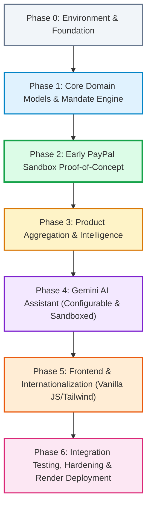

# Development Roadmap & Implementation Strategy
## AI-Powered Multilingual Shopping Intelligence Platform

> **Document Status:** Authoritative Implementation Roadmap (Task 6: Final Architecture Approval & PayPal Reliability Pass)  
> **Event Target:** PayPal AI Hackathon  
> **Deployment Target:** Render Cloud Platform  
> **Standards Compliance:** RFC 9457 (Problem Details) & RFC 8785 (JSON Canonicalization Scheme)  
> **Database Authority:** Schema names and DDL ordering strictly aligned with `DATABASE_DESIGN.md`.

---

## 1. Phased Development Plan

The project is structured into seven sequential phases. Crucially, the implementation is organized so that an **Early PayPal Sandbox Proof-of-Concept (Phase 2)** is completed immediately after the core domain and mandate engine, de-risking payments before the AI copilot and frontend interfaces are constructed.

---

## 2. Phase-by-Phase Deliverables & Dependencies

### Phase 0: Environment & Foundation
- **Objectives:** Establish development workspace, configuration management, exact minor-unit and scaled integer FX standards, RFC 9457 error handling, and baseline health-check endpoint.
- **Key Tasks:**
  - Initialize Python virtual environment with `pyproject.toml` and `requirements.txt` (FastAPI, Uvicorn, Pydantic v2, SQLAlchemy 2.0, HTTPX, google-genai, argon2-cffi).
  - Setup `.env.example` with strict typing via `pydantic-settings` (model names, PayPal Sandbox credentials, database URL).
  - Configure SQLite engine with WAL mode (`PRAGMA journal_mode = WAL; PRAGMA foreign_keys = ON;`) and 64-bit integer minor unit convention for all monetary figures (`BIGINT`).
  - Implement exact Python `Decimal` ingestion for exchange rates with fixed scale $10^8$ (`rate_scaled: BIGINT`, `scale_factor = 100_000_000`, `ROUND_HALF_UP`).
  - Implement base RFC 9457 Problem Details exception handlers (`application/problem+json`).
  - Setup test harness using `pytest` and `pytest-asyncio`.
- **Milestone 0:** Running FastAPI server responding to `GET /health` with active database connection check and RFC 9457 error formatting.

### Phase 1: Core Domain Models, Idempotency & Mandate Engine
- **Objectives:** Implement foundational entities following the authoritative topological DAG creation order, `idempotency_records`, scaled currency rate tables with composite FK integrity, deterministic spending mandate engine, and `audit_ledger_heads` concurrency lock.
- **Key Tasks:**
  - Implement SQLAlchemy models and migrations strictly adhering to the **Authoritative 19-Step Topological DDL Order** from `DATABASE_DESIGN.md`:
    1. `users` $\rightarrow$ 2. `profiles` $\rightarrow$ 3. `sessions` $\rightarrow$ 4. `spending_mandates` $\rightarrow$ 5. `exchange_rates` (with `uq_rates_composite`) $\rightarrow$ 6. `idempotency_records` $\rightarrow$ 7. `products` $\rightarrow$ 8. `product_specifications` $\rightarrow$ 9. `retailer_offers` $\rightarrow$ 10. `price_snapshots` $\rightarrow$ 11. `payment_orders` (with `paypal_request_id`, `expires_at`, nullable `mandate_id`, and `MANUAL_INTERVENTION_REQUIRED` status support) $\rightarrow$ 12. `order_items` $\rightarrow$ 13. `mandate_reservations` (composite FK `fk_reservations_exchange_rate_composite` with `ON DELETE RESTRICT`) $\rightarrow$ 14. `payment_captures` $\rightarrow$ 15. `paypal_webhook_events` (recoverable inbox lifecycle) $\rightarrow$ 16. `wishlists` $\rightarrow$ 17. `shopping_history` $\rightarrow$ 18. `audit_ledger_heads` $\rightarrow$ 19. `audit_events`.
  - Implement **Active Idempotency Recovery Protocol**:
    - Compound uniqueness: `(user_id, operation, idempotency_key)` on `idempotency_records`.
    - Operations: `ORDER_CREATE`, `ORDER_CAPTURE`, `ORDER_CANCEL`, `ORDER_RECONCILE`.
    - Payload SHA-256 hash validation to prevent parameter tampering (mismatched payloads return HTTP 409 Conflict).
    - **Active Recovery (Financial Safety):** Stale operations in `IN_PROGRESS` (>5 minutes) trigger active resource inspection under a row-level recovery lock (`RECOVERY_IN_PROGRESS`), **never automatic failure**.
    - For `ORDER_CREATE`, retry PayPal order creation using the stored `paypal_request_id` and canonical payload strictly within the configured retention window (`PAYPAL_IDEMPOTENCY_RETENTION_HOURS = 6` default). For `ORDER_CAPTURE`, query PayPal authoritative status before resolving. For `ORDER_CANCEL`, ensure no capture is underway.
    - If the retention window has expired or retries are exhausted without resolution, order transitions to `MANUAL_INTERVENTION_REQUIRED`. Mandate reservations are **never released on worker timeout**.
    - Replay of identical key returns the recovered result.
    - **Non-Purge Protection Rule:** Retention jobs must NEVER purge records corresponding to unsettled orders (`PENDING_APPROVAL`, `APPROVED`, `CAPTURING`, `REQUIRES_RECONCILIATION`, `MANUAL_INTERVENTION_REQUIRED`).
  - Implement exact integer exchange rate math & composite integrity:
    - Base-to-quote conversion: $\text{amount\_quote} = \lfloor (\text{amount\_base} \times \text{rate\_scaled} + 50\,000\,000) / 100\,000\,000 \rfloor$.
    - **Same-Currency Invariant:** When `base_currency == quote_currency`, identity conversion is exact: `rate_scaled = 100_000_000`, `scale_factor = 100_000_000`, `exchange_rate_id = NULL`.
    - **Cross-Currency Invariant:** When `base_currency <> quote_currency`, an authentic timestamped `exchange_rates` record is mandatory with composite foreign key `(exchange_rate_id, base_currency, quote_currency, applied_rate_scaled, rate_timestamp)` and `ON DELETE RESTRICT`. In addition, explicit transactional application validation asserts matching currency pair, rate, and timestamp.
    - **Stale-Rate Policy:** Maximum rate age is 24 hours in dev, 1 hour in prod. Missing or stale rates safely reject transactions.
  - Build the **Dual-Track Order Support**:
    - **Track A (Mandate-Backed):** Deterministic Spending Mandate Engine validation (budget cap, category whitelist, per-item ceiling, FX buffer volatility reserve).
    - **Track B (No-Mandate Direct Checkout):** Platform-wide baseline safeguards:
      - Max 5 units per order.
      - **Canonical USD 1,000 ceiling:** Direct comparison for USD; dynamic conversion to USD using timestamped exchange rates for EUR, GBP, INR. Rejects if rate missing or stale. Evaluated against gross payment amount.
      - Restricted to `offer_type = 'ELIGIBLE_SANDBOX'`.
      - Explicit user confirmation required (`acknowledge_no_mandate = true`).
      - Rate limit: max 3 checkouts/hour per authenticated `user_id` or client IP/guest session.
      - Zero dummy mandate or reservation rows created.
  - Implement **Synchronized Order Expiry & Cancellation (Approved Orders Fund-Lock Leak Closure)**:
    - `payment_orders.expires_at` is authoritative for 15-minute order validity.
    - `mandate_reservations.expires_at` synchronized identically.
    - Expiry worker queries parameterized `expires_at < :now` (`datetime.now(timezone.utc)`) and `status IN ('DRAFT', 'PENDING_APPROVAL', 'APPROVED')`.
    - Cancellation endpoint allows cancelling orders where `status IN ('DRAFT', 'PENDING_APPROVAL', 'APPROVED')` prior to backend capture initiation.
    - Orders in `CAPTURING`, `REQUIRES_RECONCILIATION`, or `MANUAL_INTERVENTION_REQUIRED` are **never expired automatically**; active or ambiguous capture outcomes must be authoritatively reconciled before funds are released.
  - Implement **FX Buffer Accounting Model**:
    - Exchange rate locked for the 15-minute order window (`expires_at`).
    - Volatility buffer (200 bps = 2.0%) reserved to protect against rate fluctuations during checkout.
    - **Expenditure Distinction:** Buffer is held as a temporary volatility reserve and is **never counted as expenditure**.
  - Implement RFC 8785 Canonical JSON (JCS) SHA-256 tamper-evident chained audit logger:
    - Dedicated singleton `audit_ledger_heads (id=1)` row lock (`SELECT ... FOR UPDATE`) guarantees race-free monotonic sequence allocation and `previous_hash` propagation.
    - **Eight-Field Canonical Envelope:** `actor`, `canonical_details`, `event_id`, `event_type`, `previous_hash`, `resource`, `sequence_number`, `timestamp`.
    - Classified as **tamper-evident, not tamper-proof**.
  - Implement **Race-Safe State Transitions:**
    - In-flight creation protection: Committing `status = 'CREATING'` prior to outbound PayPal API call blocks cancellation and expiry while creation is in flight (`WHERE status IN ('PENDING_APPROVAL', 'APPROVED')` matches 0 rows).
    - Capture wins (`UPDATE payment_orders SET status = 'CAPTURING', updated_at = :now WHERE id = :id AND status = 'APPROVED'`). Client-side capture strictly prohibited.
    - Cancellation wins (`UPDATE payment_orders SET status = 'CANCELLED', updated_at = :now WHERE id = :id AND status IN ('PENDING_APPROVAL', 'APPROVED')`). Requests in `CREATING` or `CAPTURING` return HTTP 409 Conflict.
    - Expiry wins (`UPDATE payment_orders SET status = 'EXPIRED', updated_at = :now WHERE id = :id AND status IN ('PENDING_APPROVAL', 'APPROVED') AND expires_at < :now`). Orders in `CREATING`, `CAPTURING`, `REQUIRES_RECONCILIATION`, or `MANUAL_INTERVENTION_REQUIRED` match 0 rows and are never expired automatically.
    - Releases reservations exactly once. Once `CAPTURING`, cancellation and expiry cannot execute.
  - Implement **Timestamp Portability & Server Default Elimination:**
    - Eliminate naive `DEFAULT CURRENT_TIMESTAMP` across all DDL tables.
    - Store canonical 32-character ISO-8601 UTC strings (`YYYY-MM-DDTHH:MM:SS.ffffff+00:00`) via `AwareDateTime` SQLAlchemy TypeDecorator to guarantee strict lexicographical and chronological parity on SQLite without dialect `INTERVAL` arithmetic.
- **Milestone 1:** Verified mandate engine and baseline safeguard policy rejecting invalid, over-budget, or out-of-bounds purchases with zero external API dependencies.

### Phase 2: Early PayPal Sandbox Proof-of-Concept (De-risking Payments)
- **Objectives:** Implement and verify server-to-server PayPal Sandbox order creation with `PayPal-Request-Id`, pre-approval verification, persisted `APPROVED` state, failure classification, and authoritative capture before AI or UI construction.
- **Key Tasks:**
  - Build `PayPalSandboxService` with OAuth2 client-credentials token caching.
  - Implement the **Authoritative Decoupled 8-Step Order Creation Flow with `PayPal-Request-Id`**:
    1. Local DB transaction: Generate UUID v4 `paypal_request_id` and calculate synchronized `expires_at = :now + timedelta(minutes=15)` using timezone-aware UTC datetime.
    2. Insert `payment_orders` with initial `status = 'DRAFT'`, `paypal_request_id`, and `expires_at`.
    3. If mandate-backed, insert `mandate_reservations` with `status = 'PENDING'`.
    4. Insert `idempotency_records` with `status = 'IN_PROGRESS'`.
    5. Atomically transition `payment_orders` from `DRAFT` to `CREATING` (`UPDATE payment_orders SET status = 'CREATING', updated_at = :now WHERE id = :id AND status = 'DRAFT'`).
    6. Commit local database transaction immediately, releasing the database connection back to the connection pool before invoking external network calls.
    7. External PayPal API call (`POST /v2/checkout/orders`) with header `PayPal-Request-Id: <paypal_request_id>` and `custom_id` / `invoice_id` set to `internal_order_number` as reconciliation metadata.
    8. Brief DB transaction: persist returned `paypal_order_id`, transition internal status from `CREATING` to `PENDING_APPROVAL`, mark idempotency `COMPLETED`, commit.
    - **Definitive Failure Compensation:** On PayPal validation rejection (HTTP 400 `INVALID_REQUEST`, 422 `UNPROCESSABLE_ENTITY`, 401, 403), transition order from `CREATING` to `FAILED`, mark reservation `RELEASED`, restore mandate balance immediately.
    - **Ambiguous Failure Handling (Removal of Unsupported Search Assumptions):** On timeout (HTTP 504), network drop, gateway error (HTTP 500, 502, 503), or DB failure after PayPal returns an ID, **NEVER release mandate funds**. Transition order from `CREATING` to `REQUIRES_RECONCILIATION`. Re-submit creation request with the **identical `PayPal-Request-Id` and payload** to recover the `paypal_order_id` safely via PayPal request idempotency. Return HTTP 202 Accepted as a standard JSON operation-status response (NOT RFC 9457 error).
  - Implement **Explicit Persisted State Flow & Authoritative Backend Capture**:
    - Pre-approval verification: Query PayPal `GET /v2/checkout/orders/{stored_id}` to verify buyer approval (`APPROVED`).
    - **Persist `APPROVED` State:** Atomically update `payment_orders` status from `PENDING_APPROVAL` to `APPROVED` (`UPDATE payment_orders SET status = 'APPROVED', updated_at = :now WHERE id = :id AND status = 'PENDING_APPROVAL'`).
    - **One-Capture-Per-Order Invariant:** Acquire exclusive lock by transitioning `payment_orders` from `APPROVED` to `CAPTURING` (`WHERE status = 'APPROVED'`). Client-side PayPal JavaScript SDK capture (`actions.order.capture()`) is strictly prohibited. Reject concurrent capture attempts with HTTP 409 Conflict.
    - Capture payment: Execute `POST /v2/checkout/orders/{stored_id}/capture`.
    - Commit actual converted amount to `COMMITTED` in `mandate_reservations`, transition order to `COMPLETED`, and **release the excess FX buffer** back to available budget immediately upon capture!
    - Store captured transaction in `payment_captures` applying privacy data minimization (capture ID, status, amount, currency, timestamp; discard raw payload containing buyer PII).
  - Implement **Webhook Ingestion, Lease Fencing & Recoverable Inbox Lifecycle (`paypal_webhook_events`) (3 Phases / Canonical 9 Steps)**:
    - Implement webhook endpoint `POST /api/v1/payments/webhooks`.
    - Cryptographically verify webhook signatures using PayPal's verification service (`POST /v1/notifications/verify-webhook-signature`). Reject unverified webhooks immediately with `401 Unauthorized`.
    - Persist incoming event in `paypal_webhook_events` (`UNIQUE (paypal_event_id)`) with initial status `RECEIVED`. Return `200 OK` to PayPal immediately **after durable persistence**.
    - Build background webhook worker implementing the **3-phase, 9-step execution sequence**:
      - **Phase 1 — Atomic Lease Claim & Immediate Connection Release (Steps 1–2):**
        - Step 1: Query eligible pending events using decoupled predicate (`status = 'RECEIVED' OR (status = 'RETRYABLE_FAILED' AND next_retry_at IS NOT NULL AND next_retry_at <= :now) OR (status = 'PROCESSING' AND lease_expires_at IS NOT NULL AND lease_expires_at <= :now)`). Claim lease atomically setting `status = 'PROCESSING'`, `worker_id`, `lease_token = :new_lease_token` (UUID v4), `lease_generation = lease_generation + 1`, `processing_started_at = :now`, `lease_expires_at = :lease_expiry` (computed in application as `now + timedelta(seconds=30)`), and `updated_at = :now`.
        - Step 2: Commit lease claim immediately and release database connection back to pool.
      - **Phase 2 — External REST Verification Outside DB Transaction (Step 3):**
        - Step 3: With **zero database connections held**, query authoritative PayPal REST API (`GET /v2/checkout/orders/{paypal_order_id}` for `checkout-order` events; `GET /v2/payments/captures/{paypal_capture_id}` extracting `supplementary_data.related_ids.order_id` for `capture` events; capture IDs are never passed to order endpoints). For operations >30s, renew lease via isolated heartbeat query (`WHERE id = :id AND status = 'PROCESSING' AND lease_token = :current_lease_token AND lease_expires_at > :now`); if `result.rowcount != 1`, abort immediately.
      - **Phase 3 — Financial Processing Transaction & Atomicity Boundary (Steps 4–9):**
        - Step 4: Acquire a new connection and open explicit short-lived transaction (`async with session.begin():`).
        - Step 5: Lock internal `payment_orders` row (`FOR UPDATE`) and **validate parent-order correlation**: verify that `internal_payment_order.paypal_order_id == verified_res["supplementary_data"]["related_ids"]["order_id"]`. If mismatched, do NOT insert capture, do NOT debit mandate, escalate order to `MANUAL_INTERVENTION_REQUIRED`, append `FINANCIAL_DISCREPANCY_DETECTED` with reason `'PARENT_ORDER_MISMATCH'`, transition webhook to `MANUAL_REVIEW_REQUIRED` under fenced lease, and enforce `rowcount == 1` check with rollback on failure. (Distinct from duplicate capture conflicts).
        - Step 6: Execute capture insertion inside an isolated nested savepoint (`session.begin_nested()`). Catch unique constraint `uq_payment_captures_paypal_capture_id` collisions and rollback savepoint without invalidating outer transaction block.
        - Step 7: Resolve outcome:
          - Active orders: validate amount, currency, and capture state; mutate internal order without regressing terminal states; debit approved mandate.
          - Capture on terminal order: insert `payment_captures` with `is_discrepancy = TRUE` and `discrepancy_reason = 'CAPTURE_ON_TERMINAL_ORDER'`, escalate order to `MANUAL_INTERVENTION_REQUIRED`, do not retroactively debit mandate, quarantine funds, log `FINANCIAL_DISCREPANCY_DETECTED`.
          - Duplicate capture: apply uniform 6-field comparison contract (1. `paypal_capture_id`, 2. `payment_order_id`, 3. parent `paypal_order_id`, 4. `amount_captured_minor`, 5. `currency`, 6. `capture_status`). Identical duplicates marked `PROCESSED` without second debit; conflicting duplicates escalate order to `MANUAL_INTERVENTION_REQUIRED`, log `FINANCIAL_DISCREPANCY_DETECTED` (`DUPLICATE_CAPTURE_CONFLICT`), transition webhook to `MANUAL_REVIEW_REQUIRED`.
        - Step 8: Fenced finalization with **strict universal row-count enforcement**: execute conditional update on `paypal_webhook_events` (`WHERE id = :id AND status = 'PROCESSING' AND lease_token = :token AND lease_expires_at > :now`) and verify `fence_result.rowcount == 1`. If `rowcount == 0` (lease expired/stolen) or `> 1` (multi-row violation), worker executes `await session.rollback()`. Stale workers must NEVER commit mutations.
        - Step 9: Commit all mutations atomically when `fence_result.rowcount == 1`.
      - **Fenced Failure & Retry Transitions:** On transient failure, update `status = 'RETRYABLE_FAILED'` with exponential backoff; on unrecoverable failure, escalate to `MANUAL_REVIEW_REQUIRED`. Both enforce `rowcount == 1` with rollback on fence failure.
  - Write integration tests verifying idempotent order creation, duplicate-capture rejection, and server-side capture verification against mock/live PayPal Sandbox.
- **Milestone 2:** End-to-end backend test proving decoupled PayPal Sandbox order creation, approval verification, persisted `APPROVED` transition, one-capture-per-order locking, capture, buffer release, and automatic mandate balance deduction.

### Phase 3: Product Aggregation & Intelligence Engine
- **Objectives:** Build provider-agnostic aggregation, explicit data provenance tagging, and analytical comparison services.
- **Key Tasks:**
  - Define `ProductProviderInterface`.
  - Implement `HighFidelityMockProvider` tagged with `provenance = "SYNTHETIC_DEMO_DATA"`.
  - Implement `Channel3Adapter` tagged with `provenance = "LIVE_PROVIDER_DATA"`, with graceful fallback if credentials or quotas are unverified.
  - Build Canonical Entity Resolver (deduplicating by model/UPC/title similarity).
  - Build Product Intelligence Engine:
    - Retailer price comparison matrix & percentage delta across `retailer_offers`.
    - Normalized specification delta matrix across `product_specifications`.
    - Explainable Value-for-Money (VFM) scoring formula: $\text{VFM} = \left(\frac{\text{Specs Score}}{\text{Normalized Price}}\right) \times \text{Confidence Multiplier}$.
    - Genuine price history aggregator from stored snapshots in `price_snapshots` bucketed by calendar day (synthetic demonstration offers clearly distinguished from real listings).
  - Outbound redirect service with HTTPS and host whitelist verification, logging to `shopping_history`.
- **Milestone 3:** Functional product search and comparison API endpoints returning normalized data, pricing variance, provenance labels, and mathematical VFM scores.

### Phase 4: Gemini AI Assistant (Configurable & Sandboxed)
- **Objectives:** Integrate Google Gemini via a configurable model setting and sandboxed tool calling strictly grounded in backend data.
- **Key Tasks:**
  - Implement `AIProviderInterface` and `GeminiClient` supporting configurable `GEMINI_MODEL_NAME`.
  - Define strict Gemini Function Calling tool declarations (`tool_search_products`, `tool_get_product_intelligence`, `tool_compare_products`, `tool_check_spending_mandate`).
  - Enforce security boundaries: **tools never accept `user_id` or product prices from the model**; user ID is derived strictly from the authenticated backend session.
  - Implement multi-layered prompt injection defense: treat product data as untrusted, apply structural role boundaries, and enforce Pydantic output schemas.
  - Multilingual support for English (`en`), German (`de`), Italian (`it`), and Spanish (`es`).
- **Milestone 4:** AI assistant answers multilingual shopping queries, extracts constraints, invokes read-only tools, and explains trade-offs without hallucination or privilege escalation.

### Phase 5: Frontend & Internationalization (Vanilla JS / Tailwind CDN)
- **Objectives:** Build a responsive web interface using Vanilla JS, Tailwind CSS CDN, HttpOnly cookie sessions, and CSRF protection.
- **Key Tasks:**
  - Layout: Navigation, Search Bar, Currency/Language Pickers, Copilot Drawer, Main Content Area.
  - State & Security: In-memory state store, `Secure`, `HttpOnly` session cookies (no tokens in `localStorage`), and `X-CSRF-Token` injection.
  - Views:
    - Product Grid with faceted filters and `Live Listing` vs `Demonstration Offer` provenance badges.
    - Product Detail Modal with Specs Table, Price Comparison Matrix, and Canvas-based Genuine Price History Chart.
    - Side-by-Side Comparison Matrix View.
    - Spending Mandates Dashboard with real-time budget utilization gauges.
    - Dual-track Checkout Flow: Mandate-backed checkout selector or direct no-mandate checkout with baseline safety warning.
  - PayPal JavaScript SDK button integration executing the Phase 2 decoupled backend capture flow.
  - Unambiguous monetary display: clearly show settlement currency ($ USD) alongside mandate consumption (₹ INR) and transparent rate estimate labels.
  - Outbound external retailer redirect warning modal.
  - Client-side i18n translation dictionary loader (EN, DE, IT, ES).
- **Milestone 5:** Interactive web application enabling discovery, comparison, multilingual AI chat, mandate tracking, and PayPal Sandbox checkout.

### Phase 6: Integration Testing, Security Hardening & Render Deployment
- **Objectives:** Comprehensive security review, end-to-end integration testing, and deployment to Render.
- **Key Tasks:**
  - Execute end-to-end test scenarios across USD, EUR, GBP, and INR.
  - Test operation-specific idempotency (`ORDER_CREATE`, `ORDER_CAPTURE`, `ORDER_CANCEL`, `ORDER_RECONCILE`) with concurrent colliding requests.
  - Test `PayPal-Request-Id` retry behavior on simulated order creation timeouts.
  - Test persisted `APPROVED` state transition and verify the one-capture-per-order invariant rejects concurrent capture calls with HTTP 409 Conflict.
  - Test Active Idempotency Recovery: simulate crashed workers at $T > 5\text{m}$, verify PayPal query via request-ID retry and order retrieval, and confirm mandate reservations are never released prematurely.
  - Test race safety: simulate concurrent capture vs cancellation vs expiry, verifying conditional updates guarantee exactly-once reservation handling.
  - Validate reconciliation handling: simulate PayPal HTTP 504 timeouts and verify that mandate funds remain locked until reconciled. Verify HTTP 202 is returned as a standard JSON operation-status response.
  - Validate failure compensation: simulate PayPal HTTP 422 errors and verify that mandate funds are immediately released.
  - Test webhook signature verification and deduplication in `paypal_webhook_events`.
  - Verify JCS hash-chain verification and `audit_ledger_heads` concurrency lock under simulated parallel writes using the eight-field envelope.
  - Perform security audits: verify SQL parameterization, rate limiter enforcement, CSRF token validation, and prompt injection resilience.
  - Configure Render deployment via `render.yaml` with automatic environment variable injection.
  - Rehearse the live hackathon demonstration script.
- **Milestone 6:** Publicly accessible live deployment on Render passing all health checks and live demo flows.

---

## 3. Testing Strategy Matrix

| Testing Level | Scope & Tools | Key Scenarios Covered |
| :--- | :--- | :--- |
| **Unit Tests** | `pytest`, `unittest.mock` | Policy rule validation (budget cap, item limit, category whitelist in integer minor units); Scaled integer FX math ($10^8$ scale factor, `ROUND_HALF_UP`, orientation); Same-currency identity vs cross-currency mandatory rate; Stale rate rejection (>24h dev, >1h prod); FX buffer calculation (volatility reserve, non-expenditure logic); Argon2id hashing; JCS serialization; `AwareDateTime` TypeDecorator canonical 32-character ISO-8601 string formatting (`YYYY-MM-DDTHH:MM:SS.ffffff+00:00`), UTC timezone validation, naive datetime rejection, and legacy space-normalizing deserializer. |
| **Early PayPal PoC Tests** | `httpx.AsyncClient`, Mock/Sandbox PayPal API | Authoritative 8-step creation flow with `PayPal-Request-Id` (local DB commits `CREATING` before external dispatch; handles crash recovery at $T > 5\text{m}$); Alternative outcome branches for definitive failure compensation (HTTP 422 immediate fund release), ambiguous timeout (HTTP 504 lock retention and transition to `REQUIRES_RECONCILIATION`), and active reconciliation retry; Idempotent retry with identical `PayPal-Request-Id`; Post-creation persistence failure handling; Pre-approval verification via `GET /v2/checkout/orders/{id}`; Persisted `APPROVED` state; One-capture-per-order atomic locking; Server-side capture verification; Transition to `COMPLETED`; Release of excess FX buffer upon capture; Privacy data minimization. |
| **Dual-Track Checkout Tests** | `pytest-asyncio`, FastAPI test client | Mandate-backed checkout validation; No-mandate checkout baseline safeguard validation (quantity $\le 5$, canonical USD 1,000 ceiling dynamic conversion for EUR/GBP/INR, rate limit rejection at 4th request/hr); Verification that no-mandate checkout produces zero mandate/reservation records. |
| **Idempotency & Recovery Tests** | `pytest-asyncio`, concurrent requests | Scoped `(user_id, operation, idempotency_key)` uniqueness; In-flight collision rejection (`409 Conflict`); Payload hash mismatch rejection (`409 Conflict`); Replay with identical payload returning cached response; **Active Recovery Protocol:** Stale `IN_PROGRESS` (>5 min) claims recovery lock, retries via `PayPal-Request-Id`, queries order by ID, never auto-fails or prematurely releases funds; Verification that unresolved orders are never purged. |
| **Race-Safe Concurrency Tests** | `pytest-asyncio`, concurrent tasks | In-flight `CREATING` state blocking concurrent cancellation and expiry; Atomic state transitions: Capture in `APPROVED` transitions to `CAPTURING`, blocking cancellation and expiry; Cancellation in `PENDING_APPROVAL`/`APPROVED` transitions to `CANCELLED`, releasing reservation and blocking subsequent capture attempts (`DRAFT` is never committed visible; requests in `CREATING` or `CAPTURING` return HTTP 409 Conflict); Expiry worker querying orders where `expires_at < :now` in `PENDING_APPROVAL`/`APPROVED`, releasing reservation and blocking subsequent capture attempts; Skipping orders in `CREATING`, `CAPTURING`, `REQUIRES_RECONCILIATION`, or `MANUAL_INTERVENTION_REQUIRED`; Crash recovery of stalled `CREATING` orders at $T > 5\text{m}$. Client-side capture strictly banned. Exactly-once reservation release. |
| **Webhook Security Tests** | `pytest`, mock PayPal webhook sender | Webhook cryptographic signature verification; Rejection of forged/unverified events (HTTP 401); Durable persistence with status `RECEIVED` before 200 OK acknowledgment; Deduplication via `paypal_webhook_events` (`UNIQUE (paypal_event_id)`); Background worker eligibility decoupled query handling NULL `next_retry_at` without starvation; Atomic lease claiming with lease fencing (`lease_token`, `lease_generation`) and application-calculated `:lease_expiry`; Expired lease recovery (`lease_expires_at <= :now`); Decoupled REST verification with zero database connections held during external network round-trips; Heartbeat lease renewal for tasks >30s; Rejection of stale worker completion attempts on lease expiration; Strict universal row-count enforcement tests across all fenced update queries (`result.rowcount == 1` check), asserting that if `rowcount == 0` (simulating expired or stolen lease) or `> 1`, the entire processing transaction rolls back without mutating order status, inserting captures, debiting mandates, or appending audit ledger entries; Parent-order correlation validation test (`supplementary_data.related_ids.order_id` vs `internal_payment_order.paypal_order_id` mismatch triggering zero capture insertion, zero mandate debit, escalation to `MANUAL_INTERVENTION_REQUIRED`, tamper-evident audit event `'PARENT_ORDER_MISMATCH'`, and rollback on lease failure, distinct from duplicate capture conflict); PostgreSQL-safe duplicate capture idempotency via nested savepoints (`begin_nested()`); Uniform 6-field duplicate comparison contract (`paypal_capture_id`, `payment_order_id`, parent `paypal_order_id` matching `supplementary_data.related_ids.order_id`, `amount_captured_minor`, `currency`, `capture_status`); Deduplication of identical capture without second debit or state regression; Escalation of conflicting capture to `MANUAL_INTERVENTION_REQUIRED` with `FINANCIAL_DISCREPANCY_DETECTED` audit event; Resource-type-specific REST retrieval (`GET /v2/checkout/orders/{id}` for `checkout-order` vs `GET /v2/payments/captures/{id}` using `supplementary_data.related_ids.order_id` for captures); Marking `PROCESSED` only under fenced atomic completion; Fenced transient failure retry with exponential backoff (`RETRYABLE_FAILED`); Fenced escalation to `MANUAL_REVIEW_REQUIRED`; Out-of-order event protection (never regressing terminal states `COMPLETED`, `CANCELLED`, `EXPIRED`, `FAILED`); Verified capture on terminal order discrepancy protocol (`is_discrepancy = TRUE`, escalation to `MANUAL_INTERVENTION_REQUIRED`, mandate balance quarantine, `FINANCIAL_DISCREPANCY_DETECTED` audit logging). |
| **Database & Schema Tests** | `pytest`, SQLite & PostgreSQL test harness | Authoritative topological 19-step DDL execution DAG verification; Foreign key constraint enforcement (`PRAGMA foreign_keys = ON;`); Composite unique constraint `uq_rates_composite` on `exchange_rates`; Composite foreign key `fk_reservations_exchange_rate_composite` on `mandate_reservations` with `ON DELETE RESTRICT`; Transactional application validation asserting matching currency pair, rate, timestamp; Verification of `chk_mandate_currency_match` (`currency = quote_currency`) check constraint; Payment order status enum including `CREATING` and `MANUAL_INTERVENTION_REQUIRED`; Nullable `mandate_id` on `payment_orders`; Strict FK `mandate_reservations.payment_order_id` $\rightarrow$ `payment_orders(id)`; Verification of `chk_fx_currency_consistency` check constraint; Synchronized `expires_at` on `payment_orders` and `mandate_reservations`; Parameterized `:now` for expiry queries across SQLite and PostgreSQL; Execution of 9-case timestamp portability verification matrix: 1. SQLite canonical 32-character string formatting (`%Y-%m-%dT%H:%M:%S.%f+00:00`), 2. PostgreSQL native round-trip (`TIMESTAMP WITH TIME ZONE`), 3. Deserialization UTC normalization, 4. Naive datetime rejection, 5. Timestamp equality, 6. Timestamp ordering, 7. Expiry boundary comparisons (`expires_at < :now`), 8. Lease expiry comparisons (`lease_expires_at <= :now`), 9. Verification of zero naive server defaults (`DEFAULT CURRENT_TIMESTAMP`) across all 19 DDL tables; Zero `datetime.utcnow` defaults. |
| **Audit Ledger Concurrency Tests** | `pytest-asyncio`, multithreaded simulation | Concurrency locking on `audit_ledger_heads` singleton row (`SELECT ... FOR UPDATE`); Verification of strictly monotonic sequence numbers without duplicates or gaps; **Eight-field canonical event envelope** hashing; RFC 8785 JCS hash-chain integrity verification. |
| **Integration Tests** | `FastAPI TestClient`, SQLite async engine | RFC 9457 error contracts; HTTP 202 Accepted JSON operation-status response; Database transaction rollbacks; Ephemeral guest session creation and atomic migration to registered user; CSRF token validation; JCS chained audit log verification. |
| **AI Tool Grounding Tests** | Configurable Gemini mock & live client | Injected session identity; Strict Pydantic argument validation; Tool output schema enforcement; Defense against prompt injection in product descriptions. |
| **End-to-End Tests** | Browser manual scripted walkthrough | User searches in Spanish $\rightarrow$ Asks AI for advice $\rightarrow$ Mandate prevents over-budget purchase $\rightarrow$ Selects approved item $\rightarrow$ Checks out with PayPal Sandbox $\rightarrow$ Real-time mandate deduction with explicit currency pairings. |

---

## 4. Hackathon Demonstration Milestones & Live Demo Script

### The "Golden Demo" Narrative
- **Setting:** A user in India is shopping for premium noise-cancelling headphones listed from a US merchant in USD.
- **Budget Constraint:** The user sets an immutable spending mandate of **₹25,000 INR**, with a maximum per-item limit of **₹22,000 INR**, category restricted to **Audio/Headphones**.

### Live Demo Steps:
1. **Multilingual Discovery with Data Provenance:**
   - User opens the platform in Spanish or German.
   - Browses catalog showing clear data provenance badges (`Live Listing` vs `Demonstration Offer`).
   - Prices displayed in preferred currency (INR) with transparent estimate labels, original currency (USD), and rate timestamps.
2. **AI Advisory with Grounded Retrieval:**
   - User opens AI Copilot Drawer and asks: *"¿Cuál de estos auriculares ofrece mejor relación calidad-precio y cabe en mi presupuesto de 25000 INR?"*
   - Configurable Gemini copilot executes backend read-only search tools using session-injected identity.
   - AI accurately compares models and notes budget constraints based on actual backend data.
3. **Deep Specification & Price Comparison:**
   - User opens side-by-side comparison for 2 models.
   - Shows retailer price variance across Amazon, Best Buy, and Croma in `retailer_offers`.
   - Highlights mathematical Value-for-Money score and authentic historical price chart from `price_snapshots`.
4. **Deterministic Mandate Rejection:**
   - User attempts to purchase an offer whose converted price + FX buffer exceeds the per-item price cap.
   - **Result:** Immediate visual rejection dialog citing RFC 9457 problem details: *"Spending Mandate Violation: Item price of ₹23,450 INR (with FX buffer) exceeds limit of ₹22,000 INR."*
5. **Decoupled Seamless PayPal Sandbox Checkout (Mandate-Backed):**
   - User selects compliant product ($279 USD).
   - Backend performs decoupled order creation: records internal order in `payment_orders` with unique `paypal_request_id` and reserves ₹23,296 INR + ₹466 INR buffer in `mandate_reservations` (synchronized 15-min expiry). Commits local DB (`status = CREATING`), calls PayPal with `PayPal-Request-Id`, and persists PayPal Order ID (`PENDING_APPROVAL`).
   - PayPal Sandbox modal launches; user logs in with sandbox buyer and approves.
   - Client sends internal order ID to capture endpoint.
   - Server verifies approval with PayPal (`GET /v2/checkout/orders/{id}`), atomically persists internal status to `APPROVED`, acquires row lock transitioning to `CAPTURING`, executes capture payment ($279 USD), commits ₹23,296 INR to `COMMITTED`, transitions to `COMPLETED`, and **releases the ₹466 INR buffer** back to available budget!
   - Server outputs watermarked demonstration receipt with unambiguous currency breakdown ($279 USD captured vs ₹23,296 INR consumed).
6. **No-Mandate Baseline Checkout Demonstration (Dual-Track Validation):**
   - User performs a direct checkout without a spending mandate.
   - Backend validates baseline platform safeguards: checks quantity $\le 5$, dynamic conversion against canonical USD 1,000 ceiling, rate limit, and creates internal order with `mandate_id = NULL`.
   - Order executes identical approval verification, persisted `APPROVED` state, and capture locking, with zero mandate or reservation records touched.
7. **Reconciliation & Audit Trail:**
   - Mandate dashboard updates in real time showing exact remaining budget in INR.
   - Admin view displays the RFC 8785 JCS cryptographically chained, tamper-evident audit log verifying the full lifecycle from `audit_events` with the eight-field envelope.
