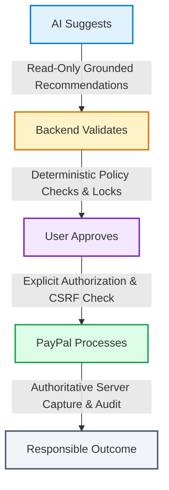
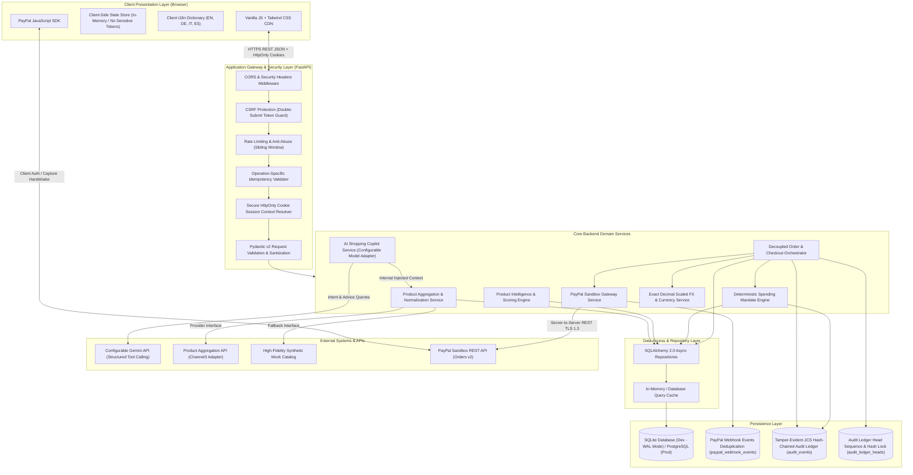
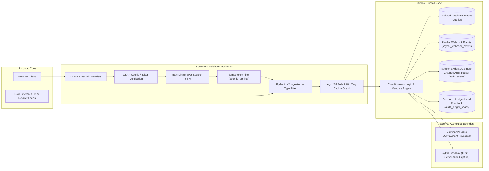

# Master System Architecture Document
## AI-Powered Multilingual Shopping Intelligence Platform

> **Project Vision:** *Discover smarter. Compare deeper. Spend responsibly.*  
> **Event:** PayPal AI Hackathon  
> **Target Deployment:** Render (FastAPI + Static Vanilla JS / Tailwind CSS CDN)  
> **Status:** Authoritative Master System Architecture (Task 6: Final Architecture Approval & PayPal Reliability Pass)  
> **Database Authority:** Schema names and DDL ordering strictly aligned with `DATABASE_DESIGN.md`.

---

## 1. Executive Summary & Core Philosophy

The **AI-Powered Multilingual Shopping Intelligence Platform** is an e-commerce intelligence system designed to shift the online shopping paradigm from impulsive, ad-driven purchasing to informed, analytical, and financially responsible spending.

Traditional e-commerce platforms incentivize overspending through deceptive countdown timers, opaque algorithmic pricing, and friction-free impulsive checkouts. Even modern AI shopping chatbots frequently act as superficial sales agents that nudge users to buy without validating product value or personal budgets.

Our platform establishes a disciplined contract with the consumer based on four architectural pillars:



### Core Tenets
1. **AI Suggests:** The AI engine acts strictly as an analytical advisor, multilingual translator, and shopping researcher. It possesses zero execution privileges over money, checkout flows, database mutations, or policy rules. It operates under strictly validated tool schemas with user identity derived exclusively from the authenticated backend session.
2. **Backend Validates:** A deterministic Python policy engine evaluates all purchase decisions against immutable user-defined spending mandates (budget ceilings, category whitelists, per-item limits). For users checking out without an active mandate, strict platform-wide baseline safeguards enforce transaction ceilings and quantity caps.
3. **User Approves:** The consumer retains complete agency. Every price comparison, specification trade-off, budget allocation, and data provenance label is made transparent before checkout initiation.
4. **PayPal Processes:** Payment transactions are executed securely via PayPal Sandbox. Eligible demonstration products complete end-to-end sandbox authorization and server-side capture with clear simulation disclosures, while external marketplace-only listings redirect directly to real retailers via validated outbound URLs.

---

## 2. High-Level System Architecture

The platform follows a **Modular Monolithic Architecture**. This guarantees high performance, rapid iteration, zero microservice network latency, and simple one-click deployment to Render while maintaining strict internal domain boundaries.



---

## 3. Technology Stack Justification

| Layer | Selected Technology | Architectural Justification |
| :--- | :--- | :--- |
| **Frontend** | Vanilla HTML5, CSS3, JavaScript (ES6+ Modules), Tailwind CSS CDN | Eliminates complex build pipelines (Vite, Webpack, Node.js tooling), prevents hydration mismatches, ensures ultra-fast page load times, and avoids single-page application (SPA) state bloat. Uses `Secure`, `HttpOnly` cookies without exposing session tokens to JavaScript or `localStorage`. |
| **Backend** | Python 3.11+, FastAPI, Pydantic v2, HTTPX (Async) | High-performance asynchronous REST API framework with native OpenAPI documentation, strict type safety, RFC 9457 Problem Details error modeling, non-blocking I/O for concurrent external aggregation, and robust background tasks for payment reconciliation. |
| **AI Model & Orchestrator** | Google Gemini API (Configurable Model via Environment) with `AIProviderInterface` | Decouples business logic from specific model tags. Operates via structured JSON schemas and read-only tool calls. Model availability, pricing, token windows, and regional quotas are marked as **UNVERIFIED** pending integration testing. |
| **Product Aggregator** | Channel3 Adapter with High-Fidelity Mock Fallback | Clean provider-agnostic abstraction (`ProductProviderInterface`). Explicitly segregates `LIVE_PROVIDER_DATA` from `SYNTHETIC_DEMO_DATA`. If Channel3 access or quota is limited, mock data provides fully transparent demonstration listings without pretending to be live retailer data. |
| **Currency & Precision Engine** | Python `Decimal` Ingestion + Fixed $10^8$ Scaled Integer Representation + 64-bit Integer Minor Units | Strict financial precision across USD, EUR, GBP, and INR. Ingests rates with `Decimal` and stores as `rate_scaled: BIGINT` ($10^8$ scale). Foreign-key deletion policy `ON DELETE RESTRICT` guarantees historical exchange rates cannot be deleted. Converted prices explicitly flagged as estimates (`is_estimated_conversion: true`). |
| **Database** | SQLite with WAL mode (Local Dev) → PostgreSQL 15+ Ready (Render) | 100% portable schema using 64-bit integer minor units (`BIGINT`), ISO-8601 UTC timestamps, and standard UUID strings. Foreign keys enforced via explicit 19-step topological creation sequence and SQLite PRAGMAs. Dedicated `paypal_webhook_events` table ensures reliable webhook deduplication. |
| **Payment Gateway** | PayPal Sandbox REST API (`/v2/checkout/orders`) | Industry-standard payment authorization and server-side capture sandbox. Authoritative 8-step creation flow avoids open database transactions. Uses unique `PayPal-Request-Id` for creation idempotency. Server verifies pre-approval before capturing. |
| **Audit Ledger** | RFC 8785 Canonical JSON (JCS) SHA-256 Hash Chain with Dedicated Ledger-Head Lock | Tamper-evident, cryptographically chained event log with eight-field canonical envelope, row-level mutex sequencing, and external periodic signed checkpoints. |
| **Deployment** | Render Web Service | Native support for Python ASGI applications, automatic SSL/TLS termination, environment variable secrets management, zero-downtime deploys from GitHub, and static file serving via FastAPI mount. |

---

## 4. Architectural Boundaries & System Components

### 4.1 Frontend Presentation Layer (Vanilla JS + Tailwind CDN)
- **View Hierarchy:**
  - `Discover View`: Search bar, faceted filters (price, retailer, category, rating), product grid with data provenance badges (`Live Listing` vs `Demonstration Offer`).
  - `Product Detail View`: Full technical specifications from `product_specifications`, retailer comparison matrix from `retailer_offers`, genuine price history chart from `price_snapshots`, value-for-money breakdown, external redirect link, or sandbox checkout trigger.
  - `Comparison Matrix View`: Side-by-side comparison of 2–4 selected products with auto-highlighted advantages and trade-offs.
  - `Shopping Copilot Drawer`: Persistent collapsible multilingual AI chat widget capable of context-aware search, comparison explanations, and budget inquiries.
  - `Spending Mandates Dashboard`: Mandate builder (budget limit, per-item cap, category whitelist), real-time balance gauges (Allocated, Reserved, Consumed, Remaining), audit history.
  - `User Account & History`: Saved `wishlists`, past simulated orders, external redirect click logs in `shopping_history`.
- **Client State & Security Management:**
  - No session tokens or secrets stored in JavaScript variables or `localStorage`.
  - Authentication managed exclusively via browser-managed `Secure`, `HttpOnly`, `SameSite=Lax` cookies.
  - State-mutating requests (`POST`, `PUT`, `DELETE`) require a CSRF token fetched from the backend and sent via custom header `X-CSRF-Token`.
- **Internationalization (i18n):** Client-side translation dictionary covering UI static strings for English (`en`), German (`de`), Italian (`it`), and Spanish (`es`), dynamically bound via `data-i18n` attributes.

### 4.2 Application Gateway & Security Layer (FastAPI)
- **Security Headers:** Injects standard security headers (`Content-Security-Policy`, `X-Content-Type-Options`, `X-Frame-Options`, `Referrer-Policy`).
- **Session Identification:** Resolves incoming HTTP requests to either an authenticated User Account in `users` or an ephemeral Guest Session in `sessions` via signed `HttpOnly` cookies.
- **CSRF Defense:** Double-submit CSRF cookie pattern or cryptographically validated session-tied anti-CSRF token on all mutation endpoints.
- **Operation-Specific Idempotency:** Validates `(user_id, operation, idempotency_key)` tuples against `idempotency_records`. Protects against duplicate concurrent mutations and replays with mismatched payload hashes.
- **Rate Limiting:** Sliding-window rate limiter per identity/IP to safeguard external Gemini and product provider API quotas against abuse.
- **Validation Pipeline:** Pydantic v2 models validate all inbound payloads, sanitizing inputs and rejecting unknown fields. Errors formatted per RFC 9457 Problem Details.

### 4.3 Product Aggregation & Provenance Subsystem
- **Provider Interface (`ProductProviderInterface`):**
  Defines asynchronous contract methods:
  - `search_products(query: str, filters: FilterParams) -> List[RawProduct]`
  - `get_product_details(provider_product_id: str) -> RawProductDetail`
  - `get_offers(provider_product_id: str) -> List[RawOffer]`
- **Channel3 Provider Adapter:** Communicates with the Channel3 API over async HTTPX. Ingested records are tagged with `provenance = "LIVE_PROVIDER_DATA"`.
- **Fallback / Mock Provider Adapter:** Provides deterministic, high-quality demonstration data. Ingested records are tagged with `provenance = "SYNTHETIC_DEMO_DATA"`.
- **Strict Data Provenance Principle:** Synthetic demonstration offers are never presented as real verified market listings. The UI and API clearly label synthetic items with transparent demonstration disclaimers.
- **Canonical Product Resolver & Normalizer:**
  - Standardizes raw provider data into a unified `Product` entity with normalized category classification, extracted specs in `product_specifications`, and exact currency minor units.
  - Matches cross-retailer listings using normalized Title, Brand, Model Number, and UPC/EAN identifiers to group offers under a single canonical product.
  - Tracks data freshness scores and marks cached entries stale after configurable TTLs (e.g., 6 hours for offers, 24 hours for specs).

### 4.4 Exact Scaled Currency Construction & FX Accounting Policy
- **Supported Currencies:** USD, EUR, GBP, and INR at minimum.
- **Exact Money Representation:** All monetary values are represented as 64-bit integer minor units (`amount_minor: int`, e.g. cents, paise, pence with scale=2).
- **Exact Scaled FX Construction via Python `Decimal`:**
  - Provider rate strings (e.g., `"83.50123456"`) are parsed using Python `Decimal` without floating-point conversion.
  - The rate is multiplied by `Decimal("100000000")` ($10^8$) and quantized using `ROUND_HALF_UP`:
    $$\text{rate\_scaled} = \text{int}\left((\text{Decimal}(rate\_str) \times 10^8).\text{quantize}(\text{Decimal}(1),\; \text{rounding}=\text{ROUND\_HALF\_UP})\right)$$
  - Safe bounds check: $0 < \text{rate\_scaled} \le 10^{14}$ to prevent 64-bit integer arithmetic overflow.
- **Currency Direction & Orientation:**
  - `base_currency` is the unit currency (e.g., USD).
  - `quote_currency` is the quoted currency (e.g., INR).
  - Applied conversion formula:
    $$\text{quote\_amount\_minor} = \left\lfloor \frac{\text{base\_amount\_minor} \times \text{rate\_scaled} + \frac{10^8}{2}}{10^8} \right\rfloor$$
- **Same-Currency vs Cross-Currency Invariants:**
  - **Same-Currency Invariant:** When `base_currency == quote_currency`, identity conversion is exact: `rate_scaled = 100_000_000`, `scale_factor = 100_000_000`, `exchange_rate_id = NULL`, requiring zero external lookup.
  - **Cross-Currency Invariant:** When `base_currency <> quote_currency`, an authentic timestamped `exchange_rates` record is **mandatory**. `mandate_reservations.exchange_rate_id` references that record with **`ON DELETE RESTRICT`** to preserve immutable audit trails. No unsafe defaults on `applied_rate_scaled`; no identity-rate fallback permitted.
  - **Composite Exchange-Rate Consistency:**
    - `exchange_rates` defines a composite unique constraint: `CONSTRAINT uq_rates_composite UNIQUE (id, base_currency, quote_currency, rate_scaled, fetched_at)`.
    - `mandate_reservations` references this composite key via `CONSTRAINT fk_reservations_exchange_rate_composite FOREIGN KEY (exchange_rate_id, base_currency, quote_currency, applied_rate_scaled, rate_timestamp) REFERENCES exchange_rates(id, base_currency, quote_currency, rate_scaled, fetched_at) ON DELETE RESTRICT`.
    - Defense-in-depth application validation: In the creation transaction, the application explicitly asserts that `reservation.base_currency == rate.base_currency`, `reservation.quote_currency == rate.quote_currency`, `reservation.applied_rate_scaled == rate.rate_scaled`, and `reservation.rate_timestamp == rate.fetched_at`.
  - **Mandate Currency & FX Quote Invariant:**
    - In `mandate_reservations`, the reservation currency must strictly equal the FX quote currency: `CONSTRAINT chk_mandate_currency_match CHECK (currency = quote_currency)`. The mandate budget is tracked in its native currency (`quote_currency`), and the converted order amount is debited against it.
    - Static constraint `chk_fx_currency_consistency` enforces that same-currency reservations have `exchange_rate_id IS NULL` and `applied_rate_scaled = 100000000`, while cross-currency reservations have `exchange_rate_id IS NOT NULL` and `applied_rate_scaled > 0`.
    - Timestamps across orders and reservations are managed via `AwareDateTime` as canonical 32-character ISO-8601 UTC strings (`YYYY-MM-DDTHH:MM:SS.ffffff+00:00`) for portable lexicographical comparisons.
    - **Database Constraint vs Application Assertion Delineation:** Row-level static column equality (`currency = quote_currency`) is enforced unconditionally by the database CHECK constraint. Dynamic multi-row referential consistency (`reservation.base_currency == rate.base_currency`, `reservation.quote_currency == rate.quote_currency`, `reservation.applied_rate_scaled == rate.rate_scaled`, `reservation.rate_timestamp == rate.fetched_at`) is asserted inside the ACID application transaction prior to commit.
  - **Stale-Rate Policy:** Maximum rate age is 24 hours in development and 1 hour in production. Missing or stale rates safely reject the transaction.
- **Unambiguous FX Buffer Accounting Policy:**
  - **Locked Exchange Rate Model:** At checkout initiation, the exchange rate is **locked** for the order's 15-minute validity window (`expires_at`).
  - **Buffer Isolation:** An FX buffer (e.g., 200 bps = 2.0%) is added to the mandate reservation:
    $$\text{reserved\_amount\_minor} = \text{base\_converted\_minor} + \lceil \text{base\_converted\_minor} \times 0.02 \rceil$$
  - **Non-Expenditure Guarantee:** The FX buffer is held as a temporary allocation safeguard. **It is never counted as actual expenditure.**
  - **Capture Settlement & Release:** At capture, the actual purchase amount consumed is determined strictly by converting the verified captured amount at the locked rate. The excess FX buffer is **immediately released** back to the user's available budget.

### 4.5 Product Intelligence & Analytical Subsystem
- **Retailer Price Comparison Matrix:** Compares current offer prices across retailers, calculating absolute delta and percentage savings relative to the market average and lowest offer in original and estimated currencies.
- **Specification Delta Analyzer:** Normalizes technical attributes into structured key-value pairs in `product_specifications` and objectively highlights superior specifications.
- **Explainable Value-for-Money (VFM) Scoring Engine:**
  - Evaluates products using a transparent mathematical formula:
    $$\text{VFM Score} = w_1 \cdot \text{PriceCompetitiveness} + w_2 \cdot \text{SpecDensity} + w_3 \cdot \text{UserRatingReliability}$$
  - *No arbitrary AI score generation:* The mathematical formula produces the raw numerical score and component sub-scores ($0\text{--}100$). The AI is only allowed to explain what the mathematical score signifies in natural language.
- **Genuine Price History Engine:**
  - Aggregates recorded chronological price snapshots in `price_snapshots` by calendar day.
  - Computes minimum, maximum, and average offer prices from authentic stored observations.
  - If insufficient historical observations exist for a product, the system explicitly displays *"Insufficient historical data"* rather than hallucinating past prices.

### 4.6 Dual Checkout Models: Mandate-Backed vs No-Mandate Checkout
The platform provides two distinct, fully supported checkout modes:

#### Model 1: Mandate-Backed Checkout
- Evaluated against user-defined spending rules in `spending_mandates` (budget ceiling, category whitelist, per-item limit).
- Executes the two-phase reservation lifecycle (`mandate_reservations` locked $\rightarrow$ committed $\rightarrow$ buffer released).

#### Model 2: No-Mandate Checkout (with Platform Baseline Safeguards)
For users who browse or purchase without an active spending mandate:
- **No Fake Mandates:** The system **does not** create dummy mandate records or fake reservations. `payment_orders.mandate_id` is set to `NULL`.
- **Platform-Wide Baseline Safeguards:**
  1. *Maximum Quantity per Order:* Capped at $\le 5$ units.
  2. *Canonical Transaction Ceiling:* Hard ceiling capped at **USD 1,000** (100,000 minor units).
     - For USD orders, evaluated directly against `total_amount_minor <= 100000`.
     - For EUR, GBP, and INR orders, dynamically converted to USD using a valid timestamped exchange rate record with integer math and `ROUND_HALF_UP`. Missing or stale rates reject checkout.
     - Evaluated against the gross payment amount of the order (`total_amount_minor`).
  3. *Eligible Item Whitelist:* Only products with `offer_type = 'ELIGIBLE_SANDBOX'`.
  4. *Explicit User Confirmation:* User must explicitly acknowledge checkout in no-mandate mode (`acknowledge_no_mandate = true`).
  5. *Abuse Rate Limiting:* Maximum 3 no-mandate checkout attempts per hour per authenticated `user_id` or client IP/guest session.
  6. *Identical Payment Protections:* Enforces identical `paypal_request_id` generation, synchronized 15-minute `expires_at`, server-side pre-approval verification, persisted `APPROVED` state transition, one-capture-per-order locking, and authoritative backend capture.
- **API & State Handling:** API responses return `mandate_settlement: null` (or `mandate_applied: false`). Capture, cancellation, and reconciliation operate without reservation commits or fund locks.

### 4.7 Multilingual AI Shopping Assistant (Gemini Provider Abstraction)
- **Model Configuration:** Configured via `GEMINI_MODEL_NAME` (with fallback logic), abstracted behind `AIProviderInterface`.
- **Injected Identity & Read-Only Tool Execution:**
  - Tools never accept `user_id` or product prices as LLM arguments.
  - The tool execution engine automatically injects the authenticated `user_id` from the secure session context.
  - Real product prices and mandate balances are fetched directly from database repositories.
- **Available Sandboxed Tools:**
  - `tool_search_products(query, category, min_price_minor, max_price_minor, currency)`
  - `tool_get_product_intelligence(product_id)`
  - `tool_compare_products(product_ids)`
  - `tool_check_spending_mandate(product_id, quantity)`
- **Multilingual Support:** Native comprehension and responses in English, German, Italian, and Spanish.
- **Untrusted Ingestion & Guardrails:**
  - Product descriptions, specifications, and provider content are treated as **untrusted data**.
  - Multi-layered defense: schema validation, clear delimiter demarcation in system prompts, strict output JSON schema enforcement, and zero execution privileges. HTML stripping alone is recognized as insufficient to prevent prompt injection.

### 4.8 PayPal Sandbox Reliability & Failure Classification Lifecycle

#### Disambiguation of Transaction Identifiers:
To ensure absolute architectural clarity, the six identifiers used in payments are segregated:
1. **Internal Payment Order ID (`payment_orders.id` / `internal_order_number`):** Platform authoritative primary key and user-facing order number (e.g. `ord_88201a` / `ORD-20261101-9921`).
2. **PayPal Request ID (`payment_orders.paypal_request_id`):** Unique UUID v4 transmitted in the `PayPal-Request-Id` HTTP header. Governs creation idempotency across PayPal's documented default retention window (6 hours, configurable via `PAYPAL_IDEMPOTENCY_RETENTION_HOURS = 6`; extensions up to 72 hours require confirmed agreement with a PayPal Account Manager).
3. **PayPal Order ID (`payment_orders.paypal_order_id`):** Gateway order identifier assigned by PayPal Orders v2 API (e.g. `5O190127TN364715T`). Used for all direct retrieval and capture calls.
4. **PayPal Capture ID (`payment_captures.paypal_capture_id`):** Gateway financial capture settlement identifier (e.g. `789012345678`).
5. **`custom_id`:** Metadata field in PayPal purchase unit holding `internal_order_number`. Visible on merchant dashboard and webhook payloads for reconciliation. **Not a searchable API query parameter.**
6. **`invoice_id`:** Accounting metadata field in PayPal purchase unit holding `internal_order_number`. Visible on merchant financial statements. **Not a searchable API query parameter.**

#### Three Distinct Time Windows (Never Conflate):
1. **PayPal Request-ID Retention Window:** Default 6 hours (configurable). Dictates how long PayPal honors duplicate `PayPal-Request-Id` headers during `POST /v2/checkout/orders`.
2. **PayPal Order Approval Validity:** Up to 3 hours from creation. Gateway-side buyer approval window before PayPal voids the order.
3. **Platform Internal Order Expiry (`expires_at`):** Authoritative 15-minute TTL. Synchronized between `payment_orders` and `mandate_reservations` to prevent stale pricing and fund locks.

#### Authoritative 8-Step Order Creation Sequence:
1. **Begin short-lived local DB transaction:** Generate internal order identifiers, UUID v4 `paypal_request_id`, and synchronized 15-minute `expires_at`.
2. **Insert `payment_orders` as `DRAFT`:** Stores internal order details, `paypal_request_id`, and synchronized `expires_at`.
3. **Insert `mandate_reservations` as `PENDING` (if mandate-backed):** Locks required budget and FX buffer with identical `expires_at`, enforcing `chk_mandate_currency_match` and `chk_fx_currency_consistency`.
4. **Insert `idempotency_records` as `IN_PROGRESS`:** Scoped by `(user_id, 'ORDER_CREATE', idempotency_key)`.
5. **Atomically transition `payment_orders` from `DRAFT` to `CREATING`:**
   ```sql
   UPDATE payment_orders 
   SET status = 'CREATING', updated_at = :now 
   WHERE id = :order_id AND status = 'DRAFT';
   ```
6. **Commit local DB transaction and release connection:** Both order creation, reservation, idempotency, and transition to `CREATING` belong to this single committed transaction. The DB connection is released back to the pool immediately before invoking external network APIs.
   - *Creation vs Cancellation/Expiry Race Protection:* Committing `status = 'CREATING'` inside the transaction prior to outbound PayPal API dispatch guarantees that cancellation and expiry queries (which strictly target `status IN ('PENDING_APPROVAL', 'APPROVED')`) match 0 rows while the external request is in flight. A client cancellation request while in `CREATING` returns HTTP 409 Conflict.
   - *Crash Recovery Invariant:* If the backend process crashes after committing `CREATING` but before receiving or persisting PayPal's response, the background active reconciliation worker detects orders in `CREATING` where `updated_at < :stale_cutoff` (e.g. >5 minutes). The worker re-submits creation to PayPal using the stored `paypal_request_id`. PayPal request idempotency returns the existing order safely without duplicate billing.
7. **Dispatch external PayPal Sandbox API request:** Call PayPal Sandbox API (`POST /v2/checkout/orders`) passing header `PayPal-Request-Id: <paypal_request_id>` and `custom_id` / `invoice_id` set to `internal_order_number`.
8. **In a new short-lived DB transaction, persist returned order:** Transition order from `CREATING` to `PENDING_APPROVAL`, update order with returned `paypal_order_id`, mark idempotency `COMPLETED`, and commit.

##### Alternative Outcome Branches from Step 7 (Failure Classification & Reconciliation):
- **Branch 7a (Happy Path -> Step 8):** PayPal returns HTTP 201 Created with `paypal_order_id`. Proceed directly to Step 8.
- **Branch 7b (Definitive Failure Compensation):** On PayPal validation rejection (HTTP 400 `INVALID_REQUEST`, 422 `UNPROCESSABLE_ENTITY`, 401, 403), PayPal confirms the order was NOT created. Execute compensating transaction in local DB: transition order from `CREATING` to `FAILED`, release mandate reservation, and return RFC 9457 error.
- **Branch 7c (Ambiguous Outcome / Network Timeout):** On gateway timeout (HTTP 500, 502, 503, 504), socket drop, connection reset, or local DB persistence failure after PayPal 201 Created: **the mandate reservation remains strictly locked.** Transition order from `CREATING` to `REQUIRES_RECONCILIATION`. Return HTTP 202 Accepted as a standard JSON operation-status response (NOT RFC 9457 error).
- **Branch 7d (Active Reconciliation Retry):**
  - The platform **never assumes** PayPal provides an order-search endpoint by `custom_id` or `invoice_id`.
  - The background worker re-submits the creation request to PayPal with the **identical `PayPal-Request-Id` and canonical payload**. Within PayPal's documented default idempotency window (**6 hours**, configurable via `PAYPAL_IDEMPOTENCY_RETENTION_HOURS`), PayPal returns the previously created order safely without duplication.
  - If PayPal authoritatively confirms the order exists, persist `paypal_order_id` and resume.
  - If PayPal definitively rejects (400/422), transition to `FAILED` and release reservation.
  - If beyond the confirmed retention window (default 6 hours) and unresolvable via verified webhooks in `paypal_webhook_events`, escalate to `MANUAL_INTERVENTION_REQUIRED`. Mandate funds remain locked until manual review.

#### Authoritative Server Capture with Persisted `APPROVED` State:
- **Strict Invariant:** Client-side PayPal JavaScript SDK capture (`actions.order.capture()`) is **strictly prohibited**. The backend exclusively owns payment capture.
1. The client sends only the internal order ID (`POST /api/v1/checkout/orders/{id}/capture`).
2. Server queries PayPal `GET /v2/checkout/orders/{stored_paypal_order_id}` to verify that the buyer approved the transaction and that the PayPal status is `APPROVED`.
3. **Atomically persist state transition from `PENDING_APPROVAL` to `APPROVED`**: `UPDATE payment_orders SET status = 'APPROVED', updated_at = :now WHERE id = :id AND status = 'PENDING_APPROVAL'`.
4. **Enforce One-Capture-Per-Order Invariant:** Server transitions internal status from `APPROVED` to `CAPTURING` under a row-level lock (`UPDATE payment_orders SET status = 'CAPTURING', updated_at = :now WHERE id = :id AND status = 'APPROVED'`). A concurrent capture, cancellation, or expiry attempt receives `409 Conflict`.
5. Server executes capture (`POST /v2/checkout/orders/{stored_paypal_order_id}/capture`).
6. Upon capture confirmation: transition order to `COMPLETED`, commit purchase amount to `actual_consumed_minor`, and **release excess FX buffer**.

#### Synchronized Payment Order Expiry & Cancellation:
- `payment_orders.expires_at` is set to exactly 15 minutes from creation.
- `mandate_reservations.expires_at` is set to the identical timestamp.
- **Approved Orders Must Not Lock Funds Indefinitely:**
  - If a buyer approves in PayPal modal but closes the browser or disconnects before `/capture` is executed, the order remains in `APPROVED`.
  - The background expiry worker queries orders where `expires_at < :now` (application-supplied timezone-aware UTC datetime `datetime.now(timezone.utc)`) and transitions orders in `status IN ('PENDING_APPROVAL', 'APPROVED')` to `EXPIRED`:
    ```sql
    UPDATE payment_orders 
    SET status = 'EXPIRED', updated_at = :now 
    WHERE id = :id AND status IN ('PENDING_APPROVAL', 'APPROVED') AND expires_at < :now;
    ```
  - Cancellation API similarly permits cancelling orders in `status IN ('PENDING_APPROVAL', 'APPROVED')` prior to backend capture initiation:
    ```sql
    UPDATE payment_orders 
    SET status = 'CANCELLED', updated_at = :now 
    WHERE id = :id AND status IN ('PENDING_APPROVAL', 'APPROVED');
    ```
  - Upon successful atomic update (1 row updated), the mandate reservation is released exactly once.
  - Orders in `CREATING`, `CAPTURING`, `REQUIRES_RECONCILIATION`, or `MANUAL_INTERVENTION_REQUIRED` are **never cancelled or expired automatically**; active or ambiguous capture outcomes must be authoritatively reconciled before funds are released. Cancellation while in `CREATING` or `CAPTURING` returns HTTP 409 Conflict.

#### Recoverable Webhook Inbox Lifecycle with Lease Fencing (3 Phases / Canonical 9 Steps):
- Incoming webhooks are cryptographically verified via PayPal verification API (`POST /v1/notifications/verify-webhook-signature`). Unverified webhooks are rejected with `401 Unauthorized`.
- Verified deliveries are persisted into `paypal_webhook_events` with initial status `RECEIVED`.
- The webhook endpoint responds `200 OK` to PayPal immediately **after durable persistence** of `RECEIVED`.
- **Phase 1 — Atomic Lease Claim & Immediate Connection Release (Steps 1–2):**
  - **Step 1 (Claim Eligible Lease):** A background worker queries pending eligible events by explicitly decoupling `RECEIVED` from retry timestamp evaluation (avoiding SQL `NULL` falsy comparisons):
    ```sql
    UPDATE paypal_webhook_events
    SET status = 'PROCESSING',
        worker_id = :worker_id,
        lease_token = :new_lease_token,
        lease_generation = lease_generation + 1,
        processing_started_at = :now,
        lease_expires_at = :lease_expiry,
        updated_at = :now
    WHERE id = (
        SELECT id FROM paypal_webhook_events
        WHERE status = 'RECEIVED'
           OR (status = 'RETRYABLE_FAILED' AND next_retry_at IS NOT NULL AND next_retry_at <= :now)
           OR (status = 'PROCESSING' AND lease_expires_at IS NOT NULL AND lease_expires_at <= :now)
        ORDER BY received_at ASC
        LIMIT 1
        FOR UPDATE SKIP LOCKED
    )
    RETURNING id, paypal_event_id, event_type, payload, lease_token, lease_generation;
    ```
    `:lease_expiry` is calculated in the application as `datetime.now(timezone.utc) + timedelta(seconds=30)` (strictly application-parameterized UTC timestamp; zero dialect `INTERVAL` syntax).
  - **Step 2 (Commit Lease Claim & Release DB Connection):** The claim transaction commits immediately, releasing the database connection back to the pool. No database connection or pool slot is held during external network round-trips.
- **Phase 2 — External REST Verification Outside DB Transaction (Step 3):**
  - **Step 3 (Execute Authoritative External REST Verification):** With **zero database connections held**, the worker invokes the authoritative PayPal REST API:
    - `checkout-order` events (`CHECKOUT.ORDER.*`): verified via `GET /v2/checkout/orders/{paypal_order_id}`.
    - `capture` events (`PAYMENT.CAPTURE.*`): verified via `GET /v2/payments/captures/{paypal_capture_id}`, extracting `supplementary_data.related_ids.order_id` to correlate to internal payment order. Capture IDs are NEVER passed to order retrieval endpoints.
  - **Safe Lease Renewal (Heartbeat):** For long-running operations (>30s), worker extends lease via an isolated query:
    ```sql
    UPDATE paypal_webhook_events
    SET lease_expires_at = :new_expiry, updated_at = :now
    WHERE id = :event_id AND status = 'PROCESSING' AND lease_token = :current_lease_token AND lease_expires_at > :now;
    ```
    If `result.rowcount != 1`, the worker lost the lease and must abort immediately without mutating internal state.
- **Phase 3 — Financial Processing Transaction & Atomicity Boundary (Steps 4–9):**
  - **Step 4 (Begin Processing Transaction):** Worker acquires a new connection from the pool and opens an explicit transaction (`async with session.begin():`).
  - **Step 5 (Lock Internal Records & Validate Parent-Order Correlation):**
    - The worker locks the target `payment_orders` row (`FOR UPDATE`).
    - **Strict Parent-Order Correlation Check:** For capture webhooks, before inserting any capture or mutating order/mandate state, the worker verifies that the internal order's `paypal_order_id` strictly matches the verified capture's parent order ID:
      ```python
      verified_parent_order_id = verified_res.get("supplementary_data", {}).get("related_ids", {}).get("order_id")
      if not verified_parent_order_id or internal_payment_order.paypal_order_id != verified_parent_order_id:
          # Escalate: parent order mismatch detected
          internal_payment_order.status = "MANUAL_INTERVENTION_REQUIRED"
          # Append FINANCIAL_DISCREPANCY_DETECTED audit event with reason 'PARENT_ORDER_MISMATCH'
          # Transition webhook to MANUAL_REVIEW_REQUIRED under fenced lease
          # Enforce result.rowcount == 1 (rollback if != 1)
      ```
      If mismatched, the platform **never** inserts the capture, **never** debits the mandate, and **never** transitions the order to `COMPLETED`. This check is strictly distinguished from duplicate-capture conflicts.
  - **Step 6 (Savepoint-Protected Capture Insertion):**
    - Inside a nested savepoint (`async with session.begin_nested():`), worker attempts to insert the capture into `payment_captures`.
    - If `uq_payment_captures_paypal_capture_id` raises `IntegrityError`, the savepoint safely rolls back without aborting the outer transaction.
  - **Step 7 (Resolve Outcome & Apply Business Logic):**
    - *Active Orders (First-Time Capture):* Validates amount, currency, and capture state. Mutates internal order safely without regressing terminal states (`COMPLETED`, `CANCELLED`, `EXPIRED`, `FAILED`). Debits approved mandate if applicable.
    - *Capture on Terminal Order:* If PayPal confirms capture on an order in `CANCELLED`, `EXPIRED`, or `FAILED`, inserts `payment_captures` with `is_discrepancy = true` and `discrepancy_reason = 'CAPTURE_ON_TERMINAL_ORDER'`, escalates order to `MANUAL_INTERVENTION_REQUIRED`, appends `FINANCIAL_DISCREPANCY_DETECTED` audit event, and marks webhook `PROCESSED`.
    - *Duplicate Capture Handling (Uniform 6-Field Comparison Contract):* If savepoint caught a duplicate, queries existing capture and checks all 6 fields: (1) `paypal_capture_id`, (2) `payment_order_id`, (3) Parent `paypal_order_id`, (4) `amount_captured_minor`, (5) `currency`, (6) `capture_status`.
      - *Identical Duplicate:* Benign replay. No duplicate debit; webhook marked `PROCESSED`.
      - *Conflicting Duplicate:* Attribute mismatch. Order escalates to `MANUAL_INTERVENTION_REQUIRED`, logs `FINANCIAL_DISCREPANCY_DETECTED` (`DUPLICATE_CAPTURE_CONFLICT`), webhook transitions to `MANUAL_REVIEW_REQUIRED`.
  - **Step 8 (Fenced Finalization with Universal Row-Count Verification):**
    - Worker executes the conditional update on `paypal_webhook_events`:
      ```sql
      UPDATE paypal_webhook_events
      SET status = :final_status, processed_at = :now, updated_at = :now,
          lease_token = NULL, lease_expires_at = NULL, last_error = :last_error
      WHERE id = :id AND status = 'PROCESSING' AND lease_token = :token AND lease_expires_at > :now;
      ```
    - **Strict Universal Row-Count Enforcement Rule:** The worker MUST verify `fence_result.rowcount == 1`. If `rowcount == 0` (lease expired or stolen) or `> 1` (multi-row violation), worker executes `await session.rollback()`. A stale worker must NEVER commit order updates, capture records, mandate debits, or audit events.
  - **Step 9 (Atomic Transaction Commit):**
    - When `fence_result.rowcount == 1`, the processing transaction commits all changes atomically: capture record, order status update, mandate debit, audit ledger entries, and webhook status.
- **Fenced Failure & Retry Queries:**
  - On transient failure: transitions to `RETRYABLE_FAILED` with exponential backoff:
    ```sql
    UPDATE paypal_webhook_events
    SET status = 'RETRYABLE_FAILED', retry_count = retry_count + 1, next_retry_at = :next_retry_at,
        last_error = :error_msg, lease_token = NULL, lease_expires_at = NULL, updated_at = :now
    WHERE id = :event_id AND status = 'PROCESSING' AND lease_token = :current_lease_token AND lease_expires_at > :now;
    ```
    Enforces `rowcount == 1`; rolls back if fence fails.
  - On unrecoverable error or max retries exceeded: transitions to `MANUAL_REVIEW_REQUIRED`:
    ```sql
    UPDATE paypal_webhook_events
    SET status = 'MANUAL_REVIEW_REQUIRED', last_error = :error_msg,
        lease_token = NULL, lease_expires_at = NULL, updated_at = :now
    WHERE id = :event_id AND status = 'PROCESSING' AND lease_token = :current_lease_token AND lease_expires_at > :now;
    ```
    Enforces `rowcount == 1`; rolls back if fence fails.

#### Duplicate Capture Idempotency & Uniform 6-Field Comparison Protocol:
If multiple PayPal webhook events deliver the same `paypal_capture_id` (or client return capture executes concurrently):
1. **PostgreSQL-Safe Nested Savepoint:** To prevent PostgreSQL transaction aborts, the capture insertion is wrapped in a nested transaction (`session.begin_nested()`). If `uq_payment_captures_paypal_capture_id` is violated, the savepoint rolls back without invalidating the outer transaction block.
2. **Retrieve Stored Capture:** The worker queries `payment_captures` by `paypal_capture_id` within the intact transaction.
3. **Uniform 6-Field Comparison Contract:** Compare stored database record against the authoritative verified PayPal REST resource:
   - `paypal_capture_id`
   - `payment_order_id`
   - Parent `paypal_order_id` (matching `supplementary_data.related_ids.order_id`)
   - `amount_captured_minor`
   - `currency`
   - `capture_status`
4. **Identical Duplicate:** If all 6 attributes match, the event is recognized as a benign replay. The worker does not insert a second capture, does not debit the mandate again, and marks the webhook `PROCESSED` under its fenced lease (`WHERE id = :id AND status = 'PROCESSING' AND lease_token = :token AND lease_expires_at > :now`). Verifies `rowcount == 1` and rolls back if fence fails.
5. **Conflicting Duplicate:** If any attribute differs, escalate internal order to `MANUAL_INTERVENTION_REQUIRED`, append `FINANCIAL_DISCREPANCY_DETECTED` (`DUPLICATE_CAPTURE_CONFLICT`) to `audit_events`, and transition the webhook event to `MANUAL_REVIEW_REQUIRED` under its fenced lease without a second debit. Verifies `rowcount == 1` and rolls back if fence fails. (Distinct from parent-order mismatch).

#### Financial Discrepancy Protocol (Handling Verified Capture on Terminal Orders):
If PayPal REST verification confirms a successful capture (`PAYMENT.CAPTURE.COMPLETED`) for an internal payment order that is already in a terminal state (`CANCELLED`, `EXPIRED`, or `FAILED`):
1. **Record Capture Discrepancy:** The verified capture is inserted into `payment_captures` with `is_discrepancy = TRUE` and `discrepancy_reason = 'CAPTURE_ON_TERMINAL_ORDER'`.
2. **Escalate Order Status:** The order is transitioned immediately to `MANUAL_INTERVENTION_REQUIRED`:
   ```sql
   UPDATE payment_orders 
   SET status = 'MANUAL_INTERVENTION_REQUIRED', updated_at = :now 
   WHERE id = :order_id;
   ```
3. **Quarantine Mandate State:** The platform does **NOT** retroactively deduct funds from the user's spending mandate (the reservation was already released upon terminal cancellation/expiry/failure).
4. **Tamper-Evident Ledger Alert:** Append an audit event to `audit_events` with `event_type = 'FINANCIAL_DISCREPANCY_DETECTED'`, detailing the unexpected capture ID, gateway transaction references, and quarantined amount.
5. **Operator Alerting:** Flag the incident on the administrative dashboard for human operators to issue a refund through PayPal Sandbox or adjust mandate ledger balances manually.

---

## 5. Security, Privacy & Tamper-Evident Audit Architecture



### 5.1 Privacy & Data Minimization
- **Sanitized PayPal Summaries:** Full raw PayPal API responses are discarded. The platform stores only sanitized summaries (`sanitized_paypal_summary_json`) in `payment_captures` containing high-level transaction identifiers, status codes, and timestamps.
- **Payer Data Redaction:** Payer email addresses are masked upon ingestion (`s***r@example.com`). Raw card numbers, CVVs, expiration dates, phone numbers, and full billing street addresses are never stored.
- **Retention & Purge Policy:**
  - Inactive guest sessions and debug logs are purged after 30 days and 14 days respectively.
  - Idempotency records for resolved orders are retained for 24 hours.
  - **Idempotency records associated with unresolved payment orders (`DRAFT`, `CREATING`, `PENDING_APPROVAL`, `APPROVED`, `CAPTURING`, `REQUIRES_RECONCILIATION`, `MANUAL_INTERVENTION_REQUIRED`) are NEVER purged.**

### 5.2 Tamper-Evident Chained Audit Logging with Dedicated Ledger-Head
- **Dedicated Ledger-Head Concurrency Control:**
  - A singleton table row `audit_ledger_heads (id=1)` stores `head_sequence_number` and `head_record_hash`.
  - When appending an audit event, the backend executes `SELECT head_sequence_number, head_record_hash FROM audit_ledger_heads WHERE id = 1 FOR UPDATE;` (or exclusive table transaction lock in SQLite).
  - This guarantees atomic sequence allocation (`new_sequence = head_sequence + 1`) and prevents race conditions on `previous_hash`.
- **Eight-Field Canonical Envelope & RFC 8785 JSON Canonicalization Scheme (JCS):**
  - Hash input is structured as an explicit eight-field JSON envelope:
    ```json
    {
      "actor": {"actor_type": "USER", "user_id": "usr_88192a"},
      "canonical_details": {"currency": "USD", "internal_order_number": "ORD-20261101-9921", "total_amount_minor": 32800},
      "event_id": "evt_7721ab",
      "event_type": "PAYMENT_CAPTURED",
      "previous_hash": "4a7d1829...391b",
      "resource": {"resource_id": "ord_88201a", "resource_type": "PAYMENT_ORDER"},
      "sequence_number": 42,
      "timestamp": "2026-11-01T23:45:00Z"
    }
    ```
  - Serialized via RFC 8785 Canonical JSON (JCS) into UTF-8 bytes before hashing:
    $$\text{record\_hash} = \text{SHA-256}(\text{rfc8785\_canonicalize}(\text{envelope})).\text{hexdigest}()$$
- **External Anchoring Checkpoints:** Every 1,000 events or daily, a signed checkpoint block is published to separate external storage containing `(sequence_number, record_hash, hmac_signature)`. The signing key is stored in environment secrets management.
- **Classification:** The ledger is properly characterized as **tamper-evident, not tamper-proof**.

---

## 6. Assumptions & Unresolved Architectural Decisions

The following items are explicitly tracked as **UNVERIFIED** and require empirical validation during implementation:

1. **PayPal Request Idempotency Window & Webhook Delivery (UNVERIFIED):**
   - *Status:* Official PayPal documentation states `PayPal-Request-Id` is retained by default for **6 hours**. An extension up to 72 hours requires explicit arrangement with a PayPal Account Manager and remains unverified for this environment. The platform strictly configures and defaults to `PAYPAL_IDEMPOTENCY_RETENTION_HOURS = 6`. Regional sandbox latencies and webhook delivery SLAs must be verified empirically during integration testing.
   - *Mitigation:* System generates persistent UUID v4 `paypal_request_id` per order creation, retries ambiguous creations only within the confirmed retention window, and implements a recoverable webhook inbox with cryptographic signature verification.
2. **Channel3 API Integration (UNVERIFIED):**
   - *Status:* Unverified third-party provider. API coverage, endpoint rate limits, pricing tiers, and regional availability in India and Europe must be verified during integration.
   - *Mitigation:* Decoupled via `ProductProviderInterface`. `HighFidelityMockProvider` provides instant fallback with explicit demonstration disclaimers.
3. **Gemini Model Availability, Pricing & Quotas (UNVERIFIED):**
   - *Status:* Model naming conventions, regional endpoint availability, context caching costs, and per-minute quota limits are unverified.
   - *Mitigation:* Configurable via environment variables (`GEMINI_MODEL_NAME`) and protected by the `AIProviderInterface` abstraction layer.
4. **Live Exchange Rate Provider (UNVERIFIED):**
   - *Status:* Upstream live Forex API subscription is unverified.
   - *Mitigation:* System utilizes stored timestamped exchange rate snapshots in `exchange_rates` with foreign-key deletion policy `ON DELETE RESTRICT`, falling back to verified reference rates with explicit estimate labeling.
