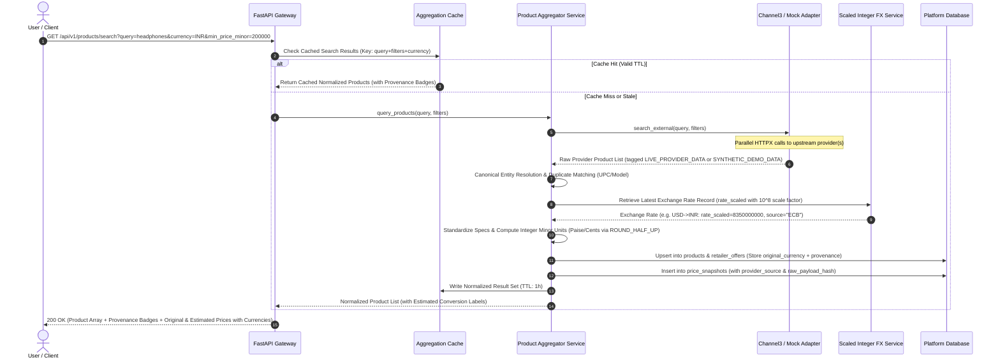
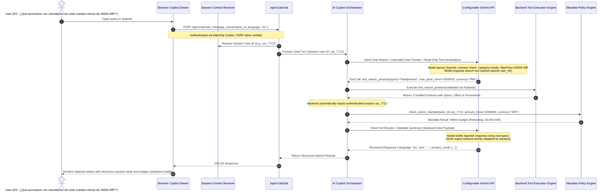
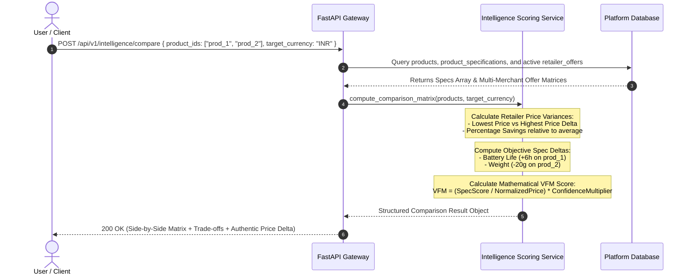
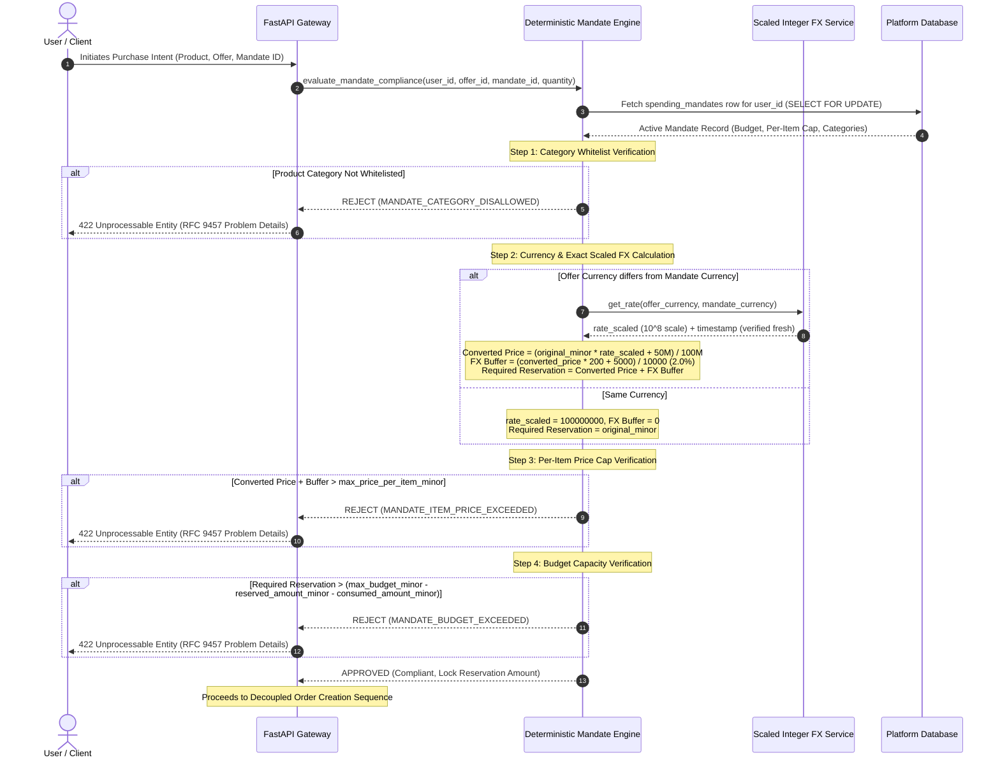
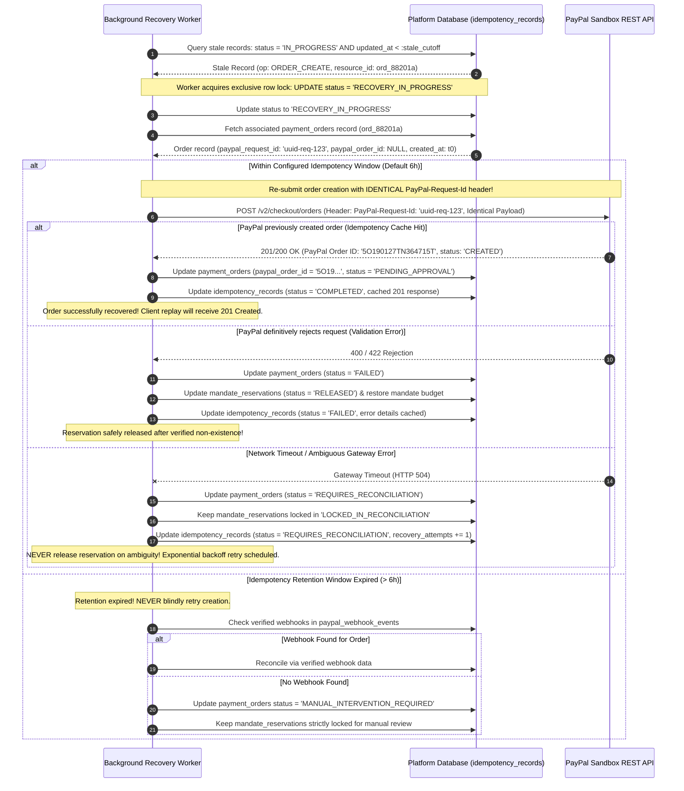
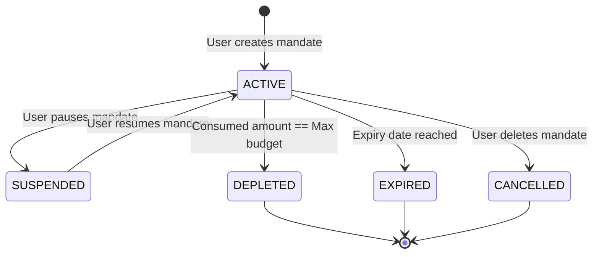
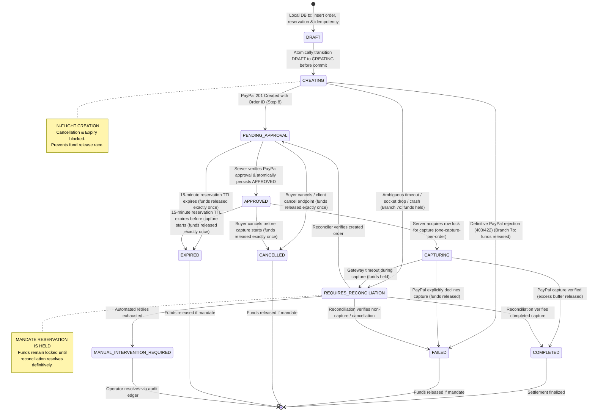

# System Data Flow & Interaction Workflows
## AI-Powered Multilingual Shopping Intelligence Platform

> **Document Purpose:** Detailed sequence diagrams and end-to-end data flow specifications for all primary user journeys, AI interactions, mandate validations, decoupled payment executions, failure classifications, active idempotency recovery, race-safe state transitions, and audit chaining.  
> **Audience:** Backend Engineers, AI Engineers, Frontend Developers, QA & Reviewers.  
> **Standard Compliance:** RFC 9457 (Problem Details for HTTP APIs) & RFC 8785 (JSON Canonicalization Scheme)  
> **Database Authority:** Entity and table names strictly aligned with `DATABASE_DESIGN.md`.

---

## 1. System Data Flow Overview

The platform coordinates communication across four distinct execution boundaries:
1. **Client Browser** (Vanilla JavaScript, DOM event handlers, PayPal JavaScript SDK, Secure HttpOnly Cookie Session Management)
2. **Backend Application** (FastAPI, Decoupled Policy Engine, Normalization Engine, Exact Decimal Scaled FX & Provenance Services)
3. **External Cognitive & Aggregation Services** (Configurable Google Gemini API, Channel3 API / Mock Provider)
4. **Financial Authority** (PayPal Sandbox REST API)

All data moving across these boundaries adheres to strict Pydantic schemas, integer minor-unit financial precision ($10^8$ scaled exchange rates via Python `Decimal`), deterministic state machines, and cryptographic validations.

---

## 2. Product Discovery & Aggregation Data Flow

This workflow illustrates how a user discovers products, how concurrent queries hit aggregation providers, and how products are normalized, deduplicated, tagged with data provenance, and cached.



### Data Normalization & Provenance Steps:
1. **Provenance Tagging:** Every record is explicitly tagged as `LIVE_PROVIDER_DATA` (from verified external APIs) or `SYNTHETIC_DEMO_DATA` (from mock catalogs). Synthetic offers are never displayed as verified live listings.
2. **Exact Scaled Financial Precision:** All prices are processed as 64-bit integer minor units (`amount_minor: int`). Exchange rates are ingested using Python `Decimal` and stored as scaled integers (`rate_scaled: BIGINT`, scale $10^8$). Original currency is preserved (`original_price_minor`, `original_currency`).
3. **Same-Currency Identity vs Cross-Currency:** For same-currency requests, `rate_scaled = 100_000_000`, `exchange_rate_id = NULL`. For cross-currency conversions, a valid, timestamped record is mandatory with deletion policy `ON DELETE RESTRICT` ($\le 24$h dev, $\le 1$h prod). Missing or stale rates safely abort conversion.
4. **Estimated Conversion:** Converted prices (e.g. USD to INR) are calculated using integer arithmetic with `ROUND_HALF_UP` and flagged as `is_estimated_conversion: true`.
5. **Entity Resolution:** Matches on `UPC`, `EAN`, `Model Number`, or normalized brand + title to associate multiple `retailer_offers` to a single canonical `product_id`.

---

## 3. Multilingual AI Shopping Assistant Interaction Flow

The AI Assistant understands multilingual queries (English, German, Italian, Spanish), extracts shopping intent, invokes sandboxed backend tools, and returns structured advice strictly grounded in actual catalog data.



### AI Tool Execution Boundaries:
- **Session-Derived Identity:** Tools never accept `user_id` as a model parameter. Identity is derived strictly from the authenticated backend session.
- **Backend Authority on Prices:** Real product prices and mandate balances are fetched by backend tools from database repositories. Model-supplied numbers are never trusted for policy checks.
- **Untrusted Ingestion:** Product descriptions and external text are treated as untrusted input. The backend uses schema containment and prompt delimiters; HTML stripping alone is recognized as insufficient to prevent prompt injection.

---

## 4. Product Specification & Retailer Price Comparison Flow

This flow computes deterministic specification differences, multi-retailer price variance, and an explainable Value-for-Money (VFM) index.



---

## 5. Spending Mandate Deterministic Policy Verification Flow

Before any checkout or payment order is created, the Spending Mandate Engine deterministically enforces user-defined governance rules with zero LLM authority.



---

## 6. Decoupled Order Creation, PayPal Sandbox Capture & Uncertainty Handling

This core flow details the decoupled 8-step creation sequence with `PayPal-Request-Id`, pre-approval verification, persisted `APPROVED` transition, one-capture-per-order locking, and buffer release.

```mermaid
sequenceDiagram
    autonumber
    actor User as User / Client
    participant UI as Browser (PayPal JS SDK)
    participant OrderAPI as /api/v1/checkout/orders
    participant Policy as Policy & Mandate Engine
    participant PayPalSvc as PayPal Backend Gateway
    participant PayPalAPI as PayPal Sandbox REST API
    participant DB as Platform Database

    User->>UI: Selects Offer to Purchase
    
    alt Track A1: Eligible Sandbox Product (Mandate-Backed)
        UI->>OrderAPI: POST /api/v1/checkout/orders (Header: Idempotency-Key, X-CSRF-Token, mandate_id: "mand_4091")
        Note over OrderAPI: Idempotency Check: (user_id, 'ORDER_CREATE', key, payload_hash)
        OrderAPI->>Policy: Validate purchase against mandate limits
        
        Note over OrderAPI, DB: Authoritative Local DB Transaction (Steps 1-6):<br/>1. Generate UUID v4 paypal_request_id & 15-min synchronized expires_at (canonical 32-character AwareDateTime)<br/>2. Insert payment_orders (status = 'DRAFT')<br/>3. Insert mandate_reservations (status = 'PENDING', locks budget + buffer, enforce chk_mandate_currency_match and chk_fx_currency_consistency)<br/>4. Insert idempotency_records (status = 'IN_PROGRESS')<br/>5. Atomically transition: UPDATE payment_orders SET status = 'CREATING', updated_at = :now WHERE id = :id AND status = 'DRAFT'<br/>6. Commit Local DB Transaction and release connection back to pool! (CREATING state blocks cancel & expiry races)
        OrderAPI->>DB: Execute Steps 1-6 & Commit Transaction (status = 'CREATING')
        Note over OrderAPI, DB: DB connection is released before external network call!
        
        Note over OrderAPI, PayPalSvc: Step 7: External PayPal API Call (In-flight creation protected by CREATING state)
        Note over OrderAPI: If process crashes before dispatch, reconciliation worker safely recovers via stored paypal_request_id.
        OrderAPI->>PayPalSvc: create_paypal_order(amount_minor, currency, internal_order_number, paypal_request_id)
        PayPalSvc->>PayPalAPI: POST /v2/checkout/orders (Header: PayPal-Request-Id, custom_id=order_number, invoice_id=order_number)
        
        alt Branch 7a: PayPal Creation Succeeds (Happy Path -> Step 8)
            PayPalAPI-->>PayPalSvc: 201 Created (PayPal Order ID: "5O190127TN364715T")
            Note over OrderAPI, DB: Step 8: Brief Local DB Transaction<br/>- Store paypal_order_id<br/>- Transition order status: 'CREATING' -> 'PENDING_APPROVAL'<br/>- Mark idempotency completed & commit
            OrderAPI->>DB: Update Order Status & Commit
            OrderAPI-->>UI: 201 Created { internal_order_id: "ord_88201a", paypal_order_id: "5O190127...", expires_at: "..." }
            
        else Branch 7b: Definitive Failure (e.g. 400 INVALID_REQUEST, 422 UNPROCESSABLE_ENTITY, 401/403)
            PayPalAPI-->>PayPalSvc: 400 / 422 Rejection (Order confirmed NOT created)
            Note over OrderAPI, DB: Branch 7b: Safe Compensating Transaction<br/>- Transition order: 'CREATING' -> 'FAILED'<br/>- Release mandate reservation: 'PENDING' -> 'RELEASED'<br/>- Mark idempotency FAILED & commit
            OrderAPI->>DB: Compensate & Release Funds & Commit
            OrderAPI-->>UI: 422 / 502 (RFC 9457 Problem Details)
            
        else Branch 7c: Ambiguous Outcome (HTTP 500, 502, 503, 504 Timeout, Socket Drop, or Local DB Save Crash)
            PayPalAPI--xPayPalSvc: HTTP 504 Gateway Timeout or Network Interruption
            Note over OrderAPI, DB: Branch 7c: Uncertainty Handling (Removal of Unsupported Search Assumptions)<br/>- Transition order: 'CREATING' -> 'REQUIRES_RECONCILIATION'<br/>- Mandate reservation stays 'LOCKED_IN_RECONCILIATION'<br/>- Reservation is NEVER released on ambiguous outcomes!<br/>- Reconciler will retry creation with IDENTICAL PayPal-Request-Id (Branch 7d)!
            OrderAPI->>DB: Mark Reconciliation & Commit
            OrderAPI-->>UI: 202 Accepted (Standard JSON Operation Status: status="REQUIRES_RECONCILIATION", retry_after=30)
        end
        
        Note over User, UI: User approves in PayPal Modal (Client actions.order.capture() is strictly prohibited)
        UI->>User: Launch PayPal Sandbox Modal (PayPal JS SDK)
        User->>PayPalAPI: Authenticates Sandbox Buyer & Approves Payment
        PayPalAPI-->>UI: onApprove() signals buyer approval (Calls backend /capture; never captures directly)
        
        UI->>OrderAPI: POST /api/v1/checkout/orders/ord_88201a/capture (Header: Idempotency-Key, X-CSRF-Token)
        Note over OrderAPI: Idempotency checked: (user_id, 'ORDER_CAPTURE', key)<br/>Server retrieves stored paypal_order_id from internal record.
        
        Note over OrderAPI, PayPalAPI: Authoritative Pre-Approval Verification:
        OrderAPI->>PayPalSvc: verify_order_status(stored_paypal_order_id)
        PayPalSvc->>PayPalAPI: GET /v2/checkout/orders/{stored_id}
        PayPalAPI-->>PayPalSvc: 200 OK (Status: "APPROVED")
        
        Note over OrderAPI, DB: Atomic DB Transition to APPROVED:<br/>UPDATE payment_orders SET status = 'APPROVED' WHERE id = :id AND status = 'PENDING_APPROVAL'
        OrderAPI->>DB: Persist status = 'APPROVED'
        
        Note over OrderAPI, DB: One-Capture-Per-Order Invariant Lock:<br/>UPDATE payment_orders SET status = 'CAPTURING' WHERE id = :id AND status = 'APPROVED'
        OrderAPI->>DB: Lock Order Status to 'CAPTURING'
        
        OrderAPI->>PayPalSvc: capture_payment(stored_paypal_order_id)
        PayPalSvc->>PayPalAPI: POST /v2/checkout/orders/{stored_id}/capture
        
        alt Successful Capture
            PayPalAPI-->>PayPalSvc: 201 Created (Status: COMPLETED, Capture ID: 7890)
            Note over OrderAPI: Server verifies amount and currency match internal order.<br/>Moves actual converted amount to COMMITTED.<br/>RELEASES THE EXCESS FX BUFFER back to user's available budget!
            OrderAPI->>DB: Update Order ('COMPLETED'), Commit Reservation ('COMMITTED'),<br/>Release Excess FX Buffer, Store Sanitized Summary & Canonical Eight-Field Audit Event
            OrderAPI-->>UI: 200 OK (Receipt with unambiguous settlement & mandate currencies)
            UI-->>User: Displays order confirmation with simulation badge and updated mandate balance
            
        else Gateway Timeout on Capture
            PayPalAPI--xPayPalSvc: HTTP 504 Gateway Timeout
            Note over OrderAPI: MANDATE RESERVATION SAFETY RULE:<br/>Order transitions to REQUIRES_RECONCILIATION.<br/>Reservation stays locked until /reconcile queries PayPal GET order.
            OrderAPI->>DB: Transition Order Status to REQUIRES_RECONCILIATION
            OrderAPI-->>UI: 202 Accepted (Standard JSON Operation Status: status="REQUIRES_RECONCILIATION", retry_after=30)
        end

    else Track A2: Eligible Sandbox Product (No-Mandate Checkout)
        UI->>OrderAPI: POST /api/v1/checkout/orders (mandate_id: null)
        Note over OrderAPI: Validate Platform Baseline Safeguards:<br/>1. Quantity <= 5 units<br/>2. Canonical USD 1,000 ceiling (dynamic conversion for EUR/GBP/INR)<br/>3. Explicit user confirmation checked<br/>4. Rate limit check (max 3/hr per user_id or IP)
        Note over OrderAPI, DB: Create payment_orders (status = 'DRAFT' -> immediately committed as 'CREATING', paypal_request_id, expires_at, mandate_id = NULL)<br/>NO FAKE MANDATE OR RESERVATION CREATED! (CREATING state blocks cancel/expiry race)
        OrderAPI->>DB: Insert Order & Commit status = 'CREATING'
        OrderAPI->>PayPalSvc: create_paypal_order() with PayPal-Request-Id -> PayPal API
        PayPalAPI-->>PayPalSvc: 201 Created (PayPal Order ID)
        OrderAPI->>DB: Update Order ('PENDING_APPROVAL') & Commit
        OrderAPI-->>UI: 201 Created (with mandate_settlement: null, expires_at: "...")
        Note over User, UI: User approves in PayPal -> UI calls /capture
        OrderAPI->>PayPalSvc: verify approval (GET order)
        OrderAPI->>DB: Persist 'APPROVED' -> Lock 'CAPTURING' (one-capture invariant)
        OrderAPI->>PayPalSvc: capture payment -> PayPal API
        PayPalAPI-->>PayPalSvc: 201 Created
        OrderAPI->>DB: Update Order ('COMPLETED'), No reservation commit needed!
        OrderAPI-->>UI: 200 OK (Receipt with mandate_applied: false)
        
    else Track B: External Marketplace-Only Product
        UI->>OrderAPI: GET /api/v1/checkout/retailer-redirect/{offer_id}
        OrderAPI->>OrderAPI: Validate outbound URL (HTTPS + Exact Host Whitelist)
        OrderAPI->>DB: Log Shopping History Event in shopping_history (Type: REDIRECTED_TO_RETAILER)
        OrderAPI-->>UI: 200 OK { redirect_url: "https://www.amazon.com/dp/...", retailer_name: "Amazon" }
        UI->>User: Displays Modal: "You are leaving our platform to purchase directly from Amazon. This is not an internal PayPal Sandbox order."
        User->>UI: Clicks "Continue to Retailer"
        UI->>User: Opens verified external retailer URL in new browser tab
    end
```

---

## 7. Active Idempotency Recovery Flow (Removal of Unsupported Search Assumptions)

When a client crashes, network drops, or worker times out during an in-flight mutating operation, the **Active Recovery Worker** reconciles resource state safely without premature failure. Order creation retry with the identical `PayPal-Request-Id` and payload hash is strictly governed by the configured idempotency retention window (`PAYPAL_IDEMPOTENCY_RETENTION_HOURS = 6` default; up to 72h only if contractually confirmed):



---

## 8. Webhook Ingestion & Recoverable Processing Flow (`paypal_webhook_events`)

The platform implements a **Recoverable Inbox Pattern** for incoming PayPal webhooks. Events are durably persisted in `paypal_webhook_events` as `RECEIVED` before acknowledging PayPal, and are processed asynchronously by a resilient background worker with resource-type-specific REST verification:

```mermaid
sequenceDiagram
    autonumber
    participant PayPal as PayPal Webhook Service
    participant WebhookAPI as /api/v1/payments/webhooks
    participant CertValidator as Cryptographic Signature Validator
    participant DB as Platform Database (paypal_webhook_events)
    participant Worker as Background Webhook Worker
    participant PayPalREST as PayPal Orders / Payments REST API

    PayPal->>WebhookAPI: POST webhook delivery (Headers: transmission-id, signature, cert-url)
    WebhookAPI->>CertValidator: Verify signature against PayPal public cert / API
    
    alt Signature Invalid
        CertValidator-->>WebhookAPI: Invalid Signature
        WebhookAPI-->>PayPal: 401 Unauthorized (Reject unverified webhook delivery)
    else Signature Valid
        CertValidator-->>WebhookAPI: Signature Verified
        
        Note over WebhookAPI, DB: Durable Persistence with status = 'RECEIVED'
        WebhookAPI->>DB: INSERT INTO paypal_webhook_events (paypal_event_id, event_type, resource_type, resource_id, parent_order_id, status='RECEIVED', ...)
        alt Duplicate Event (Unique paypal_event_id violation)
            DB-->>WebhookAPI: Duplicate detected (Already durably recorded)
            WebhookAPI-->>PayPal: 200 OK (Acknowledge delivery; no duplicate processing)
        else First-Time Event
            DB-->>WebhookAPI: Event persisted with status = 'RECEIVED'
            WebhookAPI-->>PayPal: 200 OK (Authoritative delivery acknowledgment)
        end
    end

    Note over Worker, DB: Phase 1: Atomic Lease Claim (Dedicated Short-Lived DB Transaction):
    Worker->>DB: Query eligible events: status = 'RECEIVED' OR (status = 'RETRYABLE_FAILED' AND next_retry_at IS NOT NULL AND next_retry_at <= :now) OR (status = 'PROCESSING' AND lease_expires_at IS NOT NULL AND lease_expires_at <= :now)
    Worker->>DB: Atomically claim event under fenced lease: UPDATE status = 'PROCESSING', worker_id = :id, lease_token = :token, lease_generation = lease_generation + 1, lease_expires_at = :lease_expiry, updated_at = :now RETURNING id, lease_token, lease_generation
    Worker->>DB: Commit lease claim transaction & release connection back to pool!

    Note over Worker, PayPalREST: Phase 2: External REST Verification (Zero open database connections or transactions!)
    alt Operation Takes > 30s (Slow External PayPal REST Call)
        Note over Worker, DB: Safe Lease Heartbeat Renewal:<br/>UPDATE paypal_webhook_events SET lease_expires_at = :new_expiry, updated_at = :now<br/>WHERE id = :id AND status = 'PROCESSING' AND lease_token = :token AND lease_expires_at > :now
        Worker->>DB: Extend Lease (If rows_updated != 1, lease was lost -> abort processing immediately!)
    end
    
    alt Resource Type: checkout-order (CHECKOUT.ORDER.*)
        Worker->>PayPalREST: GET /v2/checkout/orders/{paypal_order_id}
        PayPalREST-->>Worker: Authoritative Order State (e.g. status: 'APPROVED')
    else Resource Type: capture (PAYMENT.CAPTURE.*)
        Worker->>PayPalREST: GET /v2/payments/captures/{paypal_capture_id}
        PayPalREST-->>Worker: Authoritative Capture State & supplementary_data.related_ids.order_id
    end

    Note over Worker, DB: Phase 3: Financial Processing Transaction (New Short-Lived ACID DB Transaction)
    Worker->>DB: Open transaction (session.begin) & resolve order via verified parent order ID (with_for_update)
    
    alt Parent-Order Correlation Mismatch (order.paypal_order_id != verified_parent_order_id)
        Note over Worker, DB: CORRELATION DISCREPANCY DETECTED!<br/>- Do NOT insert capture or debit mandate<br/>- Escalate order to MANUAL_INTERVENTION_REQUIRED<br/>- Append FINANCIAL_DISCREPANCY_DETECTED ('PARENT_ORDER_MISMATCH') to audit_events<br/>- Transition webhook to MANUAL_REVIEW_REQUIRED under fenced lease
        Worker->>DB: UPDATE paypal_webhook_events SET status = 'MANUAL_REVIEW_REQUIRED', last_error = 'PARENT_ORDER_MISMATCH', lease_token = NULL, lease_expires_at = NULL, updated_at = :now WHERE id = :id AND status = 'PROCESSING' AND lease_token = :token AND lease_expires_at > :now
        Note over Worker, DB: Enforce rowcount == 1: If 0 rows return, ROLL BACK entire transaction!
    else Parent-Order Correlation Validated
        Note over Worker, DB: PostgreSQL-Safe Nested Savepoint (begin_nested):<br/>Attempt INSERT INTO payment_captures inside savepoint.<br/>If uq_payment_captures_paypal_capture_id violated, ROLLBACK TO SAVEPOINT.<br/>Query stored capture & compare 6 fields against verified PayPal REST resource:<br/>1. paypal_capture_id, 2. payment_order_id, 3. parent paypal_order_id (supplementary_data.related_ids.order_id),<br/>4. amount_captured_minor, 5. currency, 6. capture_status
        
        alt Duplicate Capture Collision Caught
            alt Identical Verified Duplicate (All 6 fields match exactly)
                Note over Worker, DB: Identical Duplicate Delivery Recognized<br/>- Do NOT perform second mandate debit or mutation<br/>- Complete webhook event under fenced lease
                Worker->>DB: UPDATE paypal_webhook_events SET status = 'PROCESSED', processed_at = :now, updated_at = :now, lease_token = NULL, lease_expires_at = NULL WHERE id = :id AND status = 'PROCESSING' AND lease_token = :token AND lease_expires_at > :now
                Note over Worker, DB: Enforce rowcount == 1: If rows_updated != 1, ROLL BACK entire transaction!
            else Conflicting Duplicate (Any verified attribute differs)
                Note over Worker, DB: TAMPERING / DATA MISMATCH DETECTED!<br/>- Escalate order to MANUAL_INTERVENTION_REQUIRED<br/>- Append FINANCIAL_DISCREPANCY_DETECTED ('DUPLICATE_CAPTURE_CONFLICT') to audit_events<br/>- Escalate webhook event to MANUAL_REVIEW_REQUIRED under fenced lease
                Worker->>DB: UPDATE paypal_webhook_events SET status = 'MANUAL_REVIEW_REQUIRED', last_error = :err, lease_token = NULL, lease_expires_at = NULL, updated_at = :now WHERE id = :id AND status = 'PROCESSING' AND lease_token = :token AND lease_expires_at > :now
                Note over Worker, DB: Enforce rowcount == 1: If rows_updated != 1, ROLL BACK entire transaction!
            end
        else First-Time Capture Insertion Succeeded
            alt Active Order Lifecycle (CREATING, PENDING_APPROVAL, APPROVED, CAPTURING)
                Note over Worker, DB: First-Time Capture Settlement:<br/>1. Mutate internal payment_orders ('COMPLETED') & commit mandate reservation<br/>2. Release excess FX buffer immediately back to available budget<br/>3. UPDATE paypal_webhook_events SET status = 'PROCESSED', processed_at = :now, updated_at = :now, lease_token = NULL, lease_expires_at = NULL WHERE id = :id AND status = 'PROCESSING' AND lease_token = :token AND lease_expires_at > :now
                Worker->>DB: Mutate order/mandate & complete webhook under fenced lease
                Note over Worker, DB: Enforce rowcount == 1: If 0 rows return (lease lost/expired), ROLL BACK entire transaction!
            else Verified Capture on Terminal Order (Internal Order is already CANCELLED, EXPIRED, or FAILED)
                Note over Worker, DB: FINANCIAL DISCREPANCY DETECTED!<br/>- Record capture in payment_captures (is_discrepancy=TRUE, reason='CAPTURE_ON_TERMINAL_ORDER')<br/>- Transition order to MANUAL_INTERVENTION_REQUIRED<br/>- Do NOT automatically release or consume mandate funds<br/>- Append high-priority FINANCIAL_DISCREPANCY_DETECTED to audit_events
                Worker->>DB: Persist discrepancy in payment_captures & escalate order to MANUAL_INTERVENTION_REQUIRED
                Worker->>DB: UPDATE paypal_webhook_events SET status = 'PROCESSED', processed_at = :now, updated_at = :now, lease_token = NULL, lease_expires_at = NULL WHERE id = :id AND status = 'PROCESSING' AND lease_token = :token AND lease_expires_at > :now
                Note over Worker, DB: Enforce rowcount == 1: If rows_updated != 1, ROLL BACK entire transaction!
            end
        end
    end
    Note over Worker, DB: Commit: Entire processing transaction commits atomically! Zero zombie mutations possible.
    
    alt External Network Failure Branches (Outside DB Tx)
        alt Transient Failure (Network drop / timeout)
            Worker->>DB: UPDATE paypal_webhook_events SET status = 'RETRYABLE_FAILED', retry_count += 1, next_retry_at = :backoff_time, last_error = :err, lease_token = NULL, lease_expires_at = NULL, updated_at = :now WHERE id = :id AND status = 'PROCESSING' AND lease_token = :token AND lease_expires_at > :now
            Note over Worker, DB: Enforce rowcount == 1: If rows_updated != 1, transaction rolls back.
        else Terminal Failure / Max Retries Exceeded
            Worker->>DB: UPDATE paypal_webhook_events SET status = 'MANUAL_REVIEW_REQUIRED', last_error = :err, lease_token = NULL, lease_expires_at = NULL, updated_at = :now WHERE id = :id AND status = 'PROCESSING' AND lease_token = :token AND lease_expires_at > :now
            Note over Worker, DB: Enforce rowcount == 1: If rows_updated != 1, transaction rolls back.
        end
    end
```

---

## 9. Guest Browsing to Authenticated User Session Migration Flow

Ensures frictionless onboarding with secure HttpOnly cookies, CSRF protection, and atomic migration of saved items and mandates.

```mermaid
sequenceDiagram
    autonumber
    actor Guest as Guest User
    participant UI as Browser Client
    participant AuthAPI as /api/v1/auth
    participant DB as Platform Database

    Guest->>UI: Adds 2 items to Wishlist & configures Guest Mandate
    UI->>AuthAPI: POST /api/v1/auth/guest-session
    AuthAPI->>DB: Create Guest User in users & session in sessions (UUID: gst_usr_881)
    AuthAPI-->>UI: Set-Cookie: session_token=gst_sess_991; Secure; HttpOnly; SameSite=Lax
    UI->>DB: (Via API) Associate wishlists & spending_mandates with gst_usr_881

    Note over Guest, UI: Guest decides to create a permanent account
    Guest->>UI: Fills Registration Form (Email, Password)
    UI->>AuthAPI: POST /api/v1/auth/register-and-migrate { email, password } (Includes HttpOnly Cookie & CSRF Header)
    AuthAPI->>AuthAPI: Hash Password with Argon2id
    
    Note over DB: Atomic DB Transaction:
    AuthAPI->>DB: Insert New User Record in users (user_id: usr_555)
    AuthAPI->>DB: Reassign all wishlists rows from gst_usr_881 -> usr_555
    AuthAPI->>DB: Reassign spending_mandates & mandate_reservations from gst_usr_881 -> usr_555
    AuthAPI->>DB: Mark guest session invalid in sessions & create new session for usr_555
    
    AuthAPI-->>UI: Set-Cookie: session_token=new_auth_sess_112; Secure; HttpOnly; SameSite=Lax
    AuthAPI-->>UI: 201 Created (User Profile + Migrated Items Count)
    UI-->>Guest: Updates UI: Logged in as User, all saved data seamlessly intact
```

---

## 10. Summary of State Machine Lifecycles & Race-Safe Concurrency

### 10.1 Spending Mandate State Machine


### 10.2 Payment Order Resilient State Machine & Race-Safe Transitions
The successful state sequence strictly requires the persisted `CREATING` and `APPROVED` states:

$$\text{DRAFT} \longrightarrow \text{CREATING} \longrightarrow \text{PENDING\_APPROVAL} \longrightarrow \text{APPROVED} \longrightarrow \text{CAPTURING} \longrightarrow \text{COMPLETED}$$



### 10.3 Race-Safe Concurrency Resolution Matrix

| Winning Operation | Conditional Atomic SQL | Lockout Behavior | Reservation Impact |
| :--- | :--- | :--- | :--- |
| **Capture Wins** | `UPDATE payment_orders SET status = 'CAPTURING', updated_at = :now WHERE id = :id AND status = 'APPROVED'` | Locks order in `CAPTURING`. Concurrent cancel and expiry workers match 0 rows and abort immediately. Enforces one-capture-per-order. Client-side capture (`actions.order.capture()`) is strictly prohibited. | Committed to `COMMITTED` upon PayPal success; excess FX buffer is released immediately. If ambiguous, locked in `REQUIRES_RECONCILIATION`. |
| **Cancellation Wins** | `UPDATE payment_orders SET status = 'CANCELLED', updated_at = :now WHERE id = :id AND status IN ('PENDING_APPROVAL', 'APPROVED')` | Order transitions to `CANCELLED`. Permitted from `PENDING_APPROVAL` / `APPROVED` (prior to backend capture initiation). Blocked during `CREATING` and `CAPTURING`. Subsequent capture attempt fails `WHERE status = 'APPROVED'` condition and returns HTTP 409 Conflict. | Released exactly once (`status = 'RELEASED'`); mandate available balance restored. |
| **Expiry Wins** | `UPDATE payment_orders SET status = 'EXPIRED', updated_at = :now WHERE id = :id AND status IN ('PENDING_APPROVAL', 'APPROVED') AND expires_at < :now` | Order transitions to `EXPIRED`. Permitted from `PENDING_APPROVAL` / `APPROVED` prior to capture initiation. Blocked during `CREATING` and `CAPTURING`. Eliminates fund-lock leaks when buyer abandons after approval. Orders in `CREATING`, `CAPTURING`, `REQUIRES_RECONCILIATION`, or `MANUAL_INTERVENTION_REQUIRED` match 0 rows and are never expired automatically. | Released exactly once (`status = 'RELEASED'`); mandate available balance restored. |
